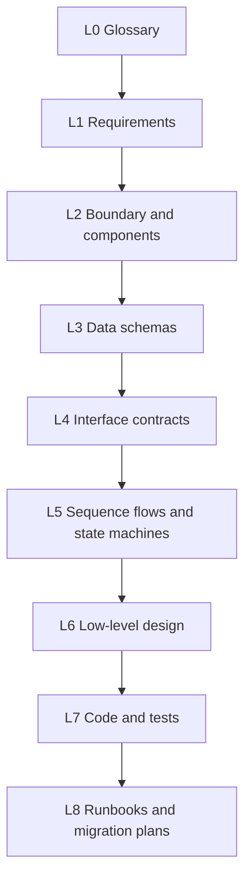
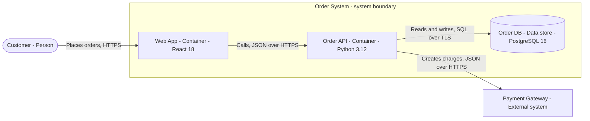
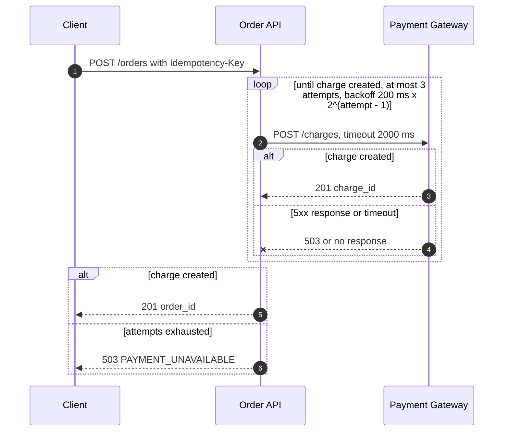
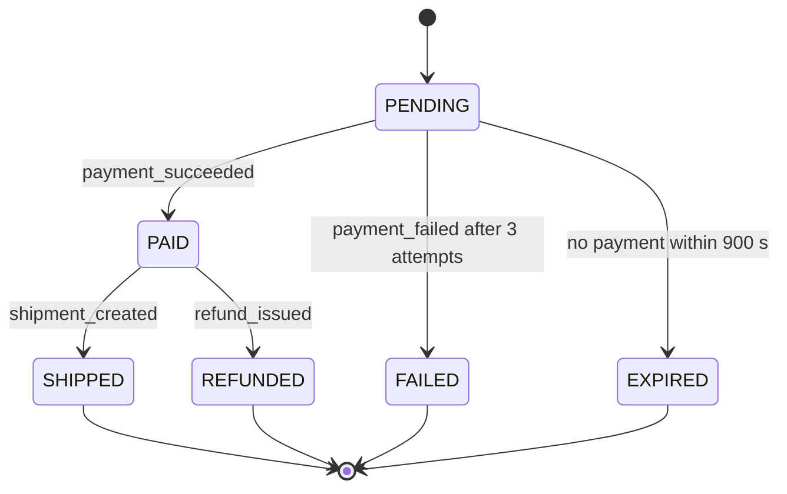

# Engineering QA Playbook

| Field | Value |
|---|---|
| Document | `ENGINEERING_QA_PLAYBOOK.md` |
| Version | 1.0.0 |
| Status | Active |
| Date | 2026-11-14 |
| Purpose | Standard operating procedure for planning, drafting, verifying, and fixing technical deliverables |
| Applies to | Human and automated authors of requirements, designs, records, diagrams, agent context files, and production code |

## Contents

- [0. Conventions](#0-conventions)
- [1. Pre-Drafting Architecture & Dependency Standards](#1-pre-drafting-architecture--dependency-standards)
- [2. Artifact Checklists & Verification Standards](#2-artifact-checklists--verification-standards)
- [3. Pre-Delivery Quality Gates](#3-pre-delivery-quality-gates)
- [4. Reusable Prompt Template](#4-reusable-prompt-template)

---

## 0. Conventions

### 0.1 Normative keywords

**MUST**, **MUST NOT**, **SHOULD**, and **MAY** are used as defined in RFC 2119. A deviation from a MUST rule is a defect. A deviation from a SHOULD rule requires a one-line written justification in the artifact.

### 0.2 Identifier scheme

Every traceable item carries an ID. IDs are immutable and are never reused after deletion.

| Prefix | Item | Example |
|---|---|---|
| `REQ-` | Functional requirement | `REQ-014` |
| `NFR-` | Non-functional requirement | `NFR-003` |
| `ASM-` | Engineering assumption | `ASM-002` |
| `OQ-` | Open question | `OQ-005` |
| `HLD-` | High-level design component | `HLD-04` |
| `LLD-` | Low-level design component | `LLD-04.2` |
| `ADR-` | Architecture decision record | `ADR-0007` |
| `FM-` | Failure mode | `FM-011` |
| `TC-` | Test case or acceptance test | `TC-031` |

### 0.3 Terms

| Term | Definition |
|---|---|
| Artifact | Any deliverable covered by Section 2. |
| Upstream / downstream | Artifact A is upstream of B when B references names, types, or decisions defined in A. |
| Locked | An artifact with a version number, a completed review, and a rule that any later change increments the version and triggers re-verification of all downstream artifacts. |
| Defect | A deviation from a MUST rule in this playbook, or an entry in a Common Defect Catalog. |
| Gate | A pass/fail check in Section 3. One failed gate blocks release. |

---

## 1. Pre-Drafting Architecture & Dependency Standards

No artifact is drafted until the three activities in this section are complete and the Definition of Ready (1.4) passes.

### 1.1 Separating explicit requirements from engineering assumptions

**Rule R-1.** Every input statement MUST be classified into exactly one of the classes below before drafting starts.

| Class | Definition | Admission test |
|---|---|---|
| Explicit requirement (`REQ` / `NFR`) | Stated by the requester or a governing document. | A source can be cited: quoted text, ticket ID, document section, or line number. |
| Derived requirement (`REQ`, marked *derived*) | Not stated, but logically necessary to satisfy an explicit requirement. | Names its parent `REQ` ID and the reasoning in one sentence. |
| Assumption (`ASM`) | A value or condition the author selected because the source is silent. | No source exists. Recorded with all fields in R-3. |
| Open question (`OQ`) | A gap where a wrong guess has high impact. | Blocks the sections that depend on it until answered. |
| Out of scope | Explicitly excluded behaviour. | Listed in the scope section with a reason. |

**Rule R-2.** A statement with no citable source is an assumption, not a requirement. It MUST NOT be written in requirement form ("The system MUST…") until the requester confirms it.

**Rule R-3.** Each assumption MUST be recorded with these fields:

| Field | Content |
|---|---|
| ID | `ASM-nnn` |
| Statement | One declarative sentence with concrete values. |
| Reason | Why this value was selected (default, precedent, measurement). |
| Impact if false | `High` (redesign of one or more components), `Medium` (change inside one component), or `Low` (configuration change only). |
| Validation method | How and by whom it will be confirmed. |
| Status | `Open`, `Validated`, or `Rejected`. |

**Rule R-4.** Assumptions MUST NOT be embedded silently in prose. Any design decision that depends on an assumption cites its ID inline, for example: "Session tokens expire after 3600 s (ASM-004)."

**Rule R-5.** An assumption with impact `High` MUST be converted to an open question and resolved before any dependent section is drafted. If it cannot be resolved, the dependent sections are marked `BLOCKED: OQ-nnn`.

Example register:

| ID | Class | Statement | Source or reason | Impact if false | Status |
|---|---|---|---|---|---|
| REQ-001 | Explicit | The system MUST export orders as CSV. | Ticket PAY-212, line 4 | n/a | Accepted |
| REQ-002 | Derived | The system MUST escape commas and quotes in CSV fields per RFC 4180. | Parent REQ-001; an unescaped export is not parseable | n/a | Accepted |
| ASM-001 | Assumption | Exports contain at most 100,000 rows. | Largest tenant holds 61,000 orders today | Medium | Open |
| OQ-001 | Open question | Must exports include soft-deleted orders? | Source is silent; affects the schema and the query | High | Blocking REQ-001 design |

### 1.2 Dependency ordering

**Rule D-1.** Artifacts are built in the level order below. An artifact at level *N* MAY reference only **locked** artifacts at levels lower than *N*.

| Level | Artifact layer | Locked when |
|---|---|---|
| L0 | Glossary and domain terms | Every domain noun used in requirements has one definition. |
| L1 | Requirements (`REQ`, `NFR`), constraints, assumptions | Each requirement has an ID, a source, and at least one acceptance criterion. No `High` assumption is open. |
| L2 | System boundary and component inventory (HLD) | Every component has an ID, one responsibility, and a list of the requirements it serves. |
| L3 | Data schemas | Every field has a name, type, nullability, constraints, and default. Every status field has an enumerated value set. |
| L4 | Interface contracts (API, events, CLI) | Every operation has request and response schemas built only from L3 types, plus a complete error list. |
| L5 | Behavioural models (sequence flows, state machines) | Every message matches an L4 operation name. Every state matches an L3 enumerated value. |
| L6 | Low-level design (module internals, algorithms, configuration) | Every LLD component maps to one HLD component. Every external call has a failure-mode entry. |
| L7 | Code, tests, and agent context files | Lint, type check, and tests exit with code 0. |
| L8 | Operational records (runbooks, migration and rollback plans) | Every command has been executed in a non-production environment. |



**Rule D-2 (schema before contract).** A data schema MUST be locked before any API contract, event definition, or sequence diagram that carries its fields is drafted.

**Rule D-3 (single definition).** Each name (entity, field, endpoint, component, state, error code) is defined in exactly one artifact. All other artifacts reference that name with identical spelling and letter case.

**Rule D-4 (change propagation).** A change to a locked artifact MUST increment its version, and every downstream artifact MUST be re-verified against Section 3 before release.

**Rule D-5 (no cycles).** If artifact A references B and B references A, the shared content is extracted into a new artifact at a lower level.

**Rule D-6 (ADRs are cross-cutting).** An ADR is written at the level where its decision is made and is locked before any artifact that depends on that decision.

### 1.3 Failure-mode identification

**Rule F-1.** Before drafting any design, diagram, or code artifact, the author MUST list every interaction that crosses a process, network, storage, or trust boundary, and record at least one failure mode per interaction.

Failure-mode record:

| Field | Content |
|---|---|
| ID | `FM-nnn` |
| Interaction | Caller, callee, and operation name. |
| Trigger | The condition that causes the failure (timeout, 5xx response, malformed payload, constraint violation). |
| Detection | The signal that reveals it (exception type, status code, health check, metric threshold). |
| Timeout | Value in milliseconds. |
| Retry policy | Maximum attempts, backoff formula, jitter, retryable conditions. `None` is a valid value and is written explicitly. |
| Resulting state | Named error state or error code. |
| Caller-visible behaviour | Exact response returned to the caller or user. |
| Recovery | Automatic action, manual runbook reference, or `None`. |
| Observability | Log event name and metric name emitted. |

**Rule F-2 (boundary conditions).** For each input, the author MUST state the behaviour for every applicable row:

| Category | Conditions to specify |
|---|---|
| Size | Empty, one element, maximum, maximum + 1 |
| Value | Null or missing, zero, negative, minimum, maximum, wrong type |
| Text | Empty string, whitespace only, maximum length + 1, non-ASCII characters, control characters |
| Time | Time-zone boundary, daylight-saving transition, clock skew between hosts, expired timestamp |
| Ordering | Duplicate delivery, out-of-order delivery, concurrent modification of the same record |
| Resources | Quota exhausted, disk full, connection pool exhausted, rate limit reached |
| Authorization | Unauthenticated, authenticated without permission, expired credential |
| Partial failure | Step *k* of *n* succeeds and step *k* + 1 fails |

**Rule F-3 (timeouts and retries).**

| ID | Rule |
|---|---|
| T-1 | Every synchronous call across a process boundary MUST declare a timeout in milliseconds. |
| T-2 | A caller's timeout MUST exceed the callee's worst-case duration: `attempts × per-attempt timeout + sum of backoff delays`. Example: 3 attempts × 2000 ms + (200 ms + 400 ms) = 6600 ms, so the caller timeout is at least 7000 ms. |
| T-3 | The sum of timeouts along the critical path of an operation MUST be at most the maximum response time stated in the NFR for that operation. |
| T-4 | Retries are permitted only for operations that are idempotent or that carry an idempotency key. |
| T-5 | A retry policy MUST state the maximum attempts, the backoff formula, the jitter range, and the retryable conditions. |
| T-6 | After the final attempt, the flow MUST reach a named error state. Unbounded retry is a defect. |

**Rule F-4 (error states).** Every error MUST have a stable machine-readable code, a transport status mapping, a retryable flag, and a defined caller action. Errors are catalogued once (Rule D-3):

| Code | HTTP status | Retryable | Trigger | Caller action |
|---|---|---|---|---|
| `VALIDATION_FAILED` | 400 | No | Request body violates the schema | Correct the request |
| `ORDER_NOT_FOUND` | 404 | No | No order exists with the supplied ID | None |
| `PAYMENT_UNAVAILABLE` | 503 | Yes | Payment gateway failed 3 attempts | Retry after the `Retry-After` interval |

### 1.4 Definition of Ready

Drafting starts only when every line is true:

- [ ] Every input statement is classified (R-1) and every assumption has all fields (R-3).
- [ ] No assumption with impact `High` has status `Open` (R-5).
- [ ] All upstream artifacts for the target level are locked (D-1).
- [ ] Every boundary-crossing interaction has at least one `FM` record (F-1).
- [ ] Every synchronous call has a timeout value and an explicit retry policy (F-3).
- [ ] The error catalogue exists and contains every code referenced by an `FM` record (F-4).

---

## 2. Artifact Checklists & Verification Standards

Each artifact type has four parts: (a) Structural Blueprint, (b) Order of Construction, (c) Common Defect Catalog, and (d) Remediation Standard. Parts (c) and (d) share one table: the **Detection** column states how to find the defect, and the **Remediation standard** column states the objective condition under which the defect is closed. A defect is closed only when that condition is verifiably true.

### 2.1 Product & Functional Requirements (PRD / FRD)

#### (a) Structural Blueprint

| # | Required section | Required depth |
|---|---|---|
| 1 | Document control | Version, owner, status, change log with dates. |
| 2 | Problem statement and objectives | Each objective has a metric, a baseline value, a target value, and a measurement window. |
| 3 | Scope | In-scope list and out-of-scope list, each item one sentence. |
| 4 | Actors and permissions | Every actor named, with the operations each is permitted to perform. |
| 5 | Functional requirements | One behaviour per ID, written as "The system MUST…", with priority (Must / Should / Could), source, and one or more acceptance criteria in Given / When / Then form. |
| 6 | Non-functional requirements | Numeric target, unit, percentile or time window, load condition, and measurement point. |
| 7 | Data requirements | Entities, mandatory attributes, retention period in days, data classification. |
| 8 | External interfaces and dependencies | System name, direction of data flow, owner, availability commitment. |
| 9 | Error and edge-case behaviour | Observable behaviour for each applicable row of Rule F-2. |
| 10 | Assumptions and open questions | Full register per Rule R-3. |
| 11 | Release criteria | Conditions that must be true to ship, each verifiable by a test or a measurement. |
| 12 | Traceability matrix | Objective → `REQ` / `NFR` → acceptance test (`TC`). |

#### (b) Order of Construction

1. Problem statement and measurable objectives.
2. Actors and permissions.
3. Scope boundaries (in and out).
4. Functional requirements, one behaviour each.
5. Acceptance criteria for every functional requirement, including one error path.
6. Non-functional requirements with numeric targets.
7. Data requirements and external dependencies.
8. Edge-case behaviour table.
9. Assumption and open-question register.
10. Traceability matrix, then release criteria.

#### (c) Common Defect Catalog and (d) Remediation Standard

| ID | Defect | Detection | Remediation standard |
|---|---|---|---|
| PRD-D1 | Untestable requirement: uses a qualifier with no measurable threshold. | Run the vague-term scan in Section 3.3. Check that each requirement has a Given / When / Then criterion. | Each requirement has one or more acceptance criteria whose outcome is observable and binary. Each NFR has a number, a unit, a percentile or window, and a load condition. |
| PRD-D2 | Compound requirement: one ID covers several behaviours joined by "and" or "or". | Count MUST clauses and distinct outcomes per ID. | Each ID contains exactly one MUST clause and one verifiable outcome. Split items receive new IDs; the original ID is retired, not reused. |
| PRD-D3 | Solution stated as a requirement: names a technology, schema, or algorithm with no source. | Search requirements for product names, library names, and implementation verbs. | The requirement states the need and the observable behaviour. Implementation detail is moved to the design, unless it is a constraint with a cited source. |
| PRD-D4 | Missing error and edge-case behaviour. | For each requirement that accepts input or uses a dependency, look for a failure-path criterion. | Each such requirement has one or more acceptance criteria for a failure path, naming the exact error code or message returned. |
| PRD-D5 | Hidden assumption or untraceable requirement. | Check each requirement for a source. Check the traceability matrix for empty cells. | Every requirement cites a source or a parent `REQ`. Every sourceless statement is in the `ASM` register. The matrix has zero empty cells. |

### 2.2 Technical Design (High-Level Architecture & Low-Level Detailed Design)

#### (a) Structural Blueprint

**High-Level Design (HLD)**

| # | Required section | Required depth |
|---|---|---|
| 1 | Context, goals, non-goals | Linked requirement IDs. Non-goals listed explicitly. |
| 2 | Component inventory | ID, name, single responsibility, technology with major version, owning team, served `REQ` IDs. |
| 3 | Architecture view | One context diagram and one container diagram per Section 2.4. |
| 4 | Data architecture | Data stores, owning component for each entity, consistency model per store (strong or eventual, with the staleness bound in seconds). |
| 5 | Interface inventory | Each interface with protocol, direction, synchronous or asynchronous, authentication and authorization method. |
| 6 | Cross-cutting concerns | Security controls, observability (logs, metrics, traces), configuration, deployment topology. |
| 7 | NFR approach | For each NFR: the mechanism that satisfies it and a capacity estimate that shows inputs, formula, and result. |
| 8 | Alternatives and decisions | Links to ADRs (Section 2.3). |
| 9 | Risks and failure modes | Links to `FM` records. |

**Low-Level Design (LLD), per component**

| # | Required section | Required depth |
|---|---|---|
| 1 | Parent and responsibility | Parent `HLD` ID and a one-sentence responsibility. |
| 2 | Module structure | Modules or classes, public functions with full signatures. |
| 3 | Data schema | Each field: name, type, nullability, constraints, default, index. Each enum: full value set. |
| 4 | Interface contract | Method and path (or topic), request schema, response schema, all status codes, all error codes, idempotency behaviour, pagination, versioning. |
| 5 | Logic | Pseudocode or numbered steps for every non-trivial algorithm. Complexity stated where input size is unbounded. |
| 6 | State and concurrency | Transaction boundaries, isolation level, locking strategy, ordering guarantees. |
| 7 | Error handling | Table mapping each `FM` ID to detection, response, and error code. |
| 8 | Configuration | Key, type, default, permitted range, whether a restart is required. |
| 9 | Timeouts and retries | Values per Rule F-3. |
| 10 | Test strategy | Test cases per public function: valid input, boundary input, failure path. |

**Depth criterion:** an engineer who did not attend the design discussions can implement the component without asking any question about types, error handling, or step order.

#### (b) Order of Construction

1. Requirement coverage list (which `REQ` and `NFR` IDs this design serves).
2. System boundary and component inventory.
3. Data schemas (lock per Rule D-2).
4. Interface contracts built from the locked schemas.
5. Behavioural flows for each requirement (Section 2.5).
6. Cross-cutting concerns and NFR mechanisms with capacity estimates.
7. ADRs for each decision with more than one viable option.
8. LLD per component, in this order: schema → contract → logic → error handling → configuration → tests.
9. Traceability matrix (Section 3.1).

#### (c) Common Defect Catalog and (d) Remediation Standard

| ID | Defect | Detection | Remediation standard |
|---|---|---|---|
| TD-D1 | Orphan or missing component: an LLD component with no HLD parent, an HLD component with no LLD, or a requirement served by no component. | Build the matrix in Section 3.1 and look for empty cells. | The matrix has zero orphans in both directions. Each LLD component has exactly one HLD parent. |
| TD-D2 | Underspecified contract: fields without types or nullability, or operations without error responses. | Check each field and each operation against LLD blueprint rows 3 and 4. | Every field has type, nullability, and constraints. Every operation lists all success statuses and every error code it can return, each present in the error catalogue. |
| TD-D3 | Success-path-only design: no timeouts, retries, or failure handling. | Count boundary-crossing calls and compare with the count of `FM` records. | Every boundary-crossing call has one or more `FM` records with a timeout in milliseconds, an explicit retry policy, and a named resulting state. |
| TD-D4 | Naming or schema drift between sections, diagrams, and contracts. | Extract all entity, field, endpoint, and component names and compare them case-sensitively across artifacts. | Each name has one defining location (Rule D-3) and all references match exactly. The comparison reports zero mismatches. |
| TD-D5 | NFR claimed without a mechanism or arithmetic. | For each NFR, look for a named mechanism and a calculation. | Each NFR has a named mechanism and a capacity estimate with stated inputs, formula, result, and headroom percentage. |

### 2.3 Implementation & Maintenance Records (Runbooks, ADRs, Rollback/Migration Plans)

#### (a) Structural Blueprint

**Runbook**

| # | Required section | Required depth |
|---|---|---|
| 1 | Purpose and trigger | Alert name or the exact condition that starts the runbook. |
| 2 | Severity and escalation | Severity level, escalation contact, time limit in minutes before escalating. |
| 3 | Prerequisites | Access roles, tools with versions, target environment. |
| 4 | Parameters | Table of every placeholder: name, meaning, example value, where to obtain it. |
| 5 | Diagnosis | Numbered steps, each with a command and the expected output for each branch. |
| 6 | Remediation | Numbered steps, one action each: command, execution context (host, directory, user), expected output. |
| 7 | Verification | Command and expected result that confirm the service is restored. |
| 8 | Reversal | How to undo the remediation steps. |
| 9 | Record | Owner, date last executed in a non-production environment. |

**Architecture Decision Record (ADR)**

| # | Required section | Required depth |
|---|---|---|
| 1 | Title and ID | `ADR-nnnn: <decision in noun-phrase form>`. |
| 2 | Status and date | `Proposed`, `Accepted`, `Deprecated`, or `Superseded by ADR-nnnn`. |
| 3 | Context | The forces and constraints, with `REQ` / `NFR` IDs. |
| 4 | Options considered | Two or more options, each with advantages and disadvantages. |
| 5 | Decision | One paragraph in active voice: "We will…". |
| 6 | Consequences | Positive outcomes, negative outcomes (one or more), and follow-up actions with owners. |

**Migration and Rollback Plan**

| # | Required section | Required depth |
|---|---|---|
| 1 | Change summary | Current state, target state, affected components and data. |
| 2 | Preconditions | Backup taken and a restore test completed, required versions, change-freeze status. |
| 3 | Compatibility strategy | How old and new versions coexist (for example expand → migrate → contract) and for how long. |
| 4 | Forward steps | Numbered; each with command, expected output, and estimated duration. |
| 5 | Verification per step | Query or check with the expected result. |
| 6 | Rollback triggers | Numeric conditions, for example "error rate above 2% for 5 consecutive minutes". |
| 7 | Rollback steps | One reversal step for each forward step, in reverse order. |
| 8 | Point of no return | The step after which rollback is not possible, labelled `IRREVERSIBLE`, with the mitigation. |
| 9 | Reconciliation | How data written during the change window is validated or repaired. |
| 10 | Record | Owner, rehearsal date and environment, expected downtime in minutes. |

#### (b) Order of Construction

- **Runbook:** trigger → prerequisites and parameters → diagnosis → remediation → verification → reversal → escalation → execute end to end in a non-production environment → record the date.
- **ADR:** context → options → decision → consequences → status. Written before the decision is implemented.
- **Migration and rollback plan:** target state → preconditions → forward steps → per-step verification → rollback triggers → rollback steps → point of no return → rehearsal → record durations.

#### (c) Common Defect Catalog and (d) Remediation Standard

| ID | Defect | Detection | Remediation standard |
|---|---|---|---|
| REC-D1 | Non-executable step: prose such as "restart the service" with no command or context. | Check every step for a fenced command and an execution context. | Every action step has an exact command in a fenced code block, the execution context (host, directory, user or role), and the expected output. |
| REC-D2 | Missing verification after a state-changing step. | For each state-changing step, look for a following check. | Each state-changing step is followed by a check command and its expected result. The final step verifies the end state. |
| REC-D3 | Rollback absent, unrehearsed, or silent about irreversible steps. | Compare the count of forward steps with the count of rollback steps. Look for a rehearsal date. | Every forward step has a reversal step or is labelled `IRREVERSIBLE` with a mitigation. Rollback triggers are numeric. A rehearsal date and environment are recorded. |
| REC-D4 | ADR without alternatives, without negative consequences, or with an outdated status. | Count options and negative consequences. Check supersession links. | Two or more options with rejection reasons, one or more negative consequences, and a valid status. Supersession links exist in both the old and the new ADR. |
| REC-D5 | Undeclared placeholders, hard-coded environment values, or inline secrets. | Search for hostnames, IP addresses, account IDs, tokens, and undefined `<…>` markers. | Variable values use `<UPPER_SNAKE_CASE>` placeholders, each declared in the parameter table. A secret scan reports zero findings. |

### 2.4 Strategic Diagrams (C4 Context/Container, System Boundaries, Value Flow)

#### (a) Structural Blueprint

| # | Required element | Required depth |
|---|---|---|
| 1 | Title | Diagram type, system name, and scope, for example "Container diagram: Order System". |
| 2 | Question answered | One sentence stating what the reader learns from the diagram. |
| 3 | System boundary | Drawn explicitly. Every element is inside or outside it. |
| 4 | Elements | Name, type (person, system, container, data store), one-line responsibility. Container level adds technology and major version. |
| 5 | Relationships | Directed. Labelled with a verb phrase. Container level adds protocol and data format. |
| 6 | External actors and systems | Visually distinct from internal elements. |
| 7 | Legend | Meaning of each shape, line style, and colour used. |
| 8 | Abstraction level | One level per diagram: context, container, or component. |
| 9 | Size | At most 20 elements. Larger diagrams are split by subdomain. |
| 10 | Version and source | Version, date, and text source stored in version control. |
| 11 | Value-flow diagrams only | Each step names the actor, the hand-off, and the item exchanged (data, payment, or artifact). Lead time per step is given where measured. |

Reference example (container level, Mermaid flowchart notation):



Legend: rounded shape = person; rectangle = container or external system; cylinder = data store; enclosing box = system boundary; arrow = direction of the request.

#### (b) Order of Construction

1. State the audience and the question the diagram answers.
2. Select one abstraction level.
3. List elements from the locked HLD component inventory. Do not invent names.
4. Draw the system boundary.
5. Place actors and external systems outside the boundary.
6. Add directed relationships with labels.
7. Add the legend, title, and version.
8. Compare the element names with the HLD inventory (TD-D4).
9. Render with the target renderer and fix all errors (Section 3.2).

#### (c) Common Defect Catalog and (d) Remediation Standard

| ID | Defect | Detection | Remediation standard |
|---|---|---|---|
| SD-D1 | Mixed abstraction levels, for example classes or database tables in a container diagram. | Classify each element by type and count the distinct levels. | Each diagram contains elements of one level only. Lower-level detail is moved to a child diagram that is linked by name. |
| SD-D2 | Unlabelled, undirected, or generic relationships ("uses"). | Inspect every edge for direction and label text. | Every edge has a direction and a verb-phrase label. Container-level edges also state protocol and data format. |
| SD-D3 | Missing or ambiguous system boundary. | Check whether each element is clearly inside or outside a drawn boundary. | A boundary is drawn. Every element is inside or outside it. External systems are labelled as external. |
| SD-D4 | No legend, or one notation used with two meanings. | List each shape, colour, and line style and count its meanings. | A legend is present. Each shape, colour, and line style has exactly one meaning. |
| SD-D5 | Diagram drift: elements or names differ from the HLD. | Compare the element set with the HLD inventory at the same level. | The element set equals the HLD inventory at that level. Names match case-sensitively. The diagram version equals or is later than the HLD version it depicts. |

### 2.5 Operational Diagrams (Sequence Flows, State Machines, Retry/Error Loops)

#### (a) Structural Blueprint

**Sequence flow**

| # | Required element | Required depth |
|---|---|---|
| 1 | Title and scenario | The `REQ` ID covered, the trigger, and the preconditions. |
| 2 | Participants | Names identical to HLD / LLD components. |
| 3 | Messages | Label equals the contract operation name, for example `POST /charges`. Synchronous and asynchronous arrows are distinct. |
| 4 | Responses | Every synchronous request has a response that shows status or return type. |
| 5 | Failure branches | One `alt` branch per `FM` record for the calls shown. |
| 6 | Timeouts and retries | Timeout value, maximum attempts, and backoff formula written on the diagram. |
| 7 | Postconditions | The resulting state for each terminating branch. |

**State machine**

| # | Required element | Required depth |
|---|---|---|
| 1 | State set | Identical to the enumerated values in the L3 schema. |
| 2 | Initial and terminal states | Exactly one initial state. One or more terminal states. |
| 3 | Transitions | Each labelled `event [guard] / action`. |
| 4 | Failure and timeout transitions | Present for every state that waits on an external event. |
| 5 | Transition table | A table of every (state, event) pair → next state, or `rejected` with the error code. |

**Retry / error loop**

| # | Required element | Required depth |
|---|---|---|
| 1 | Retryable conditions | Exact status codes or exception types. |
| 2 | Bounds | Maximum attempts and maximum total duration in milliseconds. |
| 3 | Backoff | Formula and jitter range, for example `200 ms × 2^(attempt − 1)`, jitter ±20%. |
| 4 | Idempotency | The key name and where it is generated. |
| 5 | Exit | The named error state, dead-letter destination, or error code returned after the final attempt. |

Reference example (sequence flow with a bounded retry loop):



Reference example (state machine):



#### (b) Order of Construction

- **Sequence flow:** select one scenario → list participants from the HLD → draw the success path using contract operation names → add responses → add one failure branch per `FM` record → annotate timeouts and retries → state postconditions → compare message labels with the L4 contract.
- **State machine:** copy the state set from the schema enum → mark the initial and terminal states → list events → complete the transition table for every (state, event) pair → add guards and actions → add failure and timeout transitions → run the reachability check → draw the diagram from the table.
- **Retry loop:** confirm idempotency (T-4) → set bounds and backoff (T-5) → define the exit state (T-6) → confirm the caller timeout (T-2).

#### (c) Common Defect Catalog and (d) Remediation Standard

| ID | Defect | Detection | Remediation standard |
|---|---|---|---|
| OD-D1 | Success path only: no failure or timeout branches. | Count boundary-crossing calls in the diagram and count failure branches. | Every boundary-crossing call has a failure branch and a timeout branch, or one branch that names both. Each branch ends in a named state or error code. |
| OD-D2 | Messages do not match contracts, or responses are missing. | Compare each message label with the L4 operation list. Pair each synchronous request with a response. | Every message label equals a contract operation name. Every synchronous request has a response showing status or return type. |
| OD-D3 | Incomplete state machine: unreachable states, non-terminal states with no exit, or undefined (state, event) pairs. | Traverse from the initial state. Check the transition table for empty cells. | Every state is reachable from the initial state. Every non-terminal state has one or more outgoing transitions. The transition table has zero empty cells. |
| OD-D4 | Unbounded or unspecified retry loop. | Look for maximum attempts, backoff, and exit on every loop. | Each loop states maximum attempts, backoff formula, retryable conditions, and the exit state. Total retry duration satisfies Rule T-2. |
| OD-D5 | Diagram source does not render. | Render with the target renderer and read the exit code. | The source renders with exit code 0 in the renderer version named in the artifact. Reserved words (for example `end`) are not used as bare identifiers. Label text containing punctuation that the grammar reserves is quoted or reworded. |

### 2.6 Agent Context & Code (`CLAUDE.md`, Repository Rules, and Production Modules)

#### (a) Structural Blueprint

**Agent context file (`CLAUDE.md`)**

| # | Required section | Required depth |
|---|---|---|
| 1 | Project summary | One to three sentences: what the system does and for whom. |
| 2 | Technology stack | Languages, frameworks, and runtimes with major versions. |
| 3 | Repository layout | Key directories with a one-line purpose each. |
| 4 | Commands | Exact commands for install, build, run, full test suite, single test, lint, format, and type check. |
| 5 | Conventions | Only the rules that differ from language defaults or that tooling does not enforce. |
| 6 | Workflow rules | Branch naming, commit message format, required checks before a change is complete. |
| 7 | Prohibitions | Files and directories that MUST NOT be edited, operations that MUST NOT be run, and the secret-handling rule. |
| 8 | References | Paths to deeper documents instead of inlined copies. |

Depth criterion: every instruction is specific and checkable. Content that the agent can derive by reading the code is omitted.

**Repository rules**

| # | Required element | Required depth |
|---|---|---|
| 1 | Formatting and lint configuration | Committed configuration files. The CI check fails on any violation. |
| 2 | Branch and review policy | Protected branches, required number of approvals, required status checks. |
| 3 | Ownership | An ownership file that maps paths to reviewers. |
| 4 | Commit convention | Format stated with one valid example. |
| 5 | Dependency policy | A committed lock file and pinned versions. |
| 6 | Secret policy | Secret scanning in CI. No credentials in the repository. |

**Production module**

| # | Required element | Required depth |
|---|---|---|
| 1 | Module header | Purpose and the `LLD` ID implemented. |
| 2 | Public interface | Fully typed signatures that match the LLD. |
| 3 | Input validation | At every trust boundary, before any side effect. |
| 4 | Error handling | Typed errors mapped to catalogue codes. No caught-and-ignored exceptions. |
| 5 | I/O discipline | Explicit timeout on every network or storage call. Resources released on all code paths. |
| 6 | Configuration | Read from the environment or configuration files. No hard-coded hosts, credentials, or absolute paths. |
| 7 | Observability | Structured log events with a correlation ID. Metrics for latency and error count per operation. |
| 8 | Tests | Per public function: one valid-input test, one boundary test, one failure-path test. |
| 9 | Hygiene | No unused code. No `TODO` without a ticket ID. Lint and type check exit with code 0. |

#### (b) Order of Construction

- **`CLAUDE.md`:** run every command from a clean checkout and record the exact form that succeeds → write the commands section → stack and layout → conventions that tooling does not enforce → prohibitions → remove any line that restates what the code or configuration already shows.
- **Repository rules:** formatter and linter configuration → CI checks → branch protection and ownership → commit convention → dependency and secret policies.
- **Production module:** types and public signatures from the LLD → failing tests for the contract (valid, boundary, failure) → implementation → error handling and timeouts → logging and metrics → lint, type check, and tests → module header.

#### (c) Common Defect Catalog and (d) Remediation Standard

| ID | Defect | Detection | Remediation standard |
|---|---|---|---|
| AC-D1 | Incorrect or outdated commands in the context file. | Execute each documented command from a clean checkout. | Every command exits with code 0 from a clean checkout. Every referenced path exists. |
| AC-D2 | Vague, unenforceable, duplicated, or conflicting instructions (for example "write clean code"). | For each instruction, ask whether a reviewer can objectively check compliance. Search for instructions that contradict each other. | Each instruction names a concrete action or prohibition that a reviewer or tool can check. No two instructions conflict. Content derivable from the code or enforced by tooling is removed. |
| AC-D3 | Code deviates from the LLD contract: signature, types, or error codes differ. | Compare signatures and returned error codes with the LLD. Run contract tests. | Signatures, types, and error codes match the LLD exactly, and contract tests pass. Where the code is correct and the LLD is not, the LLD is updated under Rule D-4. |
| AC-D4 | Unhandled failure paths: ignored exceptions, I/O calls without timeouts, no input validation. | Search for empty exception handlers and for I/O calls with no timeout argument. Review boundary functions for validation. | Zero exception handlers that discard the error. Every I/O call has an explicit timeout. Every boundary input is validated before use. Each `FM` record has a corresponding test. |
| AC-D5 | Hard-coded configuration or secrets, or missing tests. | Run a secret scan. Search for literal hosts and absolute paths. Compare the public function list with the test list. | The secret scan reports zero findings. Configuration keys are documented with type and default. Each public function has valid-input, boundary, and failure-path tests. The suite exits with code 0. |

---

## 3. Pre-Delivery Quality Gates

Every draft MUST pass all three gates, in this order, before release. Each gate result is `PASS` or `FAIL`. Any `FAIL` blocks release: fix the defect, then re-run the failed gate and every gate after it.

### 3.1 Gate 1: Traceability Gate

**Objective:** every design element exists because of a requirement, and every requirement is implemented and tested.

Build this matrix:

| REQ / NFR | HLD component | LLD component | Interface or schema | Test |
|---|---|---|---|---|
| REQ-001 | HLD-02 | LLD-02.1 | `GET /orders/export` | TC-014 |

Pass criteria (all must be true):

- [ ] Every `REQ` and `NFR` maps to one or more HLD components and one or more tests.
- [ ] Every LLD component maps to **exactly one** HLD component (1:1 parent mapping) and to one or more `REQ` / `NFR` IDs.
- [ ] Every HLD component maps to one or more LLD components, or is marked `No LLD required` with a reason.
- [ ] The matrix has zero empty cells and zero orphans in either direction.
- [ ] Names in the matrix match their defining artifact case-sensitively (Rule D-3).

For artifacts outside the design chain: a runbook traces to the alert or `FM` record it handles, a diagram traces to the HLD inventory, and a code module traces to its `LLD` ID.

### 3.2 Gate 2: Syntax & Command Gate

**Objective:** everything a reader can copy, paste, or render works without modification, apart from declared placeholders.

Pass criteria (all must be true):

- [ ] Every CLI command has been executed in the target environment, or has been statically checked and labelled `UNVERIFIED: <reason>` on the line above it.
- [ ] Commands are in fenced code blocks with a language tag. Blocks contain no prompt characters (`$`, `>`), no typographic quotes, and no line-wrap artifacts.
- [ ] Every placeholder uses `<UPPER_SNAKE_CASE>` and is declared in a parameter table.
- [ ] Every file path exists in the repository at the referenced revision, or is marked as created by a named step.
- [ ] Every diagram source renders with exit code 0 in the renderer named in the artifact.
- [ ] Every code sample parses with the syntax check for its language.

Reference checks:

```bash
# Shell script syntax
bash -n <SCRIPT_PATH>

# Path existence
test -e <FILE_PATH> && echo "exists"

# Mermaid: render a Markdown file's diagrams, or one .mmd source file
mmdc -i <DIAGRAM_SOURCE> -o <OUTPUT_SVG>

# PlantUML: syntax check without generating images
# UNVERIFIED: PlantUML was not installed in the authoring environment; flag taken from the PlantUML command-line documentation.
# Releases with the redesigned command-line interface use --check-syntax instead.
plantuml -checkonly <DIAGRAM_SOURCE>
```

| Placeholder | Meaning | Example |
|---|---|---|
| `<SCRIPT_PATH>` | Path to a shell script | `scripts/deploy.sh` |
| `<FILE_PATH>` | Any path referenced in the artifact | `docs/hld.md` |
| `<DIAGRAM_SOURCE>` | Diagram text source | `docs/order-flow.mmd` |
| `<OUTPUT_SVG>` | Rendered output file | `out/order-flow.svg` |

Verification status of this section's examples is recorded in the Verification Record at the end of this document.

### 3.3 Gate 3: Precision Gate

**Objective:** no statement depends on the reader's interpretation of a qualifier.

Pass criteria (all must be true):

- [ ] The vague-term scan below returns zero matches outside quoted examples.
- [ ] Every performance, capacity, and availability statement has a number, a unit, a percentile or time window, and a load condition.
- [ ] Every data element has a concrete type, nullability, and format.
- [ ] Every failure statement names an error code from the catalogue (Rule F-4).
- [ ] No open-ended list terminators ("etc.", "and so on") remain. Lists are complete or bounded by a stated rule.

Vague-term scan (exit code 1 with no output means zero matches):

```bash
grep -nEiw 'fast|quick|quickly|slow|scalable|robust|reliable|secure|efficient|performant|seamless|user-friendly|intuitive|flexible|simple|easy|large|small|many|few|soon|regularly|real-time|highly available|as appropriate|as needed|if necessary|gracefully|etc|and so on' <FILE_PATH>
```

Replacement table:

| Vague term | Required replacement form | Example |
|---|---|---|
| "fast", "low latency" | Percentile latency, load condition, measurement point | "p95 latency ≤ 200 ms at 500 requests/s, measured at the load balancer" |
| "scalable" | Load range, scaling mechanism, limit | "Supports 500 to 5,000 requests/s by adding stateless API replicas; 10 replicas maximum per region" |
| "robust", "handles errors gracefully" | Named failure modes with responses | "On gateway timeout (FM-007), returns 503 `PAYMENT_UNAVAILABLE` after 3 attempts" |
| "highly available" | Availability target and window | "99.9% per 30-day month (at most 43.2 minutes of downtime)" |
| "secure" | Named controls | "TLS 1.3 in transit; AES-256 at rest; role-based access with roles `admin` and `viewer`" |
| "real-time" | Maximum end-to-end delay | "Event visible to subscribers within 2 s at p99" |
| "large", "many" | Numeric bound | "Up to 100,000 rows or 50 MB per export" |
| "regularly", "soon" | Interval or deadline | "Every 15 minutes"; "within 24 hours of the request" |
| "a number", "an ID", "a date" | Concrete type and format | `uint32`; UUID version 4 string; ISO 8601 UTC such as `2026-11-14T20:39:00Z` |
| "returns an error" | Error code, status, retryable flag | "404 `ORDER_NOT_FOUND`, not retryable" |
| "etc.", "and so on" | Complete list or bounding rule | "Supported formats: CSV, JSON, Parquet. All other values return 400 `VALIDATION_FAILED`." |

### 3.4 Gate report

Each released artifact carries this report:

| Gate | Result | Evidence |
|---|---|---|
| Traceability | PASS / FAIL | Matrix location; orphan count |
| Syntax & Command | PASS / FAIL | Commands executed: *n* of *m*; diagrams rendered: *n* of *m*; list of `UNVERIFIED` items |
| Precision | PASS / FAIL | Scan match count; statements rewritten |

A result MUST NOT be reported as `PASS` when the check was not performed. Unperformed checks are reported as `FAIL` with the reason.

---

## 4. Reusable Prompt Template

Prepend this block to any task:

```text
Follow ENGINEERING_QA_PLAYBOOK.md v1.0.0. Structure the response in exactly three parts.

PART 1 - SCOPE SUMMARY (10 lines maximum)
- Goal: one sentence.
- Artifact type: one of PRD/FRD, Technical Design, Implementation Record,
  Strategic Diagram, Operational Diagram, Agent Context & Code.
- In scope / Out of scope: one line each.
- Explicit requirements: REQ IDs with a source for each.
- Assumptions: ASM IDs with statement and impact if false (High/Medium/Low).
- Open questions: if any has High impact, stop and ask before drafting.

PART 2 - QUALITY GATE CHECK
Run the three gates on the finished draft and report them in a table:
| Gate | Result | Evidence |
| Traceability | PASS/FAIL | orphan count; matrix location |
| Syntax & Command | PASS/FAIL | commands executed n of m; diagrams rendered n of m; UNVERIFIED items |
| Precision | PASS/FAIL | vague-term matches remaining |
Fix every FAIL and re-run the gate before continuing. Do not report PASS
for a check that was not performed.

PART 3 - FINAL DELIVERABLE
- Use the Structural Blueprint and Order of Construction for the artifact type.
- Fenced code blocks with language tags; placeholders as <UPPER_SNAKE_CASE>
  with a parameter table.
- Numbers with units, concrete data types, and catalogue error codes in place
  of qualifiers.
- Output the artifact only, with no commentary after it.
```

---

## Verification Record

| Item | Check performed | Result |
|---|---|---|
| Mermaid diagrams in Sections 1.2, 2.4, 2.5 (4 diagrams) | Rendered with `mmdc` 11.16.0 using the command form in Section 3.2 | PASS: 4 of 4 rendered, exit code 0 |
| Vague-term scan command (Section 3.3) | Executed with GNU grep on one file containing 3 listed terms and one file containing none | PASS: 3 matches with exit code 0; zero matches with exit code 1 |
| `bash -n` and `test -e` commands (Section 3.2) | Executed on a valid shell script | PASS: exit code 0 for both |
| `plantuml -checkonly` command (Section 3.2) | Not executed; compared with the PlantUML command-line documentation | UNVERIFIED: PlantUML not installed in the authoring environment |
| This document against the Precision Gate | Vague-term scan run on all text outside code blocks | PASS: every match is a quoted example in Section 3.3 |
