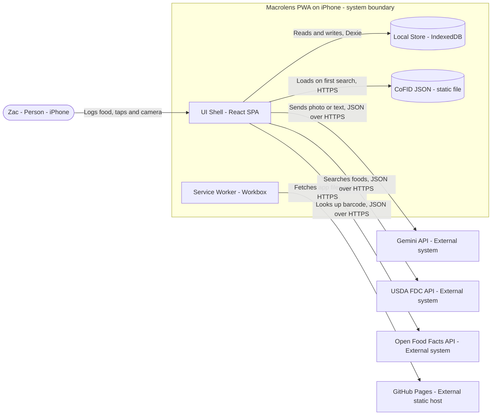
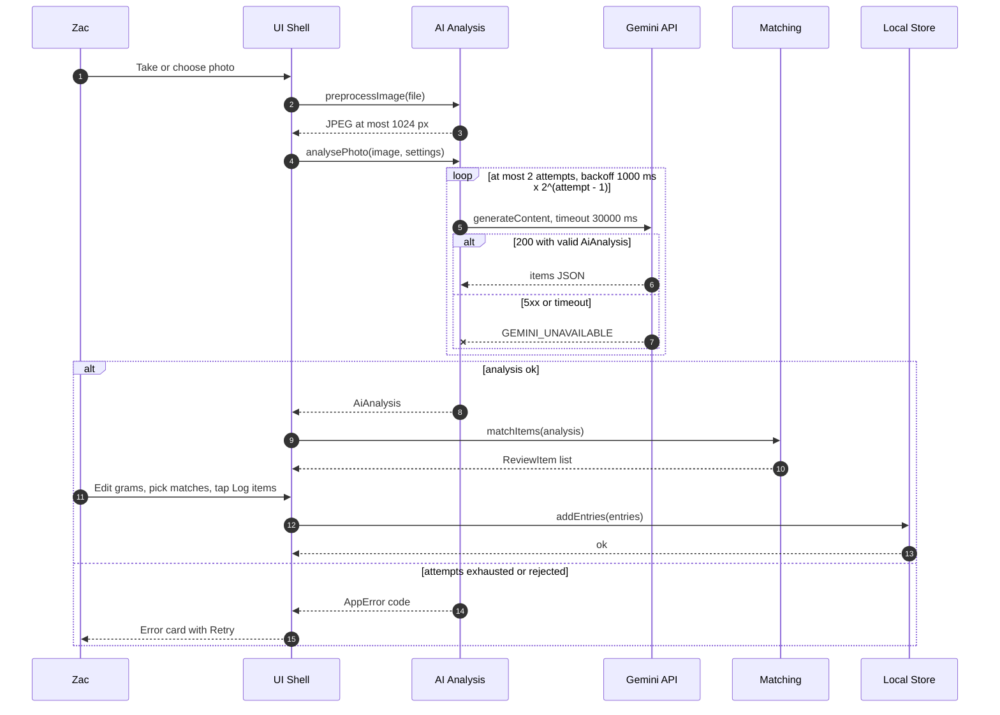
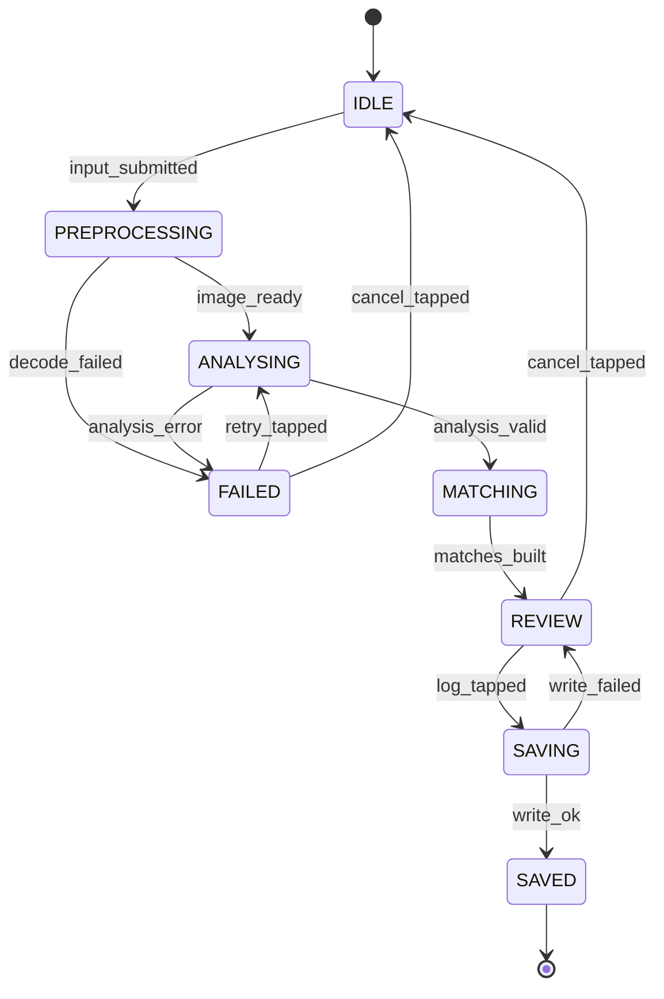

# Macrolens: Low-Level Plan

| Field | Value |
|---|---|
| Document | `docs/PLAN.md` |
| Version | 1.0.0 |
| Status | Locked input for Phase 1 (Claude Code re-verifies it, then locks `docs/requirements.md` and `docs/design.md`) |
| Date | 2026-11-17 |
| Owner | Zac (product owner, sole user) |
| Author of build | Claude Code, working autonomously |
| Governing standard | `docs/ENGINEERING_QA_PLAYBOOK.md` v1.0.0 |

## Contents

- [0. Product summary](#0-product-summary)
- [1. Source statements](#1-source-statements)
- [2. Requirements (L1)](#2-requirements-l1)
- [3. Assumptions and open questions](#3-assumptions-and-open-questions)
- [4. Glossary (L0)](#4-glossary-l0)
- [5. High-level design (L2)](#5-high-level-design-l2)
- [6. Data schemas (L3)](#6-data-schemas-l3)
- [7. Interface contracts (L4)](#7-interface-contracts-l4)
- [8. Error catalogue and failure modes](#8-error-catalogue-and-failure-modes)
- [9. Behavioural models (L5)](#9-behavioural-models-l5)
- [10. Low-level design (L6)](#10-low-level-design-l6)
- [11. Screens and interaction design](#11-screens-and-interaction-design)
- [12. Test plan](#12-test-plan)
- [13. Build phases and exit gates](#13-build-phases-and-exit-gates)
- [14. User acceptance test (UAT) and feedback loop](#14-user-acceptance-test-uat-and-feedback-loop)
- [15. Traceability matrix](#15-traceability-matrix)
- [16. Backlog (not in MVP)](#16-backlog-not-in-mvp)
- [17. Plan gate report](#17-plan-gate-report)

---

## 0. Product summary

Macrolens is a personal calorie and macro tracker that runs as an installable web app (PWA) on Zac's iPhone. It logs food for each day, shows totals against computed targets, and adds food by photo (Gemini), text description (Gemini), database search, UK barcode scan, manual entry, and saved favourites. Nutrient values come from food composition databases. Gemini identifies foods and estimates grams only; the user confirms or corrects every value before it is saved. All data stays on the phone. The app is a static site on GitHub Pages with no backend.

---

## 1. Source statements

Every requirement cites one of these. They come from Zac's request and his answers on 2026-11-17.

| ID | Source statement (quoted or summarised from Zac) |
|---|---|
| S-01 | "a calorie tracker for myself, which will be built with Claude Code" |
| S-02 | "will run on mobile (Webapp so that I don't have to deploy to app store)" |
| S-03 | "day to day count" |
| S-04 | "the most important thing is the accuracy of the data (calories, macro, etc)" |
| S-05 | "I took a pic of the food, it will take that image, analyse it, identify the food, estimate the weight of the food, and show me back the information, that I can edit as well" |
| S-06 | "when I log the food I can click on favourite button and it will be saved to the favourite meals, so I don't have to re-add every detail next time" |
| S-07 | "I will be using free tier Gemini model" |
| S-08 | Answer: nutrient numbers come from a food database; Gemini names the food and estimates grams |
| S-09 | Answer: store data on the phone only, with backup export/import |
| S-10 | Answer: the Gemini API key is pasted into app settings and stored on the phone |
| S-11 | Answer: weighs food often; must be able to type real grams from a kitchen scale |
| S-12 | Answer: targets calculated from personal stats, with override |
| S-13 | Answer: extra nutrients fibre and sugar (on top of calories, protein, carbs, fat) |
| S-14 | Answer: add food by text search, barcode scan (mainly UK products), manual entry, and describing food in words to Gemini |
| S-15 | Answer: a day is one list ordered by time (no meal sections) |
| S-16 | Answer: "whichever one is most accurate": UK CoFID first, USDA fallback |
| S-17 | Answer: favourites hold whole meals and single items; re-add with portion scaling |
| S-18 | Answer: host on GitHub Pages |
| S-19 | Answer: Claude Code asks Zac only when blocked, plus one final phone test |
| S-20 | "Claude Code writes the whole cycle: requirements, building/coding, testing (unit, functional, end to end), user feedback, and ready to use" |
| S-21 | Zac's phone is an iPhone 16 (stated previously by Zac) |

---

## 2. Requirements (L1)

Priority: **M** = Must (MVP), **S** = Should (MVP if the gate budget allows). Acceptance criteria are written as Given / When / Then. Each criterion maps to a test case in Section 12.

### 2.1 Functional requirements

| ID | Requirement | Pri | Source | Acceptance criteria |
|---|---|---|---|---|
| REQ-001 | The system MUST show, for the selected date, totals for kcal, protein, carbs, fat, fibre and sugar, each with its target and the remaining amount. | M | S-03, S-13 | Given entries totalling 1,200 kcal and a 2,430 kcal target, when Today opens, then it shows "1,200 / 2,430 kcal" and "1,230 left". Given totals above target, then the remaining value shows as a negative number with the over-target style. |
| REQ-002 | The system MUST list the selected date's entries in one list ordered by consumption time, ascending. | M | S-15 | Given entries at 08:10, 13:05 and 07:30, when Today opens, then the order is 07:30, 08:10, 13:05. Each row shows time, name, quantity with unit, kcal, protein, carbs and fat. |
| REQ-003 | The system MUST let the user move to the previous day, the next day, or a chosen date, and add or edit entries on that date. | M | S-03 (derived: a day-to-day count needs past days) | Given Today is 2026-11-17, when the user taps "previous day", then the header shows 2026-11-16 and that day's entries. Adding food while 2026-11-16 is selected stores the entry with `date = 2026-11-16`. |
| REQ-004 | The system MUST let the user edit an entry's name, quantity, unit-compatible value, time and per-100 nutrient values, and MUST recalculate the entry and the day totals on save. | M | S-05 | Given an entry of 100 g at 200 kcal/100 g, when the quantity changes to 150 g and is saved, then the entry shows 300 kcal and the day total rises by 100 kcal. |
| REQ-005 | The system MUST delete an entry after the user confirms, and MUST offer an undo control for 5,000 ms. | M | S-03 (derived) | Given an entry is deleted, when "Undo" is tapped within 5,000 ms, then the entry is restored with its original `id`. After 5,000 ms the undo control is removed. |
| REQ-006 | The system MUST search foods by text in the bundled CoFID dataset first and in USDA FoodData Central second. | M | S-14, S-16 | Given the query "basmati", when results show, then CoFID results appear first with a "CoFID" badge. When the user taps "Search USDA", then USDA results are appended with a "USDA" badge. With no USDA key, the button shows `NO_API_KEY` guidance. |
| REQ-007 | The system MUST scan EAN-13, EAN-8, UPC-A and UPC-E barcodes with the camera, look the product up in Open Food Facts, and offer typed barcode entry as a fallback. | M | S-14 | Given a valid UK barcode for a product in Open Food Facts, when it is scanned, then the review screen opens with the product name, brand and per-100 values with an "Open Food Facts" badge. Given a code that fails the GTIN checksum, then `BARCODE_INVALID` is shown. |
| REQ-008 | The system MUST let the user create an entry manually from a name, a basis (per 100 g, per 100 ml, or per serving with serving size), nutrient values and a quantity. | M | S-14 | Given per-serving values for a 30 g serving at 120 kcal, when saved with quantity 45 g, then the entry stores per-100 kcal 400 and shows 180 kcal. |
| REQ-009 | The system MUST analyse a photo with Gemini into a list of food items with estimated grams, match each item to a database food, and show an editable review screen before anything is saved. | M | S-05, S-08 | Given a photo of rice and chicken, when analysis completes, then the review screen lists 2 items, each with a name, editable grams, a matched database food with its badge, and up to 3 alternative matches. Nothing is written to the log until "Log items" is tapped. |
| REQ-010 | The system MUST convert a typed food description into the same review screen through Gemini. | M | S-14 | Given "2 boiled eggs and 1 slice of wholemeal toast with butter", when submitted, then the review screen lists 3 items with estimated grams. |
| REQ-011 | The review and edit screens MUST show the grams (or ml) field as the first editable field of every item, accept values from 0.1 to 5,000 with one decimal place, and label AI-estimated quantities "Estimated". | M | S-11 | Given an AI-estimated 180 g, when the user types 212, then the label changes from "Estimated" to "Weighed" and nutrients recalculate before saving. |
| REQ-012 | The system MUST take nutrient values from a database match when one is selected. It MUST use Gemini's own nutrient estimate only when the user explicitly chooses "Use AI estimate" for an unmatched item, and MUST flag such entries `AI_ESTIMATE`. | M | S-04, S-08 | Given an item with a selected CoFID match, then the saved per-100 values equal the CoFID values exactly. Given "Use AI estimate", then the entry shows an "AI estimate" badge and the day total shows "Includes 1 AI-estimated item". |
| REQ-013 | Every entry MUST show its data source badge: CoFID, USDA, Open Food Facts, Manual or AI estimate. | M | S-04 | Given one entry from each source, when Today opens, then each row shows the matching badge text. |
| REQ-014 | The system MUST save an entry, or a review item, as a single-item favourite from a star button, and MUST save 2 to 30 selected entries as a named meal favourite. | M | S-06, S-17 | Given an entry, when the star is tapped, then a favourite of kind `item` with the same name, quantity and per-100 values exists. Given 3 entries selected with "Save as meal" named "My porridge", then a favourite of kind `meal` with 3 items exists. |
| REQ-015 | The Favourites tab MUST list favourites by most recent use, filter them by name, and add one to the selected date at the current time with a portion multiplier from 0.25 to 5.00 in steps of 0.25, with per-item quantities editable before adding. | M | S-06, S-17 | Given "My porridge" (oats 50 g, milk 200 ml, banana 100 g), when added with multiplier 1.5, then 3 entries with 75 g, 300 ml and 150 g are logged at the current time, sharing one `groupId`. |
| REQ-016 | The system MUST let the user rename, edit items of, and delete a favourite. Deleting a favourite MUST NOT change entries already logged. | M | S-17 (derived) | Given an entry logged from favourite F, when F is deleted, then the entry and its values are unchanged. |
| REQ-017 | The system MUST compute daily targets from sex, age, height, weight, activity level and goal (Section 10.3) and MUST let the user override each target. | M | S-12 | Given male, 25 years, 178 cm, 75 kg, moderate activity, goal lose 0.25 kg per week, then targets are 2,430 kcal, 135 g protein, 68 g fat, 321 g carbs, 30 g fibre, sugar no target. |
| REQ-018 | Settings MUST store a Gemini API key, a USDA API key and a Gemini model ID on the device, with a "Test" button for each key. | M | S-07, S-10 | Given a valid Gemini key, when "Test" is tapped, then "Key works (model `<MODEL_ID>`)" is shown. Given an invalid key, then `GEMINI_AUTH_FAILED` is shown. |
| REQ-019 | The system MUST export all data to one JSON file and MUST import such a file in one transaction after schema validation, in "replace" or "merge by id" mode. | M | S-09 (derived: phone-only storage needs a backup) | Given an exported file, when imported in replace mode on an empty install, then every entry, favourite and setting except API keys is restored. Given a file failing validation, then `IMPORT_INVALID_FILE` is shown and the database is unchanged. |
| REQ-020 | The app MUST be installable to the iPhone home screen and open in standalone mode. | M | S-02 | Given the deployed URL in iOS Safari, when "Add to Home Screen" is used, then the app opens without Safari's address bar and shows the app icon and name "Macrolens". |
| REQ-021 | Logging, editing, favourites, CoFID search and targets MUST work offline after the first complete load. Photo, describe, barcode lookup and USDA search MUST show `NETWORK_OFFLINE` when offline. | M | S-02 (derived) | Given the app loaded once and the network then disabled, when the user searches "apple" and logs a result, then the entry saves. When the user starts a photo analysis, then `NETWORK_OFFLINE` is shown. |
| REQ-022 | The About screen MUST show data attributions: CoFID (Open Government Licence), Open Food Facts (ODbL) and USDA FoodData Central (CC0). | M | S-08 (derived: licence terms) | Given Settings, when About opens, then all 3 attribution texts with links are visible. |
| REQ-023 | Before the first Gemini request, the system MUST show once that the Gemini free tier may use submitted photos and text to improve Google products, and MUST require "I understand" before sending. | M | S-07 (derived: free-tier terms) | Given no prior acceptance, when "Analyse" is tapped, then the notice shows and no network request to Gemini is made until "I understand" is tapped. |
| REQ-024 | Foods whose source basis is per 100 ml MUST be logged in ml; all other foods in g. | M | S-04 (derived) | Given an Open Food Facts drink with per-100 ml values, when it is reviewed, then the quantity field shows "ml". |
| REQ-025 | The day totals MUST mark any nutrient whose total is incomplete (one or more entries have no value for it) with a "≥" prefix and a count of entries missing that value. | M | S-04 (derived) | Given 2 entries, one with fibre 3 g and one with fibre unknown, then fibre shows "≥ 3 g" and "1 item missing fibre". |
| REQ-026 | The system MUST request persistent storage on first launch and MUST show a backup reminder when the last export is more than 7 days old or has never happened and 1 or more entries exist. | S | S-09 (derived) | Given `lastBackupAt` 8 days ago, when Today opens, then a banner "Last backup 8 days ago — Export now" is shown. |

### 2.2 Non-functional requirements

| ID | Requirement | Measurement point | Source |
|---|---|---|---|
| NFR-001 | Nutrient arithmetic: entry value = per-100 value × quantity ÷ 100 with no intermediate rounding. Display rounding: kcal to the nearest integer, grams to 1 decimal place, half away from zero. Day totals sum unrounded values and round once. | Unit and property tests on `src/domain/nutrition.ts`, 10,000 generated cases | S-04 |
| NFR-002 | CoFID parity: 100% of rows and of the 6 tracked fields in the bundled JSON equal the source XLSX within an absolute difference of 0.001, after the documented `Tr` and `N` rules (ASM-009). | `scripts/verify-cofid.ts`, run in CI | S-04, S-16 |
| NFR-003 | Carbohydrate convention: all stored carbs are available carbohydrate (excluding fibre), matching UK labels. USDA "carbohydrate by difference" is converted by subtracting fibre; when USDA fibre is missing the entry is flagged `CARBS_INCLUDE_FIBRE`. | Mapper unit tests | S-04 |
| NFR-004 | CoFID search latency ≤ 100 ms p95 for queries of 2 to 30 characters, measured over 200 queries in Playwright WebKit on the development Mac. | `tests/perf/cofid-search.spec.ts` | S-02 |
| NFR-005 | Photo upload size: images are downscaled to a long edge of 1,024 px and JPEG quality 0.8 before upload; the uploaded payload is ≤ 400 KB for a 12 MP iPhone photo. | Unit test with a 4,032 × 3,024 fixture | S-07 |
| NFR-006 | Bundle size: initial JavaScript ≤ 300 KB gzip; CoFID data file ≤ 600 KB gzip, loaded on first search and cached by the service worker. | `npm run build` size report checked by `scripts/check-size.ts` | S-02 |
| NFR-007 | Accessibility: all tap targets ≥ 44 × 44 CSS px; zero axe-core violations of impact `serious` or `critical` on every screen. | Playwright + `@axe-core/playwright` | S-02 |
| NFR-008 | Secrets: API keys exist only in IndexedDB on the device; they never appear in logs, exports, the repository or test snapshots. A secret scan of the repository reports zero findings. | Export unit test; secret scan in CI | S-10 |
| NFR-009 | Content Security Policy: `connect-src` allows only `'self'`, `https://generativelanguage.googleapis.com`, `https://api.nal.usda.gov` and `https://world.openfoodfacts.org`. | E2E test reads the CSP meta tag | S-10 |
| NFR-010 | Supported clients: iOS Safari 18 or later in home-screen mode (primary) and current Chrome for Android (secondary). | Playwright projects: WebKit with the newest iPhone descriptor available, Chromium with the newest Pixel descriptor | S-02, S-21 |
| NFR-011 | Test coverage: ≥ 90% line coverage for `src/domain/**` and `src/services/**`; ≥ 80% line coverage overall. | Vitest coverage report | S-20 |
| NFR-012 | Photo analysis duration: total wait shown to the user is capped at 62,000 ms (FM-001 budget), after which a named error is shown. | Unit test with fake timers | S-05 |

### 2.3 Out of scope (MVP)

| Item | Reason |
|---|---|
| Accounts, cloud sync, multiple users | S-09: phone-only storage |
| Native iOS or Android app | S-02 |
| Backend server or API proxy | S-10, ADR-0001 (reconsidered only if OQ-001 fails) |
| Items in Section 16 | Not stated as MVP by Zac |

---

## 3. Assumptions and open questions

### 3.1 Assumption register

| ID | Statement | Reason | Impact if false | Validation method | Status |
|---|---|---|---|---|---|
| ASM-001 | The primary client is an iPhone 16 running iOS Safari 18 or later, installed to the home screen. | S-21 | Medium (barcode library and storage choices) | Zac confirms in UAT step U-01 | Open |
| ASM-002 | Default Gemini model is `gemini-3.6-flash`, fallback `gemini-3.5-flash-lite`; both are free-tier and accept image input. | Gemini API pricing page read 2026-11-17 lists both as free of charge | Low (setting change) | Phase 0 spike T0.3 calls the models list endpoint and one image request | Open |
| ASM-003 | The free-tier daily request quota covers 30 Gemini requests per day. | Personal use: about 6 meals per day plus retries | Low (user waits for the Pacific-midnight reset) | Phase 0 spike reads the quota shown in Google AI Studio; Zac confirms in UAT | Open |
| ASM-004 | Foods with a per-100 ml basis are logged in ml with no density conversion. | Labels state per 100 ml for drinks | Low | Mapper tests | Open |
| ASM-005 | Target formula inputs: activity factors 1.2, 1.375, 1.55, 1.725, 1.9; goal deltas −550, −275, 0, +275 kcal/day; protein 1.8 g per kg body weight; fat 25% of kcal; carbs the remainder; fibre 30 g (UK SACN recommendation); no sugar target. | Common defaults; user can override every target (REQ-017) | Low | Zac reviews targets in UAT step U-03 | Open |
| ASM-006 | Day boundaries use the device's local time zone; `date` is the local calendar date at consumption time. | Personal use in Europe/London | Low | Unit tests around 00:00 and DST changes | Open |
| ASM-007 | USDA energy is read from nutrient 1008 (Energy, kcal), else 2048 (Atwater specific factors), else 2047 (Atwater general factors); if none exist, the item is excluded from results. | FDC Foundation foods often lack 1008 | Low | Mapper tests with fixtures of each case | Open |
| ASM-008 | USDA search uses data types Foundation, SR Legacy and Survey (FNDDS) only; branded UK products come from Open Food Facts. | USDA branded data covers US products | Low | Review in Phase 1 | Open |
| ASM-009 | CoFID value rules: `Tr` (trace) is stored as 0; `N` (not determined), blank and `NA` are stored as `null` (unknown). Fibre uses the AOAC fibre column (UK label method). | CoFID 2021 user guide conventions | Medium (wrong fibre or zero values) | T0.4 inspects the XLSX; `verify-cofid.ts` enforces the rules | Open |
| ASM-010 | Photos are not stored after analysis; only the item results are kept. | Storage and privacy on the phone | Low | Zac confirms in UAT | Open |
| ASM-011 | The GitHub repository is public, because GitHub Pages on a free personal account serves public repositories. API keys are never in the repository (NFR-008). | S-18 | Low | Phase 8 deploy succeeds | Open |
| ASM-012 | Open Food Facts product lookups use `https://world.openfoodfacts.org/api/v2/product/<BARCODE>` with `fields`, `cc=gb` and `lc=en` parameters, and the app identifies itself as the OFF documentation requires for browser clients. | OFF API documentation | Low | T0.2 spike; ADR-0009 records the identification method | Open |

### 3.2 Open questions

| ID | Question | Impact | Blocks | Resolution plan |
|---|---|---|---|---|
| OQ-001 | Do the Gemini API, USDA FDC API and Open Food Facts API all accept requests from a browser origin (CORS) with the headers this app sends? | High: if any fails, the app needs a proxy (redesign of HLD-04, HLD-05, HLD-06) | Sections 7.2 to 7.4, Phase 2 design lock | Phase 0 spike T0.2: send real requests from a page served by `vite preview` and record each response's `Access-Control-Allow-Origin`. If all pass, mark Resolved. If any fails, write ADR-0010 with 2 proxy options (Cloudflare Worker, Vercel Function) and **stop and ask Zac** (blocker B-05). |

---

## 4. Glossary (L0)

| Term | Definition |
|---|---|
| Entry | One logged food on one date: a name, a quantity with unit, a per-100 nutrient snapshot, a source and a consumption time. |
| Per-100 values | Nutrients per 100 g, or per 100 ml when `basis = ml`. |
| Nutrient set | kcal, protein, carbs, fat, fibre, sugar. kcal, protein, carbs and fat are required numbers; fibre and sugar are numbers or `null` (unknown). |
| Carbs | Available carbohydrate, excluding fibre (NFR-003). |
| Source | Where per-100 values came from: `cofid`, `usda`, `off`, `manual`, `ai_estimate`. |
| Match | A database food selected for an AI-identified item. |
| Candidate | One of up to 3 database foods offered for an AI-identified item. |
| Favourite | A saved template of 1 to 30 items: kind `item` (1 item) or kind `meal` (2 to 30 items). |
| Portion multiplier | A factor from 0.25 to 5.00 applied to every item quantity of a favourite when it is added. |
| Group | Entries created together from one photo, one description or one meal favourite; they share a `groupId`. |
| Review screen | The editable list shown before AI, search, barcode or favourite items are logged. |
| CoFID | McCance and Widdowson's Composition of Foods Integrated Dataset 2021 (UK). |
| FDC | USDA FoodData Central. |
| OFF | Open Food Facts. |
| GTIN | The barcode number formats EAN-13, EAN-8, UPC-A and UPC-E. |

---

## 5. High-level design (L2)

### 5.1 Component inventory

| ID | Component | Single responsibility | Technology | Serves |
|---|---|---|---|---|
| HLD-01 | UI Shell | Screens, routing, navigation, and state wiring | React 19, TypeScript (strict), Tailwind CSS, React Router (hash routing) | REQ-001 to REQ-026 (presentation) |
| HLD-02 | Local Store | Persist entries, favourites, settings and profile in IndexedDB | Dexie | REQ-002 to REQ-005, REQ-014 to REQ-019, NFR-008 |
| HLD-03 | Nutrition Domain | Pure functions: scaling, totals, rounding, targets, units, validation | TypeScript, zod | REQ-001, REQ-004, REQ-011, REQ-017, REQ-025, NFR-001, NFR-003 |
| HLD-04 | Food Search | Search CoFID locally and USDA remotely; normalise results to `FoodItem` | TypeScript, `fetch` | REQ-006, NFR-002, NFR-004 |
| HLD-05 | Barcode | Decode barcodes from the camera; validate GTIN; look up OFF | `barcode-detector` polyfill (ZXing WASM), `fetch` | REQ-007, REQ-024 |
| HLD-06 | AI Analysis | Send a photo or text to Gemini and return a validated `AiAnalysis` | `@google/genai` SDK, zod | REQ-009, REQ-010, REQ-023, NFR-005, NFR-012 |
| HLD-07 | Matching | Turn each AI item into ranked database candidates and build `ReviewItem`s | TypeScript | REQ-009, REQ-010, REQ-012 |
| HLD-08 | Backup | Export, import, persistent-storage request, backup reminder | TypeScript, zod | REQ-019, REQ-026 |
| HLD-09 | PWA Layer | Manifest, icons, service worker, offline caching, update prompt | `vite-plugin-pwa` (Workbox) | REQ-020, REQ-021 |
| HLD-10 | CoFID Pipeline | Build-time conversion of the CoFID XLSX into the bundled JSON, and parity verification | Node script, SheetJS (`xlsx`) | NFR-002, ASM-009 |
| HLD-11 | HTTP Policy | Apply timeouts, retries, backoff and status-to-error mapping to every remote call | TypeScript, `fetch`, `AbortController` | NFR-012, REQ-006, REQ-007, REQ-009, REQ-010 |

Versions: Claude Code installs the current stable major of each package in Phase 3, pins it in `package-lock.json`, and records the major versions in `CLAUDE.md` and `docs/design.md`.

### 5.2 Container view

Question answered: which parts run where, and which external systems does the app call?



Legend: rounded shape = person; rectangle = container or external system; cylinder = data store; enclosing box = system boundary; arrow = direction of the request.

### 5.3 Architecture decisions to record (Phase 2)

Claude Code writes each ADR in `docs/adr/` using playbook Section 2.3 (2 or more options, 1 or more negative consequences).

| ID | Decision | Depends on |
|---|---|---|
| ADR-0001 | Client-only PWA with no backend | S-09, S-10, OQ-001 |
| ADR-0002 | Nutrient values come from databases; Gemini identifies foods and estimates grams | S-04, S-08 |
| ADR-0003 | CoFID is converted at build time and shipped as a static JSON file | S-16, NFR-002 |
| ADR-0004 | Carbs stored as available carbohydrate (UK label convention) | NFR-003 |
| ADR-0005 | Hash routing for GitHub Pages | S-18 |
| ADR-0006 | Barcode decoding with a ZXing WASM polyfill, because iOS Safari has no enabled `BarcodeDetector` | S-21, REQ-007 |
| ADR-0007 | Gemini model ID is a setting; default `gemini-3.6-flash` | ASM-002 |
| ADR-0008 | Each entry stores a per-100 snapshot so history never changes when sources change | REQ-016 |
| ADR-0009 | How the app identifies itself to Open Food Facts from a browser | ASM-012 |
| ADR-0010 | Proxy design (only written if OQ-001 fails) | OQ-001 |

---

## 6. Data schemas (L3)

All schemas live once in `src/domain/schemas.ts` as zod schemas; TypeScript types are inferred from them (Rule D-3). Field names below are the exact identifiers.

### 6.1 Enumerations

| Name | Values |
|---|---|
| `Source` | `cofid`, `usda`, `off`, `manual`, `ai_estimate` |
| `Unit` | `g`, `ml` |
| `QuantityOrigin` | `estimated`, `weighed`, `database_default` |
| `ItemFlag` | `AI_ESTIMATE`, `CARBS_INCLUDE_FIBRE`, `ENERGY_DERIVED_FROM_KJ`, `MISSING_FIBRE`, `MISSING_SUGAR` |
| `Sex` | `male`, `female` |
| `ActivityLevel` | `sedentary` (1.2), `light` (1.375), `moderate` (1.55), `very` (1.725), `extra` (1.9) |
| `Goal` | `lose_0_5` (−550), `lose_0_25` (−275), `maintain` (0), `gain_0_25` (+275) |
| `FavouriteKind` | `item`, `meal` |
| `ImportMode` | `replace`, `merge` |
| `AnalysisState` | `IDLE`, `PREPROCESSING`, `ANALYSING`, `MATCHING`, `REVIEW`, `SAVING`, `SAVED`, `FAILED` |

### 6.2 `Per100`

| Field | Type | Null | Constraints | Default |
|---|---|---|---|---|
| `kcal` | number | No | 0 ≤ x ≤ 900 | none |
| `protein` | number (g) | No | 0 ≤ x ≤ 100 | none |
| `carbs` | number (g) | No | 0 ≤ x ≤ 100 | none |
| `fat` | number (g) | No | 0 ≤ x ≤ 100 | none |
| `fibre` | number (g) | Yes | 0 ≤ x ≤ 100 | `null` |
| `sugar` | number (g) | Yes | 0 ≤ x ≤ 100 | `null` |

Cross-field rule: `protein + carbs + fat + (fibre ?? 0)` ≤ 105 (allows label rounding). Violations return `VALIDATION_FAILED`.

### 6.3 `FoodItem` (search result, barcode result, candidate)

| Field | Type | Null | Constraints | Default |
|---|---|---|---|---|
| `source` | `Source` | No | not `ai_estimate` | none |
| `sourceId` | string | No | CoFID food code, FDC ID as string, or GTIN | none |
| `name` | string | No | 1 to 200 chars, trimmed | none |
| `brand` | string | Yes | 1 to 100 chars | `null` |
| `basis` | `Unit` | No | | `g` |
| `per100` | `Per100` | No | | none |
| `servingSize` | number | Yes | 0 < x ≤ 5,000, in `basis` units | `null` |
| `flags` | `ItemFlag[]` | No | unique values | `[]` |

### 6.4 `LogEntry` (Dexie table `entries`, primary key `id`, indexes `date`, `groupId`, `[date+consumedAt]`)

| Field | Type | Null | Constraints | Default |
|---|---|---|---|---|
| `id` | string | No | UUID version 4 | generated |
| `date` | string | No | `YYYY-MM-DD`, local date of `consumedAt` | derived |
| `consumedAt` | string | No | ISO 8601 with local offset, for example `2026-11-17T13:05:00+00:00` | now |
| `name` | string | No | 1 to 200 chars | none |
| `brand` | string | Yes | 1 to 100 chars | `null` |
| `quantity` | number | No | 0.1 ≤ x ≤ 5,000, 1 decimal place | none |
| `unit` | `Unit` | No | equals the source `basis` | `g` |
| `quantityOrigin` | `QuantityOrigin` | No | | none |
| `per100` | `Per100` | No | snapshot copied at log time (ADR-0008) | none |
| `source` | `Source` | No | | none |
| `sourceId` | string | Yes | `null` only for `manual` and `ai_estimate` | `null` |
| `flags` | `ItemFlag[]` | No | `ai_estimate` source implies `AI_ESTIMATE` | `[]` |
| `aiConfidence` | number | Yes | 0 ≤ x ≤ 1 | `null` |
| `groupId` | string | Yes | UUID version 4 | `null` |
| `favouriteId` | string | Yes | UUID version 4 | `null` |
| `createdAt` | number | No | Unix epoch ms | now |
| `updatedAt` | number | No | Unix epoch ms, ≥ `createdAt` | now |

### 6.5 `Favourite` (Dexie table `favourites`, primary key `id`, index `lastUsedAt`)

| Field | Type | Null | Constraints | Default |
|---|---|---|---|---|
| `id` | string | No | UUID version 4 | generated |
| `kind` | `FavouriteKind` | No | `item` ⇔ 1 item; `meal` ⇔ 2 to 30 items | none |
| `name` | string | No | 1 to 80 chars, unique case-insensitively | first item name or user input |
| `items` | `FavouriteItem[]` | No | length 1 to 30 | none |
| `useCount` | integer | No | ≥ 0 | 0 |
| `lastUsedAt` | number | Yes | Unix epoch ms | `null` |
| `createdAt` | number | No | Unix epoch ms | now |
| `updatedAt` | number | No | Unix epoch ms | now |

`FavouriteItem` has the `LogEntry` fields `name`, `brand`, `quantity`, `unit`, `per100`, `source`, `sourceId`, `flags`, with the same constraints.

### 6.6 `Profile`, `Targets`, `Settings` (Dexie table `kv`, key = record name)

`Profile`

| Field | Type | Null | Constraints | Default |
|---|---|---|---|---|
| `sex` | `Sex` | No | | none |
| `ageYears` | integer | No | 16 to 100 | none |
| `heightCm` | number | No | 120 to 230 | none |
| `weightKg` | number | No | 35 to 300, 1 decimal place | none |
| `activity` | `ActivityLevel` | No | | `light` |
| `goal` | `Goal` | No | | `maintain` |

`Targets`

| Field | Type | Null | Constraints | Default |
|---|---|---|---|---|
| `kcal` | integer | No | 800 to 6,000 | computed |
| `protein` | integer (g) | No | 0 to 500 | computed |
| `carbs` | integer (g) | No | 0 to 1,000 | computed |
| `fat` | integer (g) | No | 0 to 400 | computed |
| `fibre` | integer (g) | No | 0 to 150 | 30 |
| `sugar` | integer (g) | Yes | 0 to 500 | `null` |
| `overridden` | object of `kcal`, `protein`, `carbs`, `fat`, `fibre`, `sugar` → boolean | No | | all `false` |

`Settings`

| Field | Type | Null | Constraints | Default |
|---|---|---|---|---|
| `geminiApiKey` | string | Yes | 20 to 200 chars | `null` |
| `usdaApiKey` | string | Yes | 20 to 200 chars | `null` |
| `geminiModel` | string | No | matches `^gemini-[a-z0-9.\-]+$` | `gemini-3.6-flash` |
| `aiDisclosureAcceptedAt` | number | Yes | Unix epoch ms | `null` |
| `lastBackupAt` | number | Yes | Unix epoch ms | `null` |
| `schemaVersion` | integer | No | ≥ 1 | 1 |

### 6.7 `AiAnalysis` (Gemini structured output, validated with zod)

| Field | Type | Null | Constraints |
|---|---|---|---|
| `items` | `AiItem[]` | No | 0 to 15 items |
| `imageQuality` | enum `good`, `poor`, `not_applicable` | No | `not_applicable` for text input |
| `notes` | string | Yes | ≤ 300 chars |

`AiItem`

| Field | Type | Null | Constraints |
|---|---|---|---|
| `name` | string | No | 1 to 100 chars, British English |
| `searchTerms` | string[] | No | 1 to 3 terms, each 1 to 60 chars, CoFID naming style (for example `rice, white, basmati, boiled`) |
| `estimatedQuantity` | number | No | 0.1 to 5,000 |
| `unit` | `Unit` | No | |
| `portionDescription` | string | No | 1 to 120 chars, for example `about 1 cup heaped` |
| `cookingMethod` | enum `raw`, `boiled`, `steamed`, `fried`, `grilled`, `roasted`, `baked`, `microwaved`, `unknown` | No | |
| `confidence` | number | No | 0 to 1 |
| `aiPer100` | `Per100` | No | Gemini's own estimate; used only on explicit user choice (REQ-012) |

### 6.8 `ReviewItem` (in-memory only)

| Field | Type | Null | Notes |
|---|---|---|---|
| `key` | string | No | UUID version 4, React key |
| `name` | string | No | editable |
| `quantity` | number | No | editable, 0.1 to 5,000 |
| `unit` | `Unit` | No | equals the selected food's `basis` |
| `quantityOrigin` | `QuantityOrigin` | No | becomes `weighed` when the user edits the quantity |
| `candidates` | `FoodItem[]` | No | 0 to 3, best first |
| `selected` | `FoodItem` or the literal `ai_estimate` or `null` | Yes | `null` blocks "Log items" for this row |
| `aiItem` | `AiItem` | Yes | `null` for non-AI flows |
| `matchScore` | number | Yes | 0 to 1; below 0.6 shows "Check match" |

### 6.9 Export file (`macrolens-backup-YYYY-MM-DD.json`)

| Field | Type | Notes |
|---|---|---|
| `format` | literal `macrolens-backup` | |
| `formatVersion` | integer | 1 |
| `exportedAt` | string | ISO 8601 UTC |
| `entries` | `LogEntry[]` | |
| `favourites` | `Favourite[]` | |
| `profile` | `Profile` or `null` | |
| `targets` | `Targets` or `null` | |
| `settings` | `Settings` without `geminiApiKey` and `usdaApiKey` | NFR-008 |

---

## 7. Interface contracts (L4)

### 7.1 Internal service contracts

All service functions return `Result<T, AppError>` (`{ ok: true, value }` or `{ ok: false, error }`). They do not throw for expected failures. `AppError` = `{ code: ErrorCode, message: string, retryable: boolean, retryAfterMs: number | null, cause?: unknown }`.

| Function | Module | Signature | Errors |
|---|---|---|---|
| `searchCofid` | `src/services/cofid/search.ts` | `(query: string, limit?: number) => Promise<Result<FoodItem[], AppError>>` | `VALIDATION_FAILED`, `COFID_UNAVAILABLE` |
| `searchUsda` | `src/services/usda/client.ts` | `(query: string, apiKey: string, signal?: AbortSignal) => Promise<Result<FoodItem[], AppError>>` | `NO_API_KEY`, `USDA_AUTH_FAILED`, `USDA_RATE_LIMITED`, `USDA_UNAVAILABLE`, `NETWORK_OFFLINE` |
| `lookupBarcode` | `src/services/off/client.ts` | `(gtin: string, signal?: AbortSignal) => Promise<Result<FoodItem, AppError>>` | `BARCODE_INVALID`, `OFF_PRODUCT_NOT_FOUND`, `OFF_INCOMPLETE_NUTRITION`, `OFF_UNAVAILABLE`, `NETWORK_OFFLINE` |
| `startScanner` | `src/services/barcode/scanner.ts` | `(video: HTMLVideoElement, onCode: (gtin: string) => void) => Promise<Result<() => void, AppError>>` (returns a stop function) | `CAMERA_PERMISSION_DENIED`, `CAMERA_UNAVAILABLE` |
| `preprocessImage` | `src/services/image/preprocess.ts` | `(file: Blob) => Promise<Result<Blob, AppError>>` | `IMAGE_DECODE_FAILED` |
| `analysePhoto` | `src/services/gemini/analyse.ts` | `(image: Blob, settings: Settings, signal?: AbortSignal) => Promise<Result<AiAnalysis, AppError>>` | `NO_API_KEY`, `AI_DISCLOSURE_REQUIRED`, `GEMINI_AUTH_FAILED`, `GEMINI_RATE_LIMITED`, `GEMINI_UNAVAILABLE`, `GEMINI_BAD_RESPONSE`, `NO_FOOD_DETECTED`, `NETWORK_OFFLINE` |
| `analyseText` | `src/services/gemini/analyse.ts` | `(description: string, settings: Settings, signal?: AbortSignal) => Promise<Result<AiAnalysis, AppError>>` | as `analysePhoto`, plus `VALIDATION_FAILED` (description 3 to 500 chars) |
| `testGeminiKey` | `src/services/gemini/analyse.ts` | `(apiKey: string, model: string) => Promise<Result<{ model: string }, AppError>>` | `GEMINI_AUTH_FAILED`, `GEMINI_MODEL_NOT_FOUND`, `GEMINI_UNAVAILABLE`, `NETWORK_OFFLINE` |
| `testUsdaKey` | `src/services/usda/client.ts` | `(apiKey: string) => Promise<Result<true, AppError>>` | `USDA_AUTH_FAILED`, `USDA_UNAVAILABLE`, `NETWORK_OFFLINE` |
| `matchItems` | `src/services/matching/match.ts` | `(analysis: AiAnalysis, opts: { usdaApiKey: string \| null, online: boolean }) => Promise<ReviewItem[]>` | none (unmatched rows have `selected = null`) |
| `exportBackup` | `src/services/backup/backup.ts` | `() => Promise<Result<Blob, AppError>>` | `STORAGE_UNAVAILABLE` |
| `importBackup` | `src/services/backup/backup.ts` | `(file: Blob, mode: ImportMode) => Promise<Result<{ entries: number, favourites: number }, AppError>>` | `IMPORT_INVALID_FILE`, `STORAGE_QUOTA_EXCEEDED`, `STORAGE_WRITE_FAILED` |

Repository functions (`src/data/*.ts`) return `Result` with `STORAGE_QUOTA_EXCEEDED`, `STORAGE_WRITE_FAILED` or `STORAGE_UNAVAILABLE`:
`listEntries(date)`, `addEntries(entries[])` (one transaction), `updateEntry(entry)`, `deleteEntry(id)`, `restoreEntry(entry)`, `listFavourites(filter?)`, `saveFavourite(fav)`, `deleteFavourite(id)`, `markFavouriteUsed(id)`, `getKv(key)`, `setKv(key, value)`.

### 7.2 Gemini API (external)

| Item | Value |
|---|---|
| Client | `@google/genai`, `ai.models.generateContent` |
| Model | `Settings.geminiModel` (default `gemini-3.6-flash`) |
| Input | System instruction (Section 10.6) + one user part: inline JPEG (`image/jpeg`, base64) or text |
| Output config | `responseMimeType: application/json`, response schema built from `AiAnalysis` (Section 6.7); Claude Code checks the current SDK field name for JSON schema in Phase 0 |
| Auth | API key from `Settings.geminiApiKey` |
| Status mapping | 400 with `API_KEY_INVALID`, 401, 403 → `GEMINI_AUTH_FAILED`; 404 model → `GEMINI_MODEL_NOT_FOUND`; 429 → `GEMINI_RATE_LIMITED`; 500 to 504, timeout → `GEMINI_UNAVAILABLE`; parse or schema failure → `GEMINI_BAD_RESPONSE` |
| CORS | Verified by T0.2 (OQ-001) |

### 7.3 USDA FoodData Central (external)

| Item | Value |
|---|---|
| Operation | `POST https://api.nal.usda.gov/fdc/v1/foods/search?api_key=<USDA_API_KEY>` |
| Body | `{ "query": "<QUERY>", "dataType": ["Foundation", "SR Legacy", "Survey (FNDDS)"], "pageSize": 25 }` |
| Fields read | `fdcId`, `description`, `dataType`, `foodNutrients[].nutrientId`, `foodNutrients[].value`, `foodNutrients[].unitName` |
| Nutrient IDs | energy 1008 / 2048 / 2047 (ASM-007), protein 1003, fat 1004, carbohydrate by difference 1005, fibre 1079, total sugars 2000 |
| Mapping | `carbs = max(0, 1005 − 1079)`; if 1079 missing then `carbs = 1005` and flag `CARBS_INCLUDE_FIBRE` (NFR-003) |
| Rate limit | 1,000 requests per hour per key (FDC API guide); 429 → `USDA_RATE_LIMITED` |
| Status mapping | 401, 403 → `USDA_AUTH_FAILED`; 429 → `USDA_RATE_LIMITED`; 500 to 504, timeout → `USDA_UNAVAILABLE` |

### 7.4 Open Food Facts (external)

| Item | Value |
|---|---|
| Operation | `GET https://world.openfoodfacts.org/api/v2/product/<BARCODE>?cc=gb&lc=en&fields=code,product_name,product_name_en,brands,nutriments,nutrition_data_per,serving_quantity,product_quantity_unit` |
| Fields read | `status`, `product.product_name_en` (else `product_name`), `brands`, `nutriments["energy-kcal_100g"]`, `nutriments["energy-kj_100g"]`, `proteins_100g`, `carbohydrates_100g`, `fat_100g`, `fiber_100g`, `sugars_100g`, `serving_quantity`, `product_quantity_unit` |
| Mapping | kcal from `energy-kcal_100g`; if missing, `energy-kj_100g ÷ 4.184` with flag `ENERGY_DERIVED_FROM_KJ`. `basis = ml` when `product_quantity_unit = ml`, else `g` (confirm field behaviour in T0.2; record in ADR-0009). Missing kcal and kJ, or missing protein, carbs or fat → `OFF_INCOMPLETE_NUTRITION` with the known fields prefilled into manual entry. |
| Not found | `status = 0` → `OFF_PRODUCT_NOT_FOUND`; manual entry opens with the barcode as `sourceId` |
| Status mapping | 500 to 504, timeout → `OFF_UNAVAILABLE` |

### 7.5 CoFID JSON (static file `public/data/cofid-2021.json`)

```json
{
  "dataset": "McCance and Widdowson's Composition of Foods Integrated Dataset 2021",
  "licence": "Open Government Licence v3.0",
  "generatedAt": "<ISO_8601_UTC>",
  "sourceSha256": "<SHA256_OF_XLSX>",
  "foods": [
    { "code": "<FOOD_CODE>", "name": "<FOOD_NAME>", "basis": "g", "per100": { "kcal": 0, "protein": 0, "carbs": 0, "fat": 0, "fibre": null, "sugar": null } }
  ]
}
```

`basis` is `ml` only where CoFID states values per 100 ml; otherwise `g`.

---

## 8. Error catalogue and failure modes

### 8.1 Error catalogue (Rule F-4)

Single definition: `src/domain/errors.ts`. "Upstream status" is the HTTP status that triggers the code, or `local`.

| Code | Upstream status | Retryable | Trigger | Message shown | Caller action |
|---|---|---|---|---|---|
| `VALIDATION_FAILED` | local | No | Input violates a schema in Section 6 | Field-level message naming the rule | Correct the field |
| `NO_API_KEY` | local | No | Required key is `null` | "Add your Gemini key in Settings" (or USDA) | Open Settings |
| `AI_DISCLOSURE_REQUIRED` | local | No | `aiDisclosureAcceptedAt` is `null` | Free-tier data notice (REQ-023) | Tap "I understand" |
| `NETWORK_OFFLINE` | local | Yes | `navigator.onLine === false` or `TypeError` from `fetch` | "You're offline" | Retry when online |
| `GEMINI_AUTH_FAILED` | 400 (`API_KEY_INVALID`), 401, 403 | No | Key rejected | "Gemini rejected the key" | Fix key in Settings |
| `GEMINI_MODEL_NOT_FOUND` | 404 | No | Model ID unknown | "Model `<MODEL_ID>` not found" | Change model in Settings |
| `GEMINI_RATE_LIMITED` | 429 | Yes | Free-tier quota reached | "Gemini limit reached. Try again in `<SECONDS>` s" or "after midnight Pacific time" for daily quota | Wait, or use search or manual entry |
| `GEMINI_UNAVAILABLE` | 500 to 504, timeout | Yes | Service failed after 2 attempts | "Gemini didn't respond" | Tap Retry |
| `GEMINI_BAD_RESPONSE` | 200 | Yes | Output fails `AiAnalysis` validation after 1 repair attempt | "Couldn't read Gemini's answer" | Tap Retry or describe in words |
| `NO_FOOD_DETECTED` | 200 | No | `items` is empty | "No food found in the photo" | Retake, or describe in words |
| `IMAGE_DECODE_FAILED` | local | No | `createImageBitmap` fails | "This image can't be read" | Choose another photo |
| `USDA_AUTH_FAILED` | 401, 403 | No | Key rejected | "USDA rejected the key" | Fix key in Settings |
| `USDA_RATE_LIMITED` | 429 | Yes | Hourly limit reached | "USDA limit reached. Try again in 60 minutes" | Wait, or use CoFID |
| `USDA_UNAVAILABLE` | 500 to 504, timeout | Yes | Failed after 2 attempts | "USDA didn't respond" | Tap Retry |
| `BARCODE_INVALID` | local | No | GTIN check digit fails | "That barcode isn't valid" | Rescan or type it |
| `OFF_PRODUCT_NOT_FOUND` | 200 with `status = 0`, or 404 | No | Product absent | "Product not in Open Food Facts" | Manual entry opens with the barcode |
| `OFF_INCOMPLETE_NUTRITION` | 200 | No | kcal or a macro missing | "Some nutrition values are missing" | Complete manual entry |
| `OFF_UNAVAILABLE` | 500 to 504, timeout | Yes | Failed after 2 attempts | "Open Food Facts didn't respond" | Tap Retry |
| `CAMERA_PERMISSION_DENIED` | local | No | `NotAllowedError` | "Camera access is off" with iOS Settings path | Enable camera, or type the barcode |
| `CAMERA_UNAVAILABLE` | local | No | `NotFoundError`, `NotReadableError`, `OverconstrainedError` | "Camera can't start" | Type the barcode |
| `COFID_UNAVAILABLE` | local or 404 | Yes | CoFID JSON fails to load or parse | "Food list didn't load" | Tap Retry when online |
| `STORAGE_UNAVAILABLE` | local | No | IndexedDB cannot open | "Storage is unavailable on this browser" | Leave private browsing |
| `STORAGE_QUOTA_EXCEEDED` | local | No | `QuotaExceededError` | "Phone storage is full" | Export, then free space |
| `STORAGE_WRITE_FAILED` | local | Yes | Any other transaction error | "Couldn't save" | Tap Retry |
| `IMPORT_INVALID_FILE` | local | No | Backup fails `format` or schema validation | "This isn't a valid Macrolens backup: `<FIRST_ERROR_PATH>`" | Choose another file |

### 8.2 Failure-mode records (Rule F-1, F-3)

Backoff formula for all retries: `delay = baseMs × 2^(attempt − 1)`, jitter ±20%. Retries apply only to idempotent read operations (T-4). All remote calls in this app are reads.

| ID | Interaction | Trigger | Detection | Timeout (ms) | Retry policy | Resulting state / code | Caller-visible behaviour | Recovery | Observability |
|---|---|---|---|---|---|---|---|---|---|
| FM-001 | AI Analysis → Gemini `generateContent` (photo) | 5xx, timeout or network drop | HTTP status, `AbortError` | 30,000 | 2 attempts, base 1,000 ms; retry on 500 to 504, timeout | `FAILED` / `GEMINI_UNAVAILABLE` | Error card with Retry; photo kept in memory | Manual retry | `ai.request.failed` with `attempt`, `status` |
| FM-002 | AI Analysis → Gemini (photo or text) | 429 | HTTP status, `Retry-After` or error details | 30,000 | None (quota errors are not retried automatically) | `FAILED` / `GEMINI_RATE_LIMITED` | Message with wait time; buttons for Search and Manual | Manual | `ai.rate_limited` |
| FM-003 | AI Analysis → Gemini | 200 with invalid JSON or schema mismatch | zod parse failure | 30,000 | 1 repair request that includes the zod error text; then stop | `FAILED` / `GEMINI_BAD_RESPONSE` | Error card with Retry and "Describe instead" | Manual | `ai.bad_response` with zod issue paths |
| FM-004 | AI Analysis → Gemini | Key invalid, model missing | 400 / 401 / 403 / 404 | 30,000 | None | `FAILED` / `GEMINI_AUTH_FAILED` or `GEMINI_MODEL_NOT_FOUND` | Link to Settings | Manual | `ai.auth_failed` |
| FM-005 | AI Analysis → Gemini | 200 with 0 items | `items.length === 0` | 30,000 | None | `FAILED` / `NO_FOOD_DETECTED` | Retake or describe | Manual | `ai.no_food` |
| FM-006 | Food Search → USDA `foods/search` | 5xx or timeout | status, `AbortError` | 8,000 | 2 attempts, base 500 ms | `USDA_UNAVAILABLE` | Inline error under results, CoFID results kept | Manual retry | `usda.failed` |
| FM-007 | Food Search → USDA | 429 or 401/403 | status | 8,000 | None | `USDA_RATE_LIMITED` / `USDA_AUTH_FAILED` | Inline message | Manual | `usda.rejected` |
| FM-008 | Barcode → OFF product | 5xx or timeout | status, `AbortError` | 8,000 | 2 attempts, base 500 ms | `OFF_UNAVAILABLE` | Error with Retry and "Enter manually" | Manual | `off.failed` |
| FM-009 | Barcode → OFF product | `status = 0` or missing nutrients | body fields | 8,000 | None | `OFF_PRODUCT_NOT_FOUND` / `OFF_INCOMPLETE_NUTRITION` | Manual entry prefilled | Manual | `off.not_found`, `off.incomplete` |
| FM-010 | Barcode → camera `getUserMedia` | Permission denied or no camera | `DOMException.name` | None: the iOS permission prompt waits for the user | None | `CAMERA_PERMISSION_DENIED` / `CAMERA_UNAVAILABLE` | Typed barcode field shown | Manual | `camera.failed` |
| FM-011 | Local Store → IndexedDB write | Quota or transaction error | `DOMException.name` | 5,000 (transaction watchdog) | None; transaction rolls back | `STORAGE_QUOTA_EXCEEDED` / `STORAGE_WRITE_FAILED` | Toast with Retry; form data kept | Manual | `db.write_failed` |
| FM-012 | Local Store → IndexedDB open | Private browsing or blocked | open error | 5,000 | None | `STORAGE_UNAVAILABLE` | Full-screen message | None | `db.open_failed` |
| FM-013 | Food Search → CoFID JSON fetch | 404, offline before first cache, parse error | status, `SyntaxError` | 15,000 | 2 attempts, base 1,000 ms | `COFID_UNAVAILABLE` | Inline error with Retry | Manual | `cofid.load_failed` |
| FM-014 | Backup → file import | Wrong format or schema | zod parse failure | None (local file read) | None | `IMPORT_INVALID_FILE` | Message with first failing path; database unchanged | Manual | `backup.import_failed` |
| FM-015 | AI Analysis → image decode | HEIC or corrupt file | `createImageBitmap` rejects | 10,000 | None | `IMAGE_DECODE_FAILED` | Message; picker stays open | Manual | `image.decode_failed` |
| FM-016 | PWA → browser storage eviction | iOS removes site data | `navigator.storage.persisted()` returns `false` | None | None | No error code; warning state | Banner: "Install to Home Screen and export a backup" | Export (REQ-019) | `storage.not_persisted` |

T-2 check for FM-001: worst case = 2 × 30,000 + 1,000 × 1.2 = 61,200 ms; UI cap 62,000 ms (NFR-012). T-2 check for FM-006 and FM-008: 2 × 8,000 + 500 × 1.2 = 16,600 ms; UI shows a cancel button from 3,000 ms.

Observability: events go to `src/services/log.ts`, which writes structured objects to `console` in development and keeps the last 200 events in memory for a hidden "Diagnostics" view in Settings. API keys and image data are never logged (NFR-008).

---

## 9. Behavioural models (L5)

### 9.1 Photo flow sequence (REQ-009, REQ-012)



### 9.2 Analysis state machine (`AnalysisState`)



Text input enters `PREPROCESSING` and leaves on `image_ready` with no image work (the event name is shared so the table stays complete).

Transition table (every state × event pair; `rejected` = ignored, no state change):

| State \ Event | input_submitted | image_ready | decode_failed | analysis_valid | analysis_error | matches_built | log_tapped | write_ok | write_failed | retry_tapped | cancel_tapped |
|---|---|---|---|---|---|---|---|---|---|---|---|
| IDLE | PREPROCESSING | rejected | rejected | rejected | rejected | rejected | rejected | rejected | rejected | rejected | rejected |
| PREPROCESSING | rejected | ANALYSING | FAILED | rejected | rejected | rejected | rejected | rejected | rejected | rejected | IDLE |
| ANALYSING | rejected | rejected | rejected | MATCHING | FAILED | rejected | rejected | rejected | rejected | rejected | IDLE (aborts request) |
| MATCHING | rejected | rejected | rejected | rejected | rejected | REVIEW | rejected | rejected | rejected | rejected | IDLE |
| REVIEW | rejected | rejected | rejected | rejected | rejected | rejected | SAVING (only if every row has `selected`) | rejected | rejected | rejected | IDLE |
| SAVING | rejected | rejected | rejected | rejected | rejected | rejected | rejected | SAVED | REVIEW | rejected | rejected |
| SAVED | rejected | rejected | rejected | rejected | rejected | rejected | rejected | rejected | rejected | rejected | rejected |
| FAILED | rejected | rejected | rejected | rejected | rejected | rejected | rejected | rejected | rejected | ANALYSING (only if the error is retryable) | IDLE |

Implementation: a pure reducer `analysisReducer(state, event)` in `src/domain/analysisMachine.ts`, tested against this table cell by cell (TC-040).

---

## 10. Low-level design (L6)

### 10.1 Repository layout

| Path | Purpose |
|---|---|
| `src/app/` | `App.tsx`, router, providers, bottom tab bar |
| `src/screens/today/` | Today screen, totals card, entry list, date switcher (LLD-01.1) |
| `src/screens/add/` | Add hub with tabs Search, Scan, Photo, Describe, Manual (LLD-01.2) |
| `src/screens/review/` | Shared review screen (LLD-01.3) |
| `src/screens/favourites/` | Favourites list and editor (LLD-01.4) |
| `src/screens/settings/` | Profile and targets, keys, backup, about, diagnostics (LLD-01.5) |
| `src/components/` | Shared UI parts: `SourceBadge`, `NutrientBar`, `QuantityInput`, `ErrorCard`, `Toast` |
| `src/domain/` | `schemas.ts`, `errors.ts`, `nutrition.ts`, `targets.ts`, `units.ts`, `gtin.ts`, `analysisMachine.ts`, `result.ts` |
| `src/data/` | `db.ts` (Dexie schema), `entries.ts`, `favourites.ts`, `kv.ts` |
| `src/services/` | `cofid/`, `usda/`, `off/`, `barcode/`, `image/`, `gemini/`, `matching/`, `backup/`, `http/fetchWithPolicy.ts`, `log.ts` |
| `scripts/` | `build-cofid.ts`, `verify-cofid.ts`, `check-size.ts`, `check-trace.ts`, `vague-scan.sh` |
| `public/data/` | `cofid-2021.json` (generated, committed) |
| `data/raw/` | Downloaded CoFID XLSX (gitignored) |
| `tests/fixtures/` | Recorded API responses, test images, CoFID sample rows |
| `tests/e2e/` | Playwright specs |
| `docs/` | Plan, requirements, design, ADRs, status, UAT, feedback |

### 10.2 LLD components

| ID | Parent | Responsibility |
|---|---|---|
| LLD-01.1 | HLD-01 | Today screen: date state, totals, entry list, edit sheet, delete with undo |
| LLD-01.2 | HLD-01 | Add hub: 5 input tabs, each producing `ReviewItem[]` |
| LLD-01.3 | HLD-01 | Review screen: editable rows, candidate picker, favourite star, Log items |
| LLD-01.4 | HLD-01 | Favourites: list, filter, multiplier sheet, editor |
| LLD-01.5 | HLD-01 | Settings: profile, targets, keys with Test, backup, about, diagnostics |
| LLD-02.1 | HLD-02 | Dexie schema v1 and repositories |
| LLD-03.1 | HLD-03 | `nutrition.ts`: `scaleNutrients`, `sumNutrients`, `roundForDisplay`, `per100FromServing` |
| LLD-03.2 | HLD-03 | `targets.ts`: `bmrMifflinStJeor`, `computeTargets`, `applyOverrides` |
| LLD-03.3 | HLD-03 | `gtin.ts`, `units.ts`, `analysisMachine.ts` |
| LLD-04.1 | HLD-04 | CoFID loader and in-memory index with `searchCofid` |
| LLD-04.2 | HLD-04 | USDA client and mapper |
| LLD-05.1 | HLD-05 | Camera scanner wrapper |
| LLD-05.2 | HLD-05 | OFF client and mapper |
| LLD-06.1 | HLD-06 | Image preprocessing |
| LLD-06.2 | HLD-06 | Gemini client, prompt, response schema, repair attempt |
| LLD-07.1 | HLD-07 | Candidate ranking and `ReviewItem` builder |
| LLD-08.1 | HLD-08 | Export, import, persist request, reminder rule |
| LLD-09.1 | HLD-09 | Manifest, icons, Workbox config, update prompt |
| LLD-10.1 | HLD-10 | `build-cofid.ts` and `verify-cofid.ts` |
| LLD-11.1 | HLD-11 | `fetchWithPolicy` and `withPolicy`: timeout, retry, backoff, status → `AppError` |

### 10.3 Nutrition and target logic (LLD-03.1, LLD-03.2)

```text
scaleNutrients(per100, quantity):
  for each key in [kcal, protein, carbs, fat]: out[key] = per100[key] * quantity / 100
  for each key in [fibre, sugar]: out[key] = per100[key] == null ? null : per100[key] * quantity / 100
  return out                         # no rounding (NFR-001)

sumNutrients(list):
  for each key: total[key] = sum of non-null values; missing[key] = count of null values
  return { total, missing }          # missing > 0 => "≥" prefix (REQ-025)

roundForDisplay(n):
  kcal -> round half away from zero to integer; other keys -> 1 decimal place

per100FromServing(perServing, servingSize):
  per100[key] = perServing[key] * 100 / servingSize   (null stays null)

bmrMifflinStJeor(sex, weightKg, heightCm, ageYears):
  base = 10 * weightKg + 6.25 * heightCm - 5 * ageYears
  return sex == male ? base + 5 : base - 161

computeTargets(profile):
  bmr  = bmrMifflinStJeor(...)
  tdee = bmr * activityFactor[profile.activity]
  kcal = max(bmr, tdee + goalDelta[profile.goal])          # floor at BMR
  kcal = round(kcal / 10) * 10
  protein = 1.8 * weightKg
  fatKcal = 0.25 * kcal
  carbs = max(0, (kcal - protein * 4 - fatKcal) / 4)
  return { kcal, protein: round(protein), fat: round(fatKcal / 9), carbs: round(carbs),
           fibre: 30, sugar: null }
```

Test vectors (synthetic values, not taken from CoFID):

| Case | Input | Expected |
|---|---|---|
| Scale | per100 kcal 130, protein 2.6, carbs 28.7, fat 0.3, fibre null; quantity 185 g | kcal 240.5 → display 241; protein 4.81 → 4.8; carbs 53.095 → 53.1; fat 0.555 → 0.6; fibre null |
| Targets | male, 25 y, 178 cm, 75 kg, `moderate`, `lose_0_25` | BMR 1,742.5; TDEE 2,700.875; kcal 2,430; protein 135; fat 68; carbs 321; fibre 30; sugar null |
| BMR floor | female, 60 y, 150 cm, 45 kg, `sedentary`, `lose_0_5` | BMR 926.5; TDEE 1,111.8; 1,111.8 − 550 = 561.8 < 926.5 → kcal 930 |
| Override warning | kcal override 1,100 | saved, with warning text "Below 1,200 kcal" shown on the targets screen |

### 10.4 CoFID search (LLD-04.1)

1. Load `cofid-2021.json` on first use; build an index of `{ code, nameLower, tokens }` where tokens are words of the name with punctuation removed.
2. Normalise the query: lower case, trim, collapse spaces, map US terms to UK terms with a fixed table in `src/services/cofid/synonyms.ts` (minimum: zucchini→courgette, eggplant→aubergine, cilantro→coriander, fries→chips, chips→crisps only when the query contains "potato chips", ground beef→minced beef, scallion→spring onion, garbanzo→chickpea).
3. Score each food: `score = matchedQueryTokens / queryTokens` where a query token matches when a name token starts with it; add 0.1 when the first name token matches the first query token; subtract `0.002 × nameLength` as a tie-breaker.
4. Return foods with score ≥ 0.5, sorted by score descending, `limit` default 20.
5. Validation: queries shorter than 2 characters return `VALIDATION_FAILED`.

### 10.5 Matching (LLD-07.1)

For each `AiItem`:
1. Run `searchCofid` for each of its `searchTerms`; merge by `code` and keep the highest score.
2. If the best CoFID score < 0.6 and `usdaApiKey` is set and online, run `searchUsda` with the first search term and score results with the same function.
3. `candidates` = top 3 across both; `selected` = top candidate when its score ≥ 0.6, else `null` (row shows "Check match" and blocks "Log items" until the user picks a candidate, searches manually, or chooses "Use AI estimate").
4. `quantity` = `estimatedQuantity` converted to the selected candidate's `basis` (g and ml are treated 1:1 per ASM-004); `quantityOrigin = estimated`.
5. Matching never changes a candidate's `per100` values (REQ-012).

### 10.6 Gemini prompt (LLD-06.2)

System instruction text (stored in `src/services/gemini/prompt.ts`; changes require updating TC-050 fixtures):

```text
You identify foods in a meal photo or description for a UK nutrition tracker.
Rules:
1. List each distinct food separately (for example rice, chicken, sauce). Combine only foods that cannot be told apart.
2. Estimate the edible quantity as served, in grams; use ml for drinks and soups.
3. Use visible objects for scale: a UK dinner plate is 26 to 28 cm across, a dinner fork is about 19 cm, a can is 330 ml.
4. Give 1 to 3 searchTerms per food in UK food-composition naming style: "food, type, preparation", for example "rice, white, basmati, boiled" or "chicken, breast, grilled, without skin".
5. Use British English food names.
6. Set confidence from 0 to 1 for the identification and the quantity together.
7. Give aiPer100 as your best estimate per 100 g or 100 ml. It is a fallback only.
8. Never invent brand names. If no food is visible, return an empty items list.
9. Return only JSON that matches the provided schema.
```

Repair attempt (FM-003): resend the same input plus `Your previous answer failed validation: <ZOD_ISSUES>. Return only valid JSON for the schema.`

### 10.7 Image preprocessing (LLD-06.1)

1. Decode with `createImageBitmap(file, { imageOrientation: 'from-image' })`; failure → `IMAGE_DECODE_FAILED`.
2. Scale so the long edge is at most 1,024 px, keeping the aspect ratio.
3. Draw to `OffscreenCanvas` (fallback `HTMLCanvasElement`), export `image/jpeg` quality 0.8.
4. If the result exceeds 400 KB, re-export at quality 0.6 (NFR-005).

### 10.8 HTTP policy (LLD-11.1)

`fetchWithPolicy(url, init, policy)` where `policy = { timeoutMs, attempts, baseBackoffMs, retryOn: (status) => boolean, mapError: (status, body) => ErrorCode }`. It combines an internal `AbortController` timeout with the caller's `signal`, checks `navigator.onLine` before each attempt, and returns `Result<Response, AppError>`. Every remote call in Sections 7.2 to 7.4 MUST use it, except the Gemini SDK call, which is wrapped in an equivalent `withPolicy(fn, policy)` helper.

### 10.9 Backup rules (LLD-08.1)

- Export: read all tables in one read transaction; strip API keys; set `lastBackupAt = now` after the file download starts.
- Import `replace`: validate the whole file first; then in one transaction clear `entries` and `favourites`, write all records, keep existing API keys.
- Import `merge`: validate first; upsert by `id`; when both sides have the same `id`, keep the record with the larger `updatedAt`.
- Persist: call `navigator.storage.persist()` on first launch and after install; show FM-016 banner when `persisted()` is `false`.

### 10.10 Configuration

| Key | Type | Default | Range | Restart needed |
|---|---|---|---|---|
| `VITE_BASE_PATH` | string | `/macrolens/` | GitHub Pages repo path | Rebuild |
| `Settings.geminiModel` | string | `gemini-3.6-flash` | Section 6.6 pattern | No |
| `GEMINI_TIMEOUT_MS` (constant) | integer | 30,000 | 5,000 to 60,000 | Rebuild |
| `HTTP_TIMEOUT_MS` (constant) | integer | 8,000 | 2,000 to 20,000 | Rebuild |
| `UNDO_WINDOW_MS` (constant) | integer | 5,000 | 3,000 to 10,000 | Rebuild |
| `BACKUP_REMINDER_DAYS` (constant) | integer | 7 | 1 to 30 | Rebuild |

Constants live in `src/config.ts`. Test-only environment variables in `.env.local` (gitignored): `GEMINI_API_KEY`, `USDA_API_KEY`, used only by the live smoke tests (TC-090 to TC-093).

---

## 11. Screens and interaction design

Mobile first: layout width 360 to 480 CSS px, centred on wider screens. Bottom tab bar with 4 tabs: **Today**, **Add** (centre, accent colour), **Favourites**, **Settings**. Light and dark themes follow the iOS system setting via `prefers-color-scheme`. Respect iOS safe areas (`env(safe-area-inset-*)`). All numbers use tabular figures.

| Screen | Content and behaviour |
|---|---|
| Today | Header: date with previous/next arrows, tap for date picker. Totals card: kcal ring (consumed / target / remaining) and 5 bars for protein, carbs, fat, fibre, sugar (sugar shows the amount only). Banners: backup reminder (REQ-026), AI-estimate count (REQ-012), storage warning (FM-016). Entry list ordered by time; each row: time, name, quantity + unit, kcal, P/C/F, source badge, star. Tap row → edit sheet. Swipe left or long press → delete with undo. Multi-select mode → "Save as meal". |
| Add | Segmented tabs: Photo (default), Describe, Search, Scan, Manual. Photo: "Take photo" (`<input type="file" accept="image/*" capture="environment">`) and "Choose from library". Each tab ends on the Review screen, except Manual which saves directly after validation. |
| Review | One card per item: quantity field first (REQ-011) with "Estimated"/"Weighed" label, name, selected match with source badge, "Change match" opens candidates plus search, nutrients preview for the current quantity, star to save as favourite, remove button. Footer: totals of the reviewed items, time picker (default now), "Log items" (disabled while any row has no `selected`). |
| Favourites | Filter field, list ordered by `lastUsedAt` descending (never-used last, by name). Tap → sheet with multiplier stepper (0.25 steps), editable item quantities, "Add to <DATE>". Edit and delete in the sheet's menu. |
| Settings | Profile and targets (computed values shown next to override fields), API keys with Test buttons and links to get each key, model ID, backup export/import, About (attributions, app version, build date), Diagnostics (last 200 events, no secrets). |

Design tokens: one accent colour, neutral greys, semantic colours for over-target (red), under-target (neutral) and AI estimate (amber). Claude Code reads the `frontend-design` guidance if available in its environment; otherwise uses Tailwind defaults with these tokens.

---

## 12. Test plan

Test names start with their TC ID, for example `it('TC-010 scales nutrients for 185 g', ...)`. `scripts/check-trace.ts` fails when a TC ID in this table has no matching test, or a test cites an unknown TC ID.

| ID | Level | Covers | Description |
|---|---|---|---|
| TC-001 | Unit | NFR-001, REQ-004 | `scaleNutrients` test vector from Section 10.3 |
| TC-002 | Property | NFR-001 | 10,000 random entries: day total equals the sum of unrounded values, rounded once; scaling is linear in quantity |
| TC-003 | Unit | REQ-025 | `sumNutrients` counts missing fibre and sugar |
| TC-004 | Unit | REQ-008 | `per100FromServing` with 30 g serving at 120 kcal → 400 kcal per 100 g |
| TC-005 | Unit | REQ-017 | `computeTargets` 3 test vectors from Section 10.3, plus override warning |
| TC-006 | Unit | ASM-006 | Entries at 23:59 and 00:01 local time, including the last Sunday of March and October in Europe/London, land on the correct `date` |
| TC-007 | Unit | REQ-007 | GTIN checksum: valid and invalid EAN-13, EAN-8, UPC-A, UPC-E |
| TC-008 | Unit | Section 6 | Every zod schema: valid record, each boundary (min, max, max + 1), null where not allowed, wrong type |
| TC-010 | Unit | NFR-002 | `verify-cofid.ts` passes on the committed JSON; fails on a fixture with one altered value |
| TC-011 | Unit | ASM-009 | CoFID conversion of `Tr`, `N`, blank, `NA` |
| TC-012 | Unit | REQ-006 | `searchCofid`: ranking, synonyms, 1-character query error |
| TC-013 | Perf | NFR-004 | 200 queries in WebKit, p95 ≤ 100 ms |
| TC-020 | Unit | NFR-003, ASM-007 | USDA mapper: carbs minus fibre, missing fibre flag, energy fallback order, food with no energy excluded |
| TC-021 | Integration (MSW) | REQ-006, FM-006, FM-007 | USDA client: 200, 401, 429, 503 twice then fail, timeout |
| TC-022 | Unit | REQ-007, REQ-024 | OFF mapper: kcal, kJ fallback, ml basis, incomplete nutrition |
| TC-023 | Integration (MSW) | FM-008, FM-009 | OFF client: found, `status = 0`, 503 twice, timeout |
| TC-030 | Unit | NFR-005, FM-015 | Image preprocessing: 4,032 × 3,024 fixture → long edge 1,024 px and ≤ 400 KB; corrupt file → `IMAGE_DECODE_FAILED` |
| TC-031 | Integration (MSW) | REQ-009, FM-001 to FM-005 | Gemini wrapper: valid response, invalid then repaired, invalid twice, 0 items, 400 key, 404 model, 429, 503 twice, timeout |
| TC-032 | Unit | NFR-012 | Fake timers: total wait never exceeds 62,000 ms |
| TC-033 | Unit | REQ-023 | No Gemini request is made before disclosure acceptance |
| TC-040 | Unit | Section 9.2 | `analysisReducer` matches every cell of the transition table |
| TC-041 | Unit | REQ-009, REQ-012 | `matchItems`: CoFID match ≥ 0.6 selected; low score → `null`; USDA fallback only with key and online; per100 values unchanged |
| TC-050 | Contract | REQ-009 | Recorded Gemini responses in `tests/fixtures/gemini/` parse with the `AiAnalysis` schema |
| TC-060 | Integration (fake-indexeddb) | REQ-002 to REQ-005 | Entry repository: add 3 entries in one transaction, ordering, update, delete, restore with the same `id` |
| TC-061 | Integration (fake-indexeddb) | REQ-014 to REQ-016 | Favourites: item and meal creation, 31 items rejected, multiplier 1.5, delete keeps entries |
| TC-062 | Integration (fake-indexeddb) | REQ-019, NFR-008 | Export has no API keys; replace import; merge import by `updatedAt`; invalid file leaves the database unchanged |
| TC-063 | Unit | REQ-026, FM-016 | Backup reminder rule at 6, 7 and 8 days; persist banner |
| TC-070 | Component | REQ-001, REQ-025 | Totals card: values, remaining, over-target style, "≥" marker |
| TC-071 | Component | REQ-011, REQ-013 | Review row: quantity first, Estimated→Weighed, badge text per source |
| TC-072 | Component | REQ-018 | Settings key Test button shows success and each error |
| TC-080 | E2E | REQ-002, REQ-003, REQ-004, REQ-005 | Log via search, edit quantity, change day, delete and undo |
| TC-081 | E2E | REQ-009, REQ-011, REQ-012 | Photo flow with mocked Gemini: 2 items, edit grams, pick alternative match, log, totals update |
| TC-082 | E2E | REQ-010 | Describe flow with mocked Gemini |
| TC-083 | E2E | REQ-007 | Barcode: typed GTIN with mocked OFF; camera path with a fake video stream showing a barcode image (Chromium project) |
| TC-084 | E2E | REQ-014, REQ-015 | Save meal from 3 entries, add with multiplier 1.5 on the next day |
| TC-085 | E2E | REQ-017, REQ-018 | Profile → targets shown; keys saved; mocked Test buttons |
| TC-086 | E2E | REQ-019 | Export, clear site data, import, data restored |
| TC-087 | E2E | REQ-020, REQ-021 | Manifest valid; service worker active; offline CoFID search and logging work; photo shows `NETWORK_OFFLINE` |
| TC-088 | E2E | NFR-007 | axe-core on every screen; tap target size check |
| TC-089 | E2E | NFR-009, REQ-022, REQ-023 | CSP meta content; About attributions; disclosure blocks the first Gemini call |
| TC-090 | Live smoke (manual trigger) | ASM-002, OQ-001 | Real Gemini call with `tests/fixtures/images/plate-rice-chicken.jpg`; response valid |
| TC-091 | Live smoke | REQ-006 | Real USDA search "banana" returns ≥ 1 result with kcal |
| TC-092 | Live smoke | REQ-007 | Real OFF lookup of 1 UK barcode chosen in Phase 0 returns kcal per 100 g |
| TC-093 | Live smoke | NFR-002 | Spot-check 10 CoFID foods in the deployed app against the XLSX |
| TC-094 | Eval (optional, not a gate) | REQ-009, REQ-011 | `npm run eval:photos`: for photos in `eval/photos/` with a CSV of true grams, report mean absolute percentage error of Gemini's gram estimates and the top-1 match rate |

E2E runs on 2 Playwright projects (NFR-010). External APIs are mocked with recorded fixtures in all CI tests; live smoke tests run only with `npm run test:live` when `.env.local` holds keys.

---

## 13. Build phases and exit gates

Claude Code works through these phases in order, commits at the end of each, and appends a line to `docs/STATUS.md` (phase, date, gate results, next step). After any context reset it reads `docs/STATUS.md` first.

| Phase | Work | Exit criteria |
|---|---|---|
| P0 Setup and spikes | T0.1 check tools: `node --version`, `npm --version`, `git --version`, `gh auth status`; create the public GitHub repository `macrolens` with `gh repo create`, add it as `origin`, push the starter files. T0.2 CORS spike for Gemini, USDA and OFF from a `vite preview` page (OQ-001); choose the TC-092 barcode. T0.3 Gemini models list + 1 image call (ASM-002); check the SDK's JSON-schema option name. T0.4 download the CoFID 2021 XLSX from GOV.UK into `data/raw/`, list sheet names and column headers, confirm ASM-009. | OQ-001 resolved or blocker B-05 raised. Spike notes in `docs/spikes.md`. |
| P1 Requirements analysis | Act as requirements analyst: re-check every REQ, NFR and ASM in this plan against playbook 2.1; add derived requirements; write `docs/requirements.md` v1.0 with the full PRD blueprint (12 sections). Use the subagent reviewer (below) on it. | Precision gate passes on the file; traceability matrix has zero empty cells; locked. |
| P2 Design lock | Write `docs/design.md` (HLD + LLD per playbook 2.2) and ADR-0001 to ADR-0009 (ADR-0010 only if needed). | TD-D1 to TD-D5 closed; Mermaid sources render. Locked. |
| P3 Scaffold | Vite + React + TypeScript strict, Tailwind, ESLint, Prettier, Vitest, Testing Library, MSW, fake-indexeddb, Playwright, `@axe-core/playwright`, `vite-plugin-pwa`, Dexie, zod, `@google/genai`, `barcode-detector`, `xlsx`. GitHub Actions: lint, typecheck, unit, e2e, size, trace, vague-scan, secret scan; deploy job to GitHub Pages on `main`. Update `CLAUDE.md` commands with the exact verified forms. | Every `CLAUDE.md` command exits 0 from a clean clone (AC-D1). |
| P4 Domain and data | LLD-02.1, LLD-03.x, LLD-10.1 test first (TC-001 to TC-011, TC-040, TC-060 to TC-063). | Tests pass; domain coverage ≥ 90%. |
| P5 Services | LLD-04.x, LLD-05.x, LLD-06.x, LLD-07.1, LLD-08.1, LLD-11.1 test first (TC-012, TC-020 to TC-033, TC-041, TC-050). | Tests pass; services coverage ≥ 90%. |
| P6 UI | LLD-01.x and LLD-09.1, with component tests TC-070 to TC-072. Check every screen at 390 × 844 CSS px with Playwright screenshots and fix layout faults found. | Tests pass. |
| P7 E2E and quality | TC-080 to TC-089, TC-013. Fix every failure. | All pass on both projects. |
| P8 Release candidate | Run all 3 gates (playbook Section 3) plus Section 17 checks; independent reviewer subagent re-checks requirements against the running app; deploy to GitHub Pages; run TC-090 to TC-093. Write `docs/UAT.md` (Section 14). Tag `v0.9.0`. | Gate report all PASS; deployed URL loads. |
| P9 UAT and release | Stop and ask Zac to run `docs/UAT.md` on the iPhone and fill `docs/FEEDBACK.md` (blocker B-06). Triage each item; fix; re-run gates; redeploy; repeat until Zac writes "accepted". Tag `v1.0.0` and write `docs/USER_GUIDE.md` (1 page). | Zac's acceptance recorded in `docs/FEEDBACK.md`. |

**Independent review.** At P1, P2 and P8, Claude Code starts a reviewer subagent that has not written the artifact, gives it the artifact plus this plan and the playbook, and asks for defects by catalogue ID (PRD-D*, TD-D*, AC-D*). Every reported defect is fixed or answered with a one-line reason in `docs/STATUS.md`.

**Blockers (the only reasons to stop and ask Zac).**

| ID | Blocker | What Zac provides |
|---|---|---|
| B-01 | `gh auth status` fails | Runs `gh auth login` |
| B-02 | Node.js or npm missing | Installs the current Node.js LTS |
| B-03 | Live tests need keys and `.env.local` is missing | Gemini key (Google AI Studio) and USDA key (FDC sign-up page) |
| B-04 | CoFID XLSX cannot be downloaded | Downloads it from GOV.UK into `data/raw/` |
| B-05 | OQ-001 fails for any API | Chooses a proxy option from ADR-0010 |
| B-06 | UAT (Phase 9) | Runs the UAT on the iPhone and fills `docs/FEEDBACK.md` |
| B-07 | A decision that is irreversible and has 2 or more reasonable options not covered by this plan | Picks an option |

---

## 14. User acceptance test (UAT) and feedback loop

Claude Code writes `docs/UAT.md` with these steps, each with an expected result and a Pass/Fail box:

| ID | Step |
|---|---|
| U-01 | Open the GitHub Pages URL in Safari on the iPhone; Share → Add to Home Screen; open from the icon (REQ-020, ASM-001) |
| U-02 | Settings: paste Gemini and USDA keys; tap both Test buttons (REQ-018) |
| U-03 | Enter profile; check targets look right to you; override one (REQ-017, ASM-005) |
| U-04 | Photo a real plate; weigh each food on the kitchen scale; correct the grams; check matches; log (REQ-009, REQ-011, REQ-012) |
| U-05 | Describe a meal in words; log (REQ-010) |
| U-06 | Scan 3 UK packaged products from the cupboard; compare kcal per 100 g with each pack label (REQ-007, NFR-002) |
| U-07 | Search "porridge oats" and log 50 g; compare with the pack (REQ-006) |
| U-08 | Save a 3-item meal as a favourite; add it tomorrow at ×1.5 (REQ-014, REQ-015) |
| U-09 | Turn on Airplane Mode; search and log a food; try a photo (REQ-021) |
| U-10 | Export a backup; open it in Files to confirm it saved (REQ-019) |
| U-11 | Use the app for 3 days; note anything wrong, or any task that takes more taps than you want, in `docs/FEEDBACK.md` |

`docs/FEEDBACK.md` template, one row per item:

| ID | Screen | What happened | What you expected | Severity (Blocker / Annoying / Idea) |
|---|---|---|---|---|
| FB-001 | | | | |

Triage rules for Claude Code: a Blocker or Annoying item that contradicts an existing REQ is a bug: fix it and add a regression test. A new wish becomes a new REQ with source `FB-nnn` if it fits the MVP scope, otherwise it goes to Section 16 with a one-line reason. Each FB item gets a status: Fixed (commit hash), Added (REQ ID), Backlog, or Won't do (reason).

---

## 15. Traceability matrix

Claude Code completes the HLD/LLD/Test columns in `docs/requirements.md` and checks them with `scripts/check-trace.ts`.

| REQ / NFR | HLD | LLD | Interface or schema | Test |
|---|---|---|---|---|
| REQ-001 | HLD-01, HLD-03 | LLD-01.1, LLD-03.1 | `sumNutrients`, `Targets` | TC-070, TC-080 |
| REQ-002 | HLD-01, HLD-02 | LLD-01.1, LLD-02.1 | `listEntries` | TC-060, TC-080 |
| REQ-003 | HLD-01 | LLD-01.1 | `LogEntry.date` | TC-006, TC-080 |
| REQ-004 | HLD-01, HLD-03 | LLD-01.1, LLD-03.1 | `updateEntry` | TC-001, TC-008, TC-080 |
| REQ-005 | HLD-01, HLD-02 | LLD-01.1, LLD-02.1 | `deleteEntry`, `restoreEntry` | TC-060, TC-080 |
| REQ-006 | HLD-04 | LLD-04.1, LLD-04.2 | `searchCofid`, `searchUsda` | TC-012, TC-021, TC-091 |
| REQ-007 | HLD-05 | LLD-05.1, LLD-05.2 | `startScanner`, `lookupBarcode` | TC-007, TC-022, TC-023, TC-083, TC-092 |
| REQ-008 | HLD-01, HLD-03 | LLD-01.2, LLD-03.1 | `per100FromServing` | TC-004, TC-008 |
| REQ-009 | HLD-06, HLD-07 | LLD-06.1, LLD-06.2, LLD-07.1 | `analysePhoto`, `matchItems`, `AiAnalysis` | TC-031, TC-040, TC-041, TC-050, TC-081, TC-090 |
| REQ-010 | HLD-06, HLD-07 | LLD-06.2, LLD-07.1 | `analyseText` | TC-031, TC-082 |
| REQ-011 | HLD-01 | LLD-01.3 | `ReviewItem.quantityOrigin` | TC-071, TC-081, TC-094 |
| REQ-012 | HLD-07 | LLD-07.1 | `ReviewItem.selected` | TC-041, TC-081 |
| REQ-013 | HLD-01 | LLD-01.1, LLD-01.3 | `Source` | TC-071 |
| REQ-014 | HLD-01, HLD-02 | LLD-01.1, LLD-01.3, LLD-02.1 | `saveFavourite` | TC-061, TC-084 |
| REQ-015 | HLD-01, HLD-02 | LLD-01.4, LLD-02.1 | `Favourite`, `markFavouriteUsed` | TC-061, TC-084 |
| REQ-016 | HLD-02 | LLD-02.1 | `deleteFavourite` | TC-061 |
| REQ-017 | HLD-03 | LLD-03.2 | `computeTargets`, `Profile` | TC-005, TC-085 |
| REQ-018 | HLD-01, HLD-06, HLD-04 | LLD-01.5, LLD-06.2, LLD-04.2 | `testGeminiKey`, `testUsdaKey` | TC-072, TC-085 |
| REQ-019 | HLD-08 | LLD-08.1 | `exportBackup`, `importBackup` | TC-062, TC-086 |
| REQ-020 | HLD-09 | LLD-09.1 | Web app manifest | TC-087 |
| REQ-021 | HLD-09, HLD-04 | LLD-09.1, LLD-04.1 | Workbox precache | TC-087 |
| REQ-022 | HLD-01 | LLD-01.5 | About screen | TC-089 |
| REQ-023 | HLD-06 | LLD-06.2 | `AI_DISCLOSURE_REQUIRED` | TC-033, TC-089 |
| REQ-024 | HLD-05, HLD-03 | LLD-05.2, LLD-03.3 | `FoodItem.basis` | TC-022 |
| REQ-025 | HLD-03, HLD-01 | LLD-03.1, LLD-01.1 | `sumNutrients` | TC-003, TC-070 |
| REQ-026 | HLD-08 | LLD-08.1 | `Settings.lastBackupAt` | TC-063 |
| NFR-001 | HLD-03 | LLD-03.1 | `scaleNutrients` | TC-001, TC-002 |
| NFR-002 | HLD-10 | LLD-10.1 | CoFID JSON | TC-010, TC-011, TC-093 |
| NFR-003 | HLD-04 | LLD-04.2 | USDA mapping | TC-020 |
| NFR-004 | HLD-04 | LLD-04.1 | `searchCofid` | TC-013 |
| NFR-005 | HLD-06 | LLD-06.1 | `preprocessImage` | TC-030 |
| NFR-006 | HLD-09 | LLD-09.1 | Build output | `scripts/check-size.ts` (CI) |
| NFR-007 | HLD-01 | LLD-01.1 to LLD-01.5 | All screens | TC-088 |
| NFR-008 | HLD-02, HLD-08 | LLD-02.1, LLD-08.1 | Export file | TC-062 |
| NFR-009 | HLD-09 | LLD-09.1 | CSP meta tag | TC-089 |
| NFR-010 | HLD-01 | LLD-01.1 to LLD-01.5 | Playwright projects | TC-080 to TC-089 |
| NFR-011 | All | All | Coverage report | CI coverage threshold |
| NFR-012 | HLD-06, HLD-11 | LLD-06.2, LLD-11.1 | `withPolicy` | TC-032 |

---

## 16. Backlog (not in MVP)

| Item | Note |
|---|---|
| Read a nutrition-label photo into per-100 values | Would add a sixth add method with label-level accuracy |
| Weekly and monthly charts | Averages against targets |
| Body-weight log and target recalculation | Updates `Profile.weightKg` |
| Recipe builder with cooked-weight yield | For home cooking in batches |
| Water tracking | |
| Copy yesterday's entries | |
| Optional encrypted cloud backup | Would need ADR revisiting ADR-0001 |

---

## 17. Plan gate report

Gate checks run on this plan file on 2026-11-17 before hand-over. Claude Code re-runs the gates on `docs/requirements.md` and `docs/design.md` in Phases 1 and 2.

| Gate | Result | Evidence |
|---|---|---|
| Traceability | PASS | Section 15: 38 of 38 REQ/NFR rows, 0 empty cells. 11 HLD components, each with 1 or more LLD components; each LLD has 1 HLD parent. Every TC ID in Section 12 appears in Section 15 or traces to a schema, assumption or state table; 0 IDs referenced without a definition (checked by script on 2026-11-17). |
| Syntax & Command | PASS, with UNVERIFIED items | Diagrams rendered: 3 of 3 with `mmdc` 11.16.0, exit code 0. JSON sample (Section 7.5) parses. Commands executed: 0 of 13 in `CLAUDE.md` (block passes `bash -n`), labelled UNVERIFIED until Phase 3 because the project does not exist yet; Phase 3 runs each from a clean clone (AC-D1). API endpoints in Sections 7.2 to 7.4 are UNVERIFIED until spike T0.2. |
| Precision | PASS | Vague-term scan: 1 match, inside quoted source statement S-04. 2 other matches were rewritten. |
