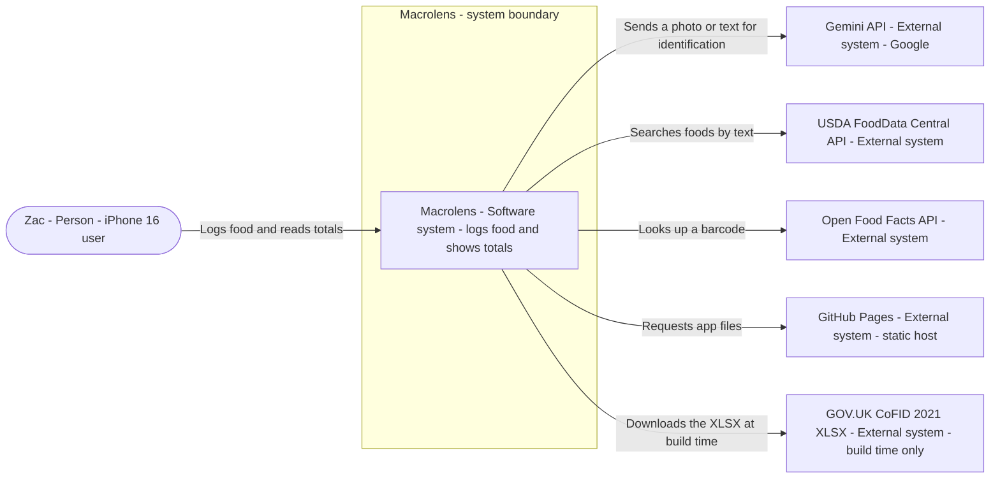
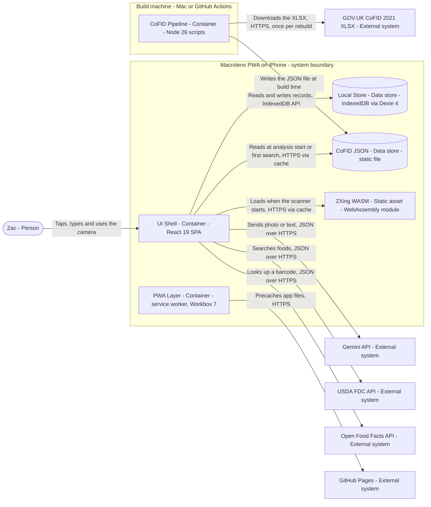
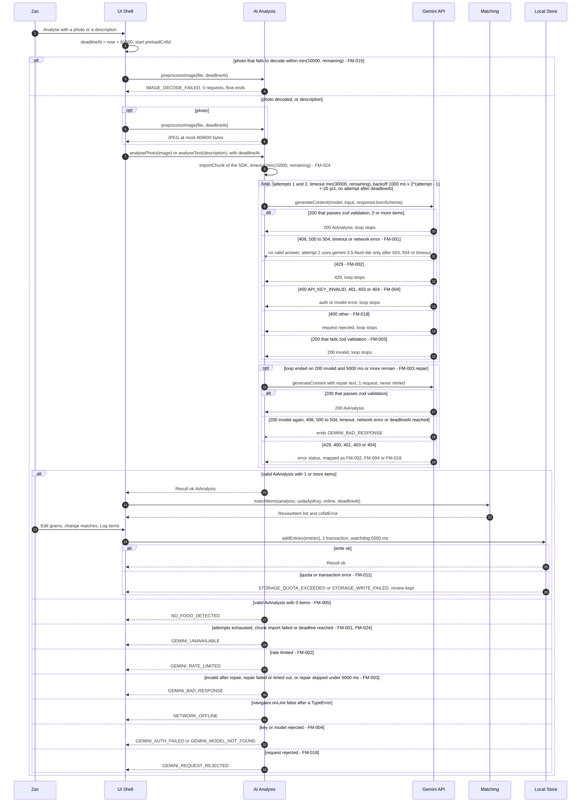
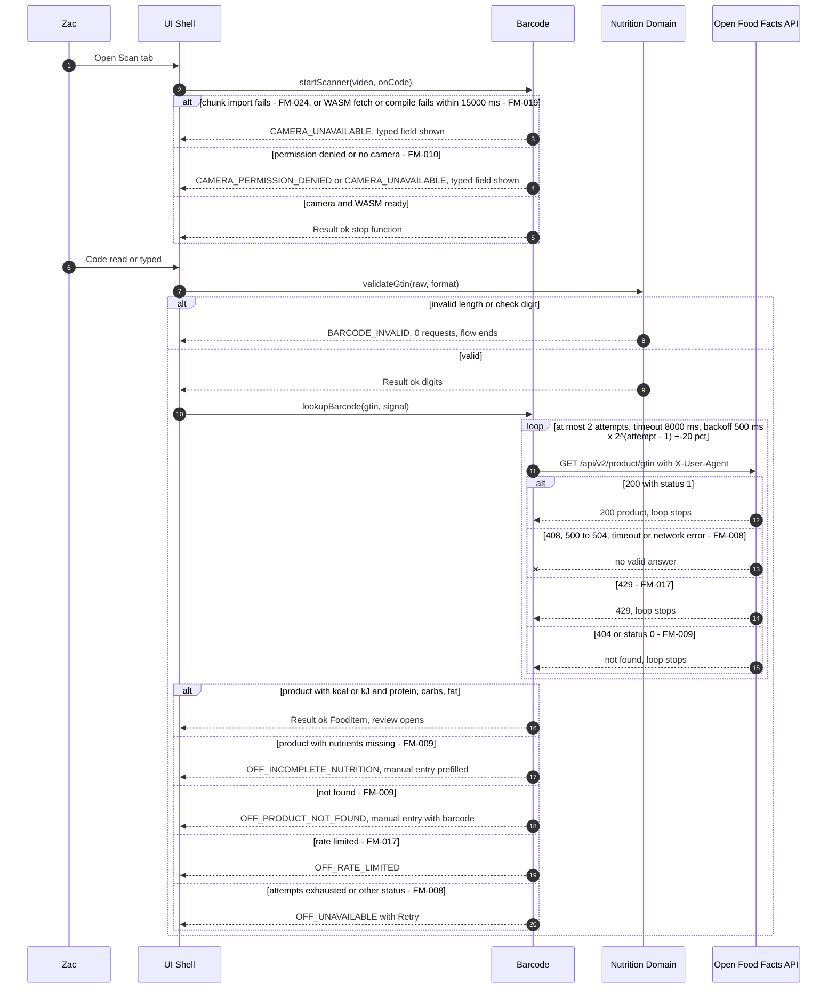
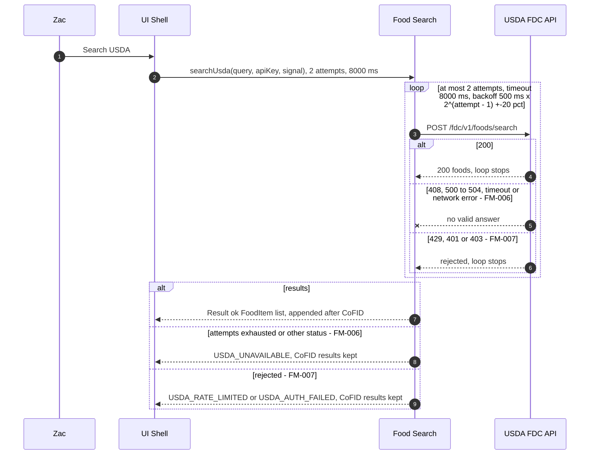
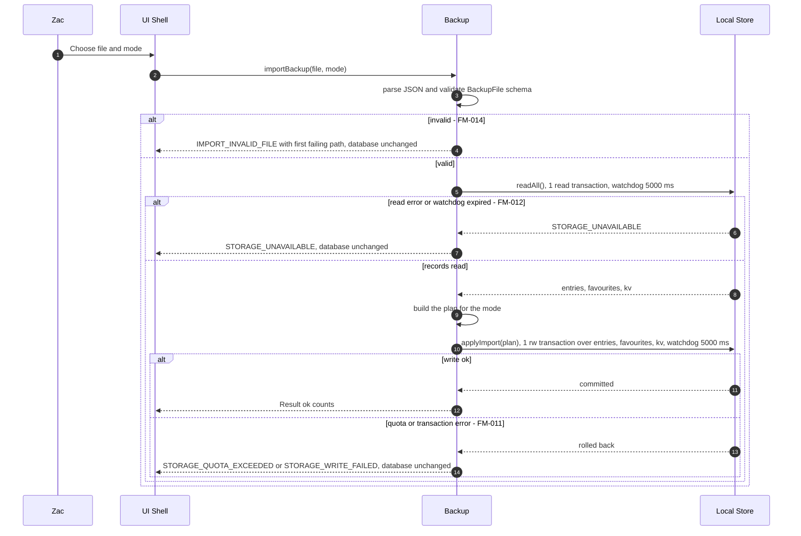
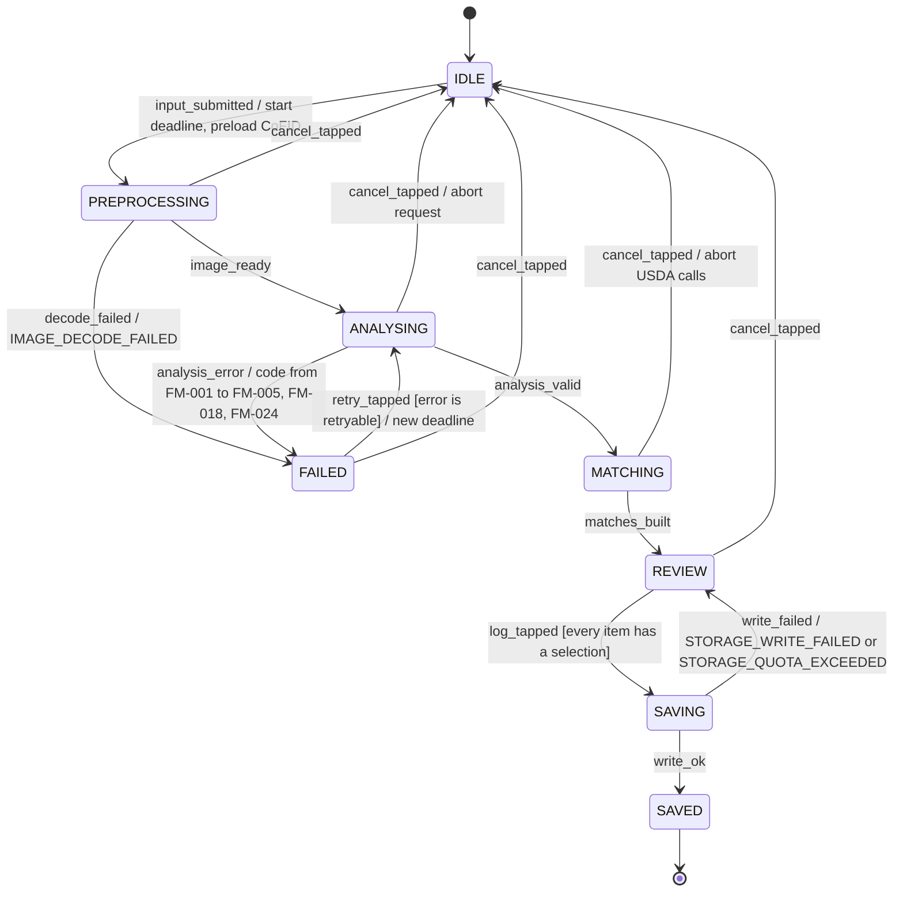

# Macrolens: Design (HLD and LLD)

## 0. Document control

| Field | Value |
|---|---|
| Document | `docs/design.md` |
| Version | 1.0.0 |
| Status | Locked (2026-11-17). Any change increments the version and re-verifies code and tests (playbook Rule D-4) |
| Owner | Zac; author Claude Code (designer, Phase 2) |
| Governing standard | `docs/ENGINEERING_QA_PLAYBOOK.md` v1.0.0, Sections 2.2, 2.4, 2.5 |
| Upstream (locked) | `docs/requirements.md` v1.0.0 (L1); `docs/PLAN.md` v1.0.0 Sections 4 (L0), 6 (L3 base), 10 (L6 base) |
| Diagram renderer | `@mermaid-js/mermaid-cli` (`mmdc`) 12.2.0 |

Change log:

| Version | Date | Change |
|---|---|---|
| 0.1.0 | 2026-11-17 | Draft from `docs/PLAN.md` Sections 5 to 11 and `docs/requirements.md` v1.0.0 |
| 1.0.0 | 2026-11-17 | Confirmation review N1 to N8 and advisories fixed (exact integer arithmetic, ADR-0015; repair failures end `GEMINI_BAD_RESPONSE`; `NETWORK_OFFLINE` delta; FM-024 "Reload app"); first independent review (24 defects, 2 advisories) fixed: deadline from `input_submitted`, `Cancellable` results, scored CoFID search, status default mapping, FM-024, Section 5.3 routes, Section 11.22 test assignment; gates run; locked (dispositions in `docs/STATUS.md`) |

Where this document and `docs/PLAN.md` differ, this document wins. "PLAN" means `docs/PLAN.md` v1.0.0; "REQS" means `docs/requirements.md` v1.0.0.

---

## 1. Context, goals and non-goals

Goal: implement every active requirement of REQS Sections 5 and 6 (65 REQ IDs, 13 NFR IDs) as a static PWA on GitHub Pages (ADR-0001).

| Goal | Requirements |
|---|---|
| Daily log with totals and targets | REQ-001, REQ-002, REQ-004, REQ-025, REQ-027 to REQ-030, REQ-049, REQ-067, REQ-072, REQ-073 |
| Add food: photo, description, search, barcode, manual, favourites | REQ-008, REQ-010, REQ-023, REQ-024, REQ-031, REQ-032, REQ-034, REQ-035, REQ-041 to REQ-046, REQ-048, REQ-069 to REQ-071, REQ-074 to REQ-077, REQ-080 |
| Review before logging, values from databases | REQ-013, REQ-036 to REQ-040, REQ-064, REQ-065, REQ-078, REQ-079 |
| Settings, About, Diagnostics | REQ-022, REQ-051 to REQ-053, REQ-061, REQ-062, REQ-081 to REQ-083 |
| Storage, backup, installable offline app | REQ-020, REQ-054 to REQ-060, REQ-063, REQ-066, REQ-068 |
| Quality targets | NFR-001 to NFR-013 |

Non-goals: the out-of-scope list of REQS Section 3 (accounts, sync, native app, backend, adding items to an existing favourite, Section 16 backlog items).

---

## 2. Component inventory (HLD)

Owning team for every component: Claude Code builds, Zac owns. Package versions are those measured on 2026-11-17 (`docs/spikes.md`); Phase 3 pins exact versions in `package-lock.json`.

| ID | Component | Single responsibility | Technology (major version) | Serves (derived from Section 12) |
|---|---|---|---|---|
| HLD-01 | UI Shell | Screens, routing, navigation and state wiring | React 19, TypeScript 7 (strict), Tailwind CSS 4, React Router 8 (hash router, ADR-0005) | REQ-001, REQ-002, REQ-004, REQ-008, REQ-010, REQ-013, REQ-022, REQ-023, REQ-025, REQ-027 to REQ-030, REQ-035 to REQ-046, REQ-049, REQ-051 to REQ-053, REQ-061, REQ-062, REQ-064, REQ-065, REQ-067, REQ-069 to REQ-073, REQ-079 to REQ-083, NFR-007, NFR-010 |
| HLD-02 | Local Store | Persist entries, favourites, profile, targets and settings in IndexedDB | Dexie 4 | REQ-002, REQ-004, REQ-029, REQ-030, REQ-041 to REQ-045, REQ-048, REQ-049, REQ-051, REQ-054 to REQ-056, REQ-068 to REQ-071, REQ-078, NFR-008 |
| HLD-03 | Nutrition Domain | Pure functions: scaling, totals, rounding, targets, GTIN, units, validation, analysis state machine | TypeScript 7, `zod/mini` 4 (ADR-0013) | REQ-001, REQ-004, REQ-008, REQ-024, REQ-025, REQ-028, REQ-037, REQ-045, REQ-049, REQ-060, REQ-072, REQ-073, REQ-075, REQ-078, REQ-079, NFR-001, NFR-011 |
| HLD-04 | Food Search | Search CoFID in memory and USDA remotely; map results to `FoodItem` | TypeScript, `fetch` | REQ-031, REQ-032, REQ-053, REQ-057, REQ-064, NFR-003, NFR-004, NFR-011 |
| HLD-05 | Barcode | Read barcodes from the camera; look products up in Open Food Facts | `barcode-detector` 3 ponyfill with `zxing-wasm` 3 (ADR-0006), `fetch` | REQ-024, REQ-034, REQ-035, REQ-074, NFR-011 |
| HLD-06 | AI Analysis | Downscale photos; send a photo or text to Gemini; return a validated `AiAnalysis` | `@google/genai` 3 (lazy chunk), `zod/mini` | REQ-010, REQ-023, REQ-052, REQ-076, REQ-080, NFR-005, NFR-011 to NFR-013 |
| HLD-07 | Matching | Turn AI items into ranked database candidates and `ReviewItem`s | TypeScript | REQ-039, REQ-040, REQ-077, NFR-011, NFR-012 |
| HLD-08 | Backup | Export, import, persistent-storage request, backup reminder | TypeScript, `zod/mini` | REQ-054 to REQ-056, REQ-059, REQ-060, REQ-066, NFR-008, NFR-011 |
| HLD-09 | PWA Layer | Manifest, icons, service worker precache, update prompt, CSP | `vite-plugin-pwa` 2 (Workbox 7), Vite 8 | REQ-020, REQ-057, REQ-058, REQ-063, NFR-006, NFR-009 |
| HLD-10 | CoFID Pipeline | Convert the CoFID XLSX to the bundled JSON at build time and verify parity | Node 26, SheetJS 0.20 (ADR-0011) | REQ-024, NFR-002 |
| HLD-11 | HTTP Policy | Apply timeouts, retries, backoff, offline checks and status → error mapping to every remote call | TypeScript, `fetch`, `AbortController` | REQ-032, REQ-034, REQ-058, REQ-076, REQ-080, NFR-011, NFR-012 |
| HLD-12 | Diagnostics Log | Record structured events and per-operation metrics in memory, without secrets | TypeScript | REQ-062, NFR-008, NFR-011 |

HLD-12 is new relative to PLAN Section 5.1: PLAN Section 8.2 names `src/services/log.ts` without a component ID.

---

## 3. Architecture views

### 3.1 Context diagram: Macrolens

Diagram version 1.0.0, 2026-11-17. Question answered: who uses Macrolens and which external systems does it depend on?

Legend: rounded shape = person; rectangle = software system; enclosing box = system boundary; arrow = direction of the request (the arrow starts at the element that sends the request). Every external system is labelled "External system".

| Element | Responsibility |
|---|---|
| Zac | Only user; logs food and reads totals on an iPhone |
| Macrolens | Records food entries and computes totals from database nutrient values |
| Gemini API | Identifies foods and estimates grams from a photo or a description |
| USDA FoodData Central API | Returns nutrient values for foods not found in CoFID |
| Open Food Facts API | Returns per-100 nutrient values for a barcode |
| GitHub Pages | Hosts the built static files |
| GOV.UK CoFID 2021 XLSX | Source file for the bundled CoFID data; downloaded only when the data is rebuilt |

### 3.2 Container diagram: Macrolens PWA

Diagram version 1.0.0, 2026-11-17. Question answered: which parts run where, and which external systems does each part call?

Legend: rounded shape = person; rectangle = container, static asset or external system; cylinder = data store; enclosing box = deployment boundary; arrow = direction of the request or write (the arrow starts at the element that acts).

| Element | HLD | Responsibility |
|---|---|---|
| UI Shell | HLD-01, HLD-03 to HLD-08, HLD-11, HLD-12 (all run in the page) | Renders screens and runs every in-page component |
| PWA Layer (service worker) | HLD-09 | Precaches app files and serves them offline |
| Local Store | HLD-02 | Holds entries, favourites, profile, targets and settings |
| CoFID JSON | Output of HLD-10, read by HLD-04 | Bundled CoFID per-100 values |
| ZXing WASM | Loaded by HLD-05 | Barcode decoder module |
| CoFID Pipeline | HLD-10 | Converts the XLSX to the CoFID JSON and verifies parity |
| GitHub Pages, Gemini, USDA, Open Food Facts, GOV.UK | External | As Section 3.1 |

The diagram is at container level; component detail is in Section 11.

---

## 4. Data architecture

### 4.1 Data stores

| Store | Owning component | Entities | Consistency model | Staleness bound |
|---|---|---|---|---|
| IndexedDB database `macrolens`, Dexie schema version 1 | HLD-02 | `entries`, `favourites`, `kv` (`profile`, `targets`, `settings`, `persistRequested`) | Strong: single device, single writer; every multi-record write is 1 Dexie `rw` transaction | 0 s |
| `public/data/cofid-2021.json` | HLD-10 (writes at build), HLD-04 (reads) | CoFID foods | Read-only per release | Fixed per release |
| Service worker precache | HLD-09 | App shell, CoFID JSON, ZXing WASM, icons | Workbox precache keyed by revision hash | Until the user accepts "Reload" (REQ-063) |
| In-memory log | HLD-12 | `DiagnosticsEvent` (last 200), metrics | Single page process | Cleared on restart |

### 4.2 Data schemas (L3)

`docs/PLAN.md` Section 6 is the field-level schema definition (names, types, nullability, constraints, defaults). It is carried forward unchanged except for the deltas below. `src/domain/schemas.ts` implements PLAN Section 6 plus these deltas with `zod/mini`, and every TypeScript type is inferred from it (Rule D-3).

| Schema | Delta | Reason |
|---|---|---|
| `Per100` | The cross-field rule `protein + carbs + fat + (fibre ?? 0) ≤ 105` is a separate refinement `UserPer100`, applied only to manual entry, per-100 edits and `aiPer100` | DR-02 |
| `StoredPer100` (new) | `Per100` plus: every non-null value has at most 3 decimal places (`abs(v × 1,000 − round(v × 1,000)) < 10^−6`). Used by `FoodItem.per100`, `LogEntry.per100` and `FavouriteItem.per100`; `AiItem.aiPer100` keeps plain `Per100`. Every producer calls `quantisePer100` (LLD-03.1) before validation: `convertRows`, `mapUsdaFood`, `mapOffProduct`, `per100FromServing`, the manual form, the per-100 edit and "Use AI estimate" | NFR-001 (exact sums, ADR-0015) |
| `FoodItem.sourceId` | CoFID IDs match `^\d{2}-\d{3,4}(#\d+)?$` | CR-06 |
| `ItemFlag` | Unchanged; `AI_ESTIMATE` is set only by REQ-040 | REQ-040 |
| `Favourite.name` | DR-08 naming for starred items | DR-08 |
| `Targets.sugar` | Nullable integer 0 to 500; when not `null`, Today shows target and remaining (REQ-001) | REQ-001 |
| `Settings.geminiModel` | Default `gemini-3.6-flash`; fallback constant `GEMINI_FALLBACK_MODEL` (Section 6.3) is not stored | ADR-0007 |
| `AiAnalysis` | Unchanged; Gemini receives the reduced form from `toGeminiSchema()` | ADR-0014 |
| `ReviewItem.selected` | `FoodItem`, the literal `ai_estimate`, or `null` | REQ-040, REQ-079 |
| `DiagnosticsEvent` (new) | `{ name: string (1 to 60 chars, matching ^[a-z]+(\.[a-z_]+)+$: dot-separated lower-case segments, words inside a segment joined by "_"), at: number (epoch ms), opId: string or null (UUID v4), fields: Record<string, string or number or boolean or null> }`; no field value may contain a stored key (Section 11, LLD-12.1) | REQ-062 |
| `ErrorCode` (new enum) | The 27 codes of REQS Section 9.1, in that order | Rule D-3 |
| `AppError` | `{ code: ErrorCode, message: string, retryable: boolean, retryAfterMs: number or null, cause?: unknown }` as PLAN Section 7.1 | PLAN 7.1 |
| `Result<T, E>` | `{ ok: true, value: T } or { ok: false, error: E }` | PLAN 7.1 |
| `Aborted` (new) | `{ ok: false, aborted: true }`: returned instead of an error when the caller's `AbortSignal` fired (Cancel, REQ-080, or unmount). It carries no `ErrorCode` and the UI shows no message | REQ-080 AC-2 |
| `Cancellable<T>` (new) | `Result<T, AppError> or Aborted`; the return type of every function in Section 5.2 that accepts a caller `signal`, except `matchItems`, which has no failure result and returns `{ items, cofidError } or Aborted` | REQ-080 |
| `NETWORK_OFFLINE` trigger (delta to REQS 9.1) | REQS 9.1 lists `navigator.onLine === false` or a `fetch` `TypeError`. The design returns `NETWORK_OFFLINE` for a `TypeError` only when `navigator.onLine` is `false`; a `TypeError` while online is a transient network error mapped to the service's `*_UNAVAILABLE` code and retried by its FM row (LLD-11.1) | A dropped connection on a phone that is still online would otherwise show "You're offline" and skip the retry that FM-001, FM-006, FM-008 and FM-013 allow; both codes are retryable and show Retry, so REQ-058 behaviour is unchanged |

Other types used by the contracts (TypeScript types in `src/domain/types.ts`; types marked "zod" are inferred from `src/domain/schemas.ts`):

| Type | Definition |
|---|---|
| `NutrientKey` | `'kcal' or 'protein' or 'carbs' or 'fat' or 'fibre' or 'sugar'` |
| `Nutrients` | `{ kcal: number, protein: number, carbs: number, fat: number, fibre: number or null, sugar: number or null }`: values for one quantity as integer micro-units (value × 1,000,000), exact (ADR-0015) |
| `NutrientTotals` | `{ kcal: number, protein: number, carbs: number, fat: number, fibre: number, sugar: number }`: integer micro-unit sums with `null` counted as 0 and reported in `MissingCounts` |
| `MissingCounts` | `{ fibre: number, sugar: number }`: count of summed entries whose value was `null` (REQ-025) |
| `Per100Input` | zod: `Per100` fields as entered for 1 serving before conversion; same nullability |
| `Scalar` | `string or number or boolean or null` |
| `ScoredFood` | `{ food: FoodItem, score: number }` with `0 ≤ score ≤ 1` (LLD-04.1) |
| `MachineState` | `{ state: AnalysisState, error: AppError or null, items: ReviewItem[] }` |
| `MachineEvent` | `{ type: 'input_submitted' or 'image_ready' or 'decode_failed' or 'analysis_valid' or 'analysis_error' or 'matches_built' or 'log_tapped' or 'write_ok' or 'write_failed' or 'retry_tapped' or 'cancel_tapped', error?: AppError, items?: ReviewItem[] }` |
| `OffProduct` | zod: the PLAN 7.4 product fields plus `quantity: string or null`, `product_quantity: number or string or null`, `product_quantity_unit: string or null` |
| `CofidFood` | zod: one element of `CofidFile.foods` (PLAN 7.5) |
| `CofidFile` | zod: the PLAN 7.5 file `{ dataset, licence, generatedAt, sourceSha256, foods: CofidFood[] }` |
| `BackupFile` | zod: the PLAN 6.9 export file |
| `ImportMode` | `'replace' or 'merge'` |
| `BarcodeFormat` | `'ean_13' or 'ean_8' or 'upc_a' or 'upc_e'` |
| `KvRecord` | `{ key: 'profile', value: Profile } or { key: 'targets', value: Targets } or { key: 'settings', value: Settings } or { key: 'persistRequested', value: boolean }` |
| `HttpPolicy`, `CallPolicy` | LLD-11.1 |
| `MetricRow` | LLD-12.1 |

Dexie schema version 1 (`src/data/db.ts`):

| Table | Primary key | Indexes | Record schema |
|---|---|---|---|
| `entries` | `id` | `date`, `groupId`, `[date+consumedAt]` | `LogEntry` |
| `favourites` | `id` | `lastUsedAt`, `name` | `Favourite` |
| `kv` | `key` | none | `KvRecord` (Section 4.2): `profile`, `targets`, `settings`, `persistRequested` |

---

## 5. Interface inventory

### 5.1 External interfaces

| Interface | Protocol | Direction | Sync or async | Authentication | Contract |
|---|---|---|---|---|---|
| Gemini `models.generateContent` | HTTPS, JSON, via `@google/genai` 3 | Out | Sync request-response | API key header `x-goog-api-key` | PLAN 7.2 with ADR-0007 and ADR-0014: `config = { systemInstruction, responseMimeType: 'application/json', responseJsonSchema: toGeminiSchema(), abortSignal }`; client `httpOptions = { timeout: GEMINI_TIMEOUT_MS, retryOptions: { attempts: 1 } }` |
| Gemini `models.get` (key test) | HTTPS, JSON, via SDK | Out | Sync | API key header | `ai.models.get({ model })`; no user content is sent, so REQ-023 does not apply |
| USDA `POST /fdc/v1/foods/search` | HTTPS, JSON | Out | Sync | Query parameter `api_key` | PLAN 7.3; headers limited to `Content-Type` (`docs/spikes.md` T0.2) |
| USDA key test | HTTPS, JSON | Out | Sync | `api_key` | Same operation with body `{ "query": "apple", "pageSize": 1 }` |
| OFF `GET /api/v2/product/<BARCODE>` | HTTPS, JSON | Out | Sync | None; header `X-User-Agent` (ADR-0009) | PLAN 7.4 with `fields` extended by `quantity,product_quantity` (P0-F9) |
| CoFID data file `GET <BASE>data/cofid-2021.json` | HTTPS, JSON, service worker cache first | Out (same origin) | Sync | None | PLAN 7.5 |
| ZXing WASM `GET <BASE>wasm/zxing_reader-<ZXING_WASM_VERSION>.wasm` | HTTPS, service worker cache first | Out (same origin) | Sync | None | ADR-0006 |
| GitHub Pages static files | HTTPS | In (to device) | Sync | None | Built `dist/` |

Placeholders: `<BARCODE>` is an 8-, 12- or 13-digit GTIN; `<BASE>` is `VITE_BASE_PATH` (default `/macrolens/`); `<ZXING_WASM_VERSION>` is the version exported by `zxing-wasm`.

### 5.2 Internal service contracts

PLAN Section 7.1 is carried forward with these changes. Every function returns `Result<T, AppError>` and does not throw for expected failures.

| Function | Module | Signature | Errors |
|---|---|---|---|
| `searchCofid` | `src/services/cofid/search.ts` | `(query: string, opts?: { limit?: number, signal?: AbortSignal, deadlineAt?: number }) => Promise<Cancellable<FoodItem[]>>` | `VALIDATION_FAILED`, `COFID_UNAVAILABLE` |
| `searchCofidScored` (new) | `src/services/cofid/search.ts` | `(query: string, opts?: { limit?: number, signal?: AbortSignal, deadlineAt?: number }) => Promise<Cancellable<ScoredFood[]>>`; `searchCofid` returns the `food` of each element | `VALIDATION_FAILED`, `COFID_UNAVAILABLE` |
| `preloadCofid` (new) | `src/services/cofid/search.ts` | `(opts?: { signal?: AbortSignal, deadlineAt?: number }) => Promise<Cancellable<number>>` (value = food count). The caller's `signal` and `deadlineAt` end only that caller's wait; the shared load continues under the FM-013 policy | `COFID_UNAVAILABLE` (also when `deadlineAt` passes first) |
| `searchUsda` | `src/services/usda/client.ts` | `(query: string, apiKey: string \| null, opts?: { signal?: AbortSignal, attempts?: number, timeoutMs?: number }) => Promise<Cancellable<FoodItem[]>>`; defaults `HTTP_ATTEMPTS`, `HTTP_TIMEOUT_MS` | `NO_API_KEY`, `VALIDATION_FAILED`, `USDA_AUTH_FAILED`, `USDA_RATE_LIMITED`, `USDA_UNAVAILABLE`, `NETWORK_OFFLINE` |
| `testUsdaKey` | `src/services/usda/client.ts` | `(apiKey: string) => Promise<Result<true, AppError>>` | `USDA_AUTH_FAILED`, `USDA_RATE_LIMITED`, `USDA_UNAVAILABLE`, `NETWORK_OFFLINE` |
| `validateGtin` (new) | `src/domain/gtin.ts` | `(raw: string, format?: BarcodeFormat) => Result<string, AppError>` (value = the digits sent to OFF: 8 for EAN-8, 12 for UPC-A and for UPC-E expanded to UPC-A, 13 for EAN-13) | `BARCODE_INVALID` |
| `lookupBarcode` | `src/services/off/client.ts` | `(gtin: string, signal?: AbortSignal) => Promise<Cancellable<FoodItem>>`; on `OFF_INCOMPLETE_NUTRITION` the error `cause` is a `Partial<FoodItem>` for prefill | `BARCODE_INVALID`, `OFF_PRODUCT_NOT_FOUND`, `OFF_INCOMPLETE_NUTRITION`, `OFF_RATE_LIMITED`, `OFF_UNAVAILABLE`, `NETWORK_OFFLINE` |
| `startScanner` | `src/services/barcode/scanner.ts` | `(video: HTMLVideoElement, onCode: (code: string, format: BarcodeFormat) => void) => Promise<Result<() => void, AppError>>` | `CAMERA_PERMISSION_DENIED`, `CAMERA_UNAVAILABLE` (FM-010, FM-019, FM-024) |
| `preprocessImage` | `src/services/image/preprocess.ts` | `(file: Blob, opts: { signal?: AbortSignal, deadlineAt: number }) => Promise<Cancellable<Blob>>`; decode timeout `min(IMAGE_DECODE_TIMEOUT_MS, deadlineAt − now)` | `IMAGE_DECODE_FAILED` |
| `analysePhoto` | `src/services/gemini/analyse.ts` | `(image: Blob, settings: Settings, opts: { signal?: AbortSignal, deadlineAt: number }) => Promise<Cancellable<AiAnalysis>>` | `NO_API_KEY`, `AI_DISCLOSURE_REQUIRED`, `GEMINI_AUTH_FAILED`, `GEMINI_MODEL_NOT_FOUND`, `GEMINI_REQUEST_REJECTED`, `GEMINI_RATE_LIMITED`, `GEMINI_UNAVAILABLE`, `GEMINI_BAD_RESPONSE`, `NO_FOOD_DETECTED`, `NETWORK_OFFLINE` |
| `analyseText` | `src/services/gemini/analyse.ts` | `(description: string, settings: Settings, opts: { signal?: AbortSignal, deadlineAt: number }) => Promise<Cancellable<AiAnalysis>>` | as `analysePhoto`, plus `VALIDATION_FAILED` |
| `testGeminiKey` | `src/services/gemini/analyse.ts` | `(apiKey: string, model: string) => Promise<Result<{ model: string }, AppError>>` | `GEMINI_AUTH_FAILED`, `GEMINI_MODEL_NOT_FOUND`, `GEMINI_REQUEST_REJECTED`, `GEMINI_RATE_LIMITED`, `GEMINI_UNAVAILABLE`, `NETWORK_OFFLINE` |
| `toGeminiSchema` (new) | `src/services/gemini/schema.ts` | `() => object`: converts the zod `AiAnalysis` with `toJSONSchema` at run time on first call, removes the ADR-0014 keywords, and memoises the result | none |
| `matchItems` | `src/services/matching/match.ts` | `(analysis: AiAnalysis, opts: { usdaApiKey: string \| null, online: boolean, signal?: AbortSignal, deadlineAt: number }) => Promise<{ items: ReviewItem[], cofidError: AppError \| null } \| Aborted>` | none returned as `Result`; `cofidError` carries `COFID_UNAVAILABLE` for REQ-077 AC-3 |
| `exportBackup` | `src/services/backup/backup.ts` | `() => Promise<Result<Blob, AppError>>`; reads with `readAll()`, then writes `lastBackupAt` with `setKv` | `STORAGE_UNAVAILABLE`, `STORAGE_QUOTA_EXCEEDED`, `STORAGE_WRITE_FAILED` |
| `importBackup` | `src/services/backup/backup.ts` | `(file: Blob, mode: ImportMode) => Promise<Result<{ entries: number, favourites: number }, AppError>>`; writes with `applyImport` | `IMPORT_INVALID_FILE`, `STORAGE_UNAVAILABLE`, `STORAGE_QUOTA_EXCEEDED`, `STORAGE_WRITE_FAILED` |
| `requestPersistence` (new) | `src/services/backup/persist.ts` | `() => Promise<'persisted' \| 'not_persisted' \| 'unsupported'>` | none |
| `backupReminder` (new) | `src/domain/reminder.ts` | `(lastBackupAt: number \| null, entryCount: number, now: number) => { show: boolean, days: number \| null }` | none |
| `importChunk` (new) | `src/services/http/importChunk.ts` | `<M>(load: () => Promise<M>, opts: { code: 'GEMINI_UNAVAILABLE' \| 'CAMERA_UNAVAILABLE', signal?: AbortSignal, deadlineAt?: number }) => Promise<Cancellable<M>>`; timeout `min(CHUNK_IMPORT_TIMEOUT_MS, deadlineAt − now)` (FM-024) | `opts.code` |
| `fetchWithPolicy` | `src/services/http/fetchWithPolicy.ts` | `(url: string, init: RequestInit, policy: HttpPolicy) => Promise<Cancellable<Response>>` | codes from `policy.mapError`, plus `NETWORK_OFFLINE` |
| `withPolicy` | `src/services/http/withPolicy.ts` | `<T>(fn: (attempt: number, signal: AbortSignal) => Promise<T>, policy: CallPolicy) => Promise<Cancellable<T>>` | codes from `policy.mapError`, plus `NETWORK_OFFLINE` |
| `log`, `metric`, `listEvents`, `addSecret` (new) | `src/services/log.ts` | `log(name: string, fields?: Record<string, Scalar>, opId?: string): void`; `metric(op: string, ms: number, ok: boolean): void`; `listEvents(): DiagnosticsEvent[]`; `addSecret(value: string): void` | none |

Repository functions (`src/data/*.ts`, LLD-02.1) as PLAN 7.1: `listEntries(date)`, `addEntries(entries[])`, `updateEntry(entry)`, `deleteEntry(id)`, `restoreEntry(entry)`, `listFavourites(filter?)`, `saveFavourite(fav)`, `deleteFavourite(id)`, `markFavouriteUsed(id, now)`, `getKv(key)`, `setKv(record: KvRecord)`, plus these new functions:

| Function | Signature | Transaction | Requirement |
|---|---|---|---|
| `countEntries` | `() => Promise<Result<number, AppError>>` | read `entries` | REQ-060 |
| `logFavourite` | `(favouriteId: string, entries: LogEntry[], now: number) => Promise<Result<void, AppError>>` | 1 `rw` over `entries` and `favourites`: add every entry, then set `lastUsedAt = now` and `useCount + 1` | REQ-045 |
| `saveProfileAndTargets` | `(profile: Profile, targets: Targets) => Promise<Result<void, AppError>>` | 1 `rw` over `kv` | REQ-049, REQ-072 |
| `readAll` | `() => Promise<Result<{ entries: LogEntry[], favourites: Favourite[], kv: KvRecord[] }, AppError>>` | 1 read over 3 tables | REQ-054 |
| `applyImport` | `(plan: { clear: boolean, entries: LogEntry[], favourites: Favourite[], kv: KvRecord[] }) => Promise<Result<void, AppError>>` | 1 `rw` over 3 tables; `clear = true` empties `entries` and `favourites` first | REQ-055, REQ-056 |

Each repository function returns `Result` with `STORAGE_QUOTA_EXCEEDED`, `STORAGE_WRITE_FAILED` or `STORAGE_UNAVAILABLE`; `saveFavourite` also returns `VALIDATION_FAILED` for DR-06.

### 5.3 Routes and screen hand-off

| Route | Screen | Parameters |
|---|---|---|
| `#/` | Redirects to `#/today/<local today>` | none |
| `#/today/<YYYY-MM-DD>` | Today (LLD-01.1) | Date; an invalid date redirects to local today |
| `#/add/<tab>` | Add hub (LLD-01.2) | `tab` = `photo` (default), `describe`, `search`, `scan`, `manual`; the date comes from the last Today route |
| `#/review` | Review (LLD-01.3) | none; reads the review session below |
| `#/favourites` | Favourites (LLD-01.4) | none |
| `#/settings`, `#/about`, `#/diagnostics` | LLD-01.5 | none |

Any other hash redirects to `#/`. Add passes `ReviewItem[]` to Review through `ReviewSessionContext` (React context in `src/app/ReviewSession.tsx`, memory only, ASM-010): `{ items: ReviewItem[], date: string, origin: 'photo' or 'describe' or 'search' or 'scan' }`. Opening `#/review` with an empty session redirects to `#/add/photo`. The session is cleared after `write_ok` and on Cancel.

---

## 6. Cross-cutting concerns

### 6.1 Security controls

| Control | Mechanism | Requirement |
|---|---|---|
| Content Security Policy | `<meta http-equiv="Content-Security-Policy">` injected into the built `index.html` by the Vite plugin `cspMeta()` in `vite.config.ts` (`apply: 'build'`, `transformIndexHtml`), so the dev server's inline React Refresh preamble is not blocked; `npm run preview` and every deployed build carry it: `default-src 'self'; script-src 'self' 'wasm-unsafe-eval'; style-src 'self'; img-src 'self' blob: data:; font-src 'self'; connect-src 'self' https://generativelanguage.googleapis.com https://api.nal.usda.gov https://world.openfoodfacts.org; worker-src 'self'; manifest-src 'self'; base-uri 'self'; form-action 'none'; object-src 'none'` | NFR-009 |
| Key storage | Keys only in `kv.settings` in IndexedDB; never in `localStorage`, URLs other than the USDA `api_key` query, logs or exports | NFR-008 |
| Key redaction | `log()` replaces any substring equal to a stored key, or to a candidate key registered with `addSecret` before a key test, with `<REDACTED>`; drops fields named `apiKey`, `key`, `image`, `data`, `url`; no event carries a request URL (the USDA URL holds the key) | NFR-008, REQ-062 |
| Export filtering | `exportBackup` builds `settings` from an explicit allow-list that excludes `geminiApiKey` and `usdaApiKey` | NFR-008 |
| Repository scan | `gitleaks` in CI on every push; `.env.local` and `data/raw/` in `.gitignore` | NFR-008 |
| Input validation | Every value crossing a trust boundary (user input, API responses, backup files, CoFID JSON) is parsed with a `zod/mini` schema before use | REQS 9.1 `VALIDATION_FAILED`, `IMPORT_INVALID_FILE`, `GEMINI_BAD_RESPONSE` |

### 6.2 Observability

Structured events go to `log()` (LLD-12.1): `{ name, at, opId, fields }`. `opId` is a UUID v4 created per user operation (one analysis, one lookup, one search, one import) and carried through every event of that operation. `metric(op, ms, ok)` keeps a count, an error count and a total duration per operation name; Diagnostics shows them.

| Event | Emitted by | Fields |
|---|---|---|
| `ai.request.started`, `ai.request.succeeded`, `ai.request.failed` | LLD-06.2 | `attempt`, `model`, `status`, `ms` |
| `ai.fallback_used` | LLD-06.2 | `from`, `to` |
| `ai.rate_limited`, `ai.bad_response`, `ai.auth_failed`, `ai.request_rejected`, `ai.no_food`, `ai.repair_skipped` | LLD-06.2 | `status`, `issuePaths`, `remainingMs` |
| `ai.test.succeeded`, `ai.test.failed` | LLD-06.2 | `model`, `status`, `code` |
| `usda.test.succeeded`, `usda.test.failed` | LLD-04.2 | `status`, `code` |
| `chunk.load_failed` | LLD-11.1 (`importChunk`) | `chunk`, `ms` |
| `image.decode_failed` | LLD-06.1 | `type`, `bytes` |
| `usda.failed`, `usda.rejected` | LLD-04.2 | `status`, `attempt` |
| `off.failed`, `off.not_found`, `off.incomplete`, `off.rate_limited` | LLD-05.2 | `status`, `missing` |
| `camera.failed`, `scanner.wasm_failed` | LLD-05.1 | `domName` |
| `cofid.load_failed`, `cofid.loaded`, `cofid.wait_expired` | LLD-04.1 | `attempt`, `foods`, `ms` |
| `matching.usda_skipped`, `matching.usda_failed` | LLD-07.1 | `remainingMs`, `code` |
| `db.write_failed`, `db.open_failed` | LLD-02.1 | `domName`, `table` |
| `backup.exported`, `backup.imported`, `backup.import_failed` | LLD-08.1 | `entries`, `favourites`, `path` |
| `storage.not_persisted` | LLD-08.1 | `result` |
| `sw.update_available`, `sw.install_failed` | LLD-09.1 | `version` |

Metric operation names: `gemini.generate`, `gemini.test`, `usda.search`, `usda.test`, `off.lookup`, `cofid.load`, `cofid.search`, `db.write`, `image.preprocess`, `chunk.import`. Event and metric names follow the `DiagnosticsEvent.name` pattern of Section 4.2.

### 6.3 Configuration

Constants live in `src/config.ts` (a rebuild changes them). `Settings` fields are runtime values in IndexedDB.

| Key | Type | Default | Permitted range | Restart needed |
|---|---|---|---|---|
| `VITE_BASE_PATH` (build env) | string | `/macrolens/` | Path with leading and trailing `/` | Rebuild |
| `APP_VERSION` (from `package.json`) | string | `0.1.0` | SemVer | Rebuild |
| `BUILD_DATE` (injected by Vite `define`) | string | Build day, `YYYY-MM-DD` | ISO date | Rebuild |
| `DEFAULT_GEMINI_MODEL` | string | `gemini-3.6-flash` | `^gemini-[a-z0-9.\-]+$` | Rebuild |
| `GEMINI_FALLBACK_MODEL` | string | `gemini-3.5-flash-lite` | same pattern | Rebuild |
| `GEMINI_TIMEOUT_MS` | integer | 30,000 | 5,000 to 60,000 | Rebuild |
| `GEMINI_ATTEMPTS` | integer | 2 | 1 to 2 | Rebuild |
| `GEMINI_BACKOFF_MS` | integer | 1,000 | 250 to 2,000 | Rebuild |
| `ANALYSIS_DEADLINE_MS` | integer | 62,000 | equals NFR-012 | Rebuild |
| `DEADLINE_RESERVE_MS` | integer | 500 | 200 to 2,000 | Rebuild; time kept after the last wait for validation, scoring and render |
| `REPAIR_MIN_REMAINING_MS` | integer | 5,000 | 1,000 to 30,000 | Rebuild |
| `HTTP_TIMEOUT_MS` | integer | 8,000 | 2,000 to 20,000 | Rebuild |
| `HTTP_ATTEMPTS` | integer | 2 | 1 to 3 | Rebuild |
| `HTTP_BACKOFF_MS` | integer | 500 | 100 to 2,000 | Rebuild |
| `KEY_TEST_TIMEOUT_MS` | integer | 8,000 | 2,000 to 20,000 | Rebuild |
| `COFID_TIMEOUT_MS` | integer | 15,000 | 5,000 to 30,000 | Rebuild |
| `COFID_ATTEMPTS` | integer | 2 | 1 to 3 | Rebuild |
| `COFID_BACKOFF_MS` | integer | 1,000 | 250 to 2,000 | Rebuild |
| `MATCH_USDA_MIN_REMAINING_MS` | integer | 3,000 | 1,000 to 10,000 | Rebuild |
| `CANCEL_VISIBLE_AFTER_MS` | integer | 3,000 | 1,000 to 10,000 | Rebuild |
| `UNDO_WINDOW_MS` | integer | 5,000 | 3,000 to 10,000 | Rebuild |
| `BACKUP_REMINDER_DAYS` | integer | 7 | 1 to 30 | Rebuild |
| `LOG_CAPACITY` | integer | 200 | 50 to 1,000 | Rebuild |
| `MATCH_THRESHOLD` | number | 0.6 | 0.3 to 0.9 | Rebuild |
| `MAX_CANDIDATES` | integer | 3 | 1 to 5 | Rebuild |
| `SEARCH_LIMIT` | integer | 20 | 5 to 50 | Rebuild |
| `SEARCH_MIN_SCORE` | number | 0.5 | 0.3 to 0.9 | Rebuild |
| `IMAGE_MAX_EDGE_PX` | integer | 1,024 | 512 to 2,048 | Rebuild |
| `JPEG_QUALITY`, `JPEG_QUALITY_RETRY` | number | 0.8, 0.6 | 0.4 to 0.95 | Rebuild |
| `UPLOAD_MAX_BYTES` | integer | 409,600 | equals NFR-005 | Rebuild |
| `IMAGE_DECODE_TIMEOUT_MS` | integer | 10,000 | 2,000 to 20,000 | Rebuild |
| `DB_TX_TIMEOUT_MS` | integer | 5,000 | 1,000 to 15,000 | Rebuild; watchdog for database open, read and write (FM-011, FM-012) |
| `WASM_PREPARE_TIMEOUT_MS` | integer | 15,000 | 5,000 to 30,000 | Rebuild (FM-019) |
| `CHUNK_IMPORT_TIMEOUT_MS` | integer | 15,000 | 5,000 to 30,000 | Rebuild (FM-024) |
| `ZXING_WASM_SHA256` | string | `33c8c50be17d0bb05454b4fd3ffb5b5ab9a8e8d1c0ebeb21a1adf4a89c1a8b59` (`zxing-wasm` 3.1.7 `dist/reader/zxing_reader.wasm`, measured 2026-11-17) | 64 lower-case hex characters | Rebuild; the build fails when the copied file differs (ADR-0006) |
| `OFF_USER_AGENT` | string | `Macrolens/<APP_VERSION> (https://github.com/Zac80085/macrolens)` | ADR-0009 | Rebuild |
| `Settings.geminiModel` | string | `DEFAULT_GEMINI_MODEL` | pattern above | No |

Test-only variables in `.env.local` (gitignored): `GEMINI_API_KEY`, `USDA_API_KEY`, read only by `npm run test:live` (TC-090 to TC-093).

### 6.4 Deployment topology

| Item | Value |
|---|---|
| Source | `https://github.com/Zac80085/macrolens`, branch `main` |
| CI | GitHub Actions workflow `.github/workflows/ci.yml`: `npm ci`, `npm audit --audit-level=high`, lint, typecheck, unit tests with coverage, `npm run build`, size check, trace check, vague-term scan, `gitleaks`, Playwright (WebKit and Chromium) against `npm run preview` |
| Deploy | Job `deploy` in the same workflow, on `main` only after every check passes: `actions/upload-pages-artifact` with `dist/`, then `actions/deploy-pages` |
| URL | `https://zac80085.github.io/macrolens/` |
| Rollback | Revert the commit on `main`; the workflow redeploys the previous build; installed apps receive it through REQ-063 |

---

## 7. NFR approach and capacity estimates

| NFR | Mechanism | Inputs | Formula | Result | Headroom |
|---|---|---|---|---|---|
| NFR-001 | Exact integer arithmetic (ADR-0015). Stored per-100 values have ≤ 3 decimals (`StoredPer100`) and quantities 1 decimal (PLAN 6.4), so `scaleNutrients` computes `round(per100 × 1,000) × round(quantity × 10)`, which equals the exact value × 1,000,000 as an integer; `sumNutrients` adds these integers; `roundForDisplay` rounds half away from zero with integer arithmetic: kcal `floor((M + 500,000) / 1,000,000)`, grams `floor((M + 50,000) / 100,000) / 10` (M ≥ 0) | Per entry ≤ 900,000 (900 kcal × 1,000) × 50,000 (5,000 × 10) = 4.5 × 10^10; 200 entries (ASM-013, above the NFR-001 load of 50) | Day sum ≤ 200 × 4.5 × 10^10 = 9 × 10^12 < 2^53 ≈ 9.007 × 10^15, so every integer is exactly representable and every addition is exact | Error 0 against exact decimal arithmetic on the stored values, as NFR-001 requires | Largest sum is 1/1,000 of 2^53 (factor 1,000); half-boundary vectors 0.5 kcal → 1, 2.5 kcal → 3, 0.15 g → 0.2, 0.05 g → 0.1, 1.45 g → 1.5, 0.1 + 0.2 g → 0.3 (TC-001) |
| NFR-002 | `scripts/build-cofid.ts` (CR-01 to CR-07) and `scripts/verify-cofid.ts` comparing every field | 2,853 rows × 6 fields | 17,118 comparisons at tolerance 0.001 | 0 mismatches required | Difference ≤ 2.2 × 10^−16 (only the 4 binary artefacts change under `quantisePer100`, ADR-0015) against a 0.001 tolerance |
| NFR-003 | `mapUsdaFood` subtracts 1079 from 1005, flags `CARBS_INCLUDE_FIBRE` | Mapper fixtures | Per item | 100% of fixtures | n/a (pass/fail) |
| NFR-004 | In-memory index of folded tokens built once; prefix match per token | 2,853 foods × 6.2 tokens average (estimate) × ≤ 5 query tokens; WebKit on an M-series Mac executes ≥ 10^8 string prefix checks per second (estimate, measured by TC-013) | 2,853 × 6.2 × 5 = 88,443 checks ÷ 10^8 per second | ≈ 0.9 ms per query | Target 100 ms: 99% headroom; TC-013 measures the real p95 |
| NFR-005 | `createImageBitmap` → canvas at long edge 1,024 px → JPEG 0.8, retry at 0.6 above 409,600 bytes | TC-090 image 4,032 × 3,024 → 1,024 × 768; `sips` JPEG 80% gave 196,940 bytes (`docs/spikes.md` T0.3) | 196,940 ÷ 409,600 | 48% of the limit | 52% |
| NFR-006 | `zod/mini`; dynamic import of `@google/genai` and `barcode-detector`; CoFID and WASM outside the initial bundle (ADR-0013). 1 KB = 1,024 bytes, so 300 KB = 307,200 bytes and 600 KB = 614,400 bytes | React stack 101,853; Dexie 32,762; `zod/mini` 13,297; app code 60,000 (estimate); CoFID JSON 66,687 | Initial = 101,853 + 32,762 + 13,297 + 60,000 = 207,912 bytes; 207,912 ÷ 307,200 = 67.7%. CoFID 66,687 ÷ 614,400 = 10.9% | 207,912 and 66,687 bytes gzip | Initial 32.3% (99,288 bytes); CoFID 89.1% (547,713 bytes) |
| NFR-007 | Tailwind `min-h-11 min-w-11` (44 px) on every control; semantic HTML; axe in Playwright | 5 screens + 5 Add tabs + 4 sheets | axe run per screen and theme | 0 serious or critical | n/a (pass/fail) |
| NFR-008 | Section 6.1 controls | Export, log, repository | Tests TC-062, TC-064; `gitleaks` | 0 findings | n/a |
| NFR-009 | CSP meta tag (Section 6.1) | 4 `connect-src` sources | TC-089 reads the tag | Exact list | n/a |
| NFR-010 | Playwright projects `webkit-iphone` (descriptor `iPhone 17`) and `chromium-pixel` (descriptor `Pixel 10`): the highest-numbered base iPhone and Pixel descriptors in Playwright 1.65.1, as REQS NFR-010 requires; a Playwright upgrade re-checks them | 2 projects | All E2E specs × 2 | 2 runs per spec | n/a |
| NFR-011 | Vitest `coverage.thresholds` per glob | Lines | `src/domain/**` and `src/services/**` ≥ 90; all ≥ 80 | CI fails below | n/a |
| NFR-012 | `deadlineAt = t(input_submitted) + ANALYSIS_DEADLINE_MS − DEADLINE_RESERVE_MS` (62,000 − 500 = 61,500 ms), created when Zac taps "Analyse" (Section 10.5) and passed to `preprocessImage`, `importChunk`, `analysePhoto` or `analyseText`, `preloadCofid`, `searchCofidScored` and `matchItems`. Every wait (decode, chunk import, Gemini attempt, backoff, repair, CoFID load, USDA call) is bounded by `min(own timeout, deadlineAt − now)`; a backoff that would end after `deadlineAt` is skipped and the attempt is not made | Unbounded worst cases: preprocess 10,000; chunk import 15,000; Gemini 2 × 30,000 + 1,200 = 61,200; repair 30,000; CoFID wait 31,200; USDA 8,000; their sum 155,400 exceeds the cap, so the deadline, not the sum, bounds the wait. Work after `deadlineAt` is synchronous only: zod validation and scoring of ≤ 15 items × 3 terms × 0.9 ms (NFR-004 estimate) ≈ 41 ms | Wait ≤ 61,500; total ≤ 61,500 + 41 + 1 render | ≤ 61,541 ms plus 1 React render | 459 ms reserve below 62,000 for the render; TC-032 asserts with fake timers that no timer fires after `deadlineAt` and the outcome arrives by 62,000 ms |
| NFR-013 | Request counter in `analyse.ts`: attempts ≤ 2, repair ≤ 1 | FM-001, FM-003 | 2 + 1 | 3 requests | 30 per day (ASM-003) ÷ 3 = 10 worst-case analyses per day |

T-2 checks for the other remote calls: FM-006 and FM-008: 2 × 8,000 + 500 × 1.2 = 16,600 ms; the UI waits for the result with Cancel visible from 3,000 ms (REQ-080). FM-013: 2 × 15,000 + 1,000 × 1.2 = 31,200 ms. FM-020 and FM-021: 1 × 8,000 = 8,000 ms. FM-019 and FM-024: 1 × 15,000 = 15,000 ms; inside an analysis FM-024 is also bounded by `deadlineAt`.

---

## 8. Architecture decisions

| ID | Decision | File |
|---|---|---|
| ADR-0001 | Client-only PWA with no backend | `docs/adr/ADR-0001-client-only-pwa.md` |
| ADR-0002 | Nutrient values from databases; Gemini identifies foods and grams | `docs/adr/ADR-0002-database-values-ai-identifies.md` |
| ADR-0003 | CoFID converted at build time to static JSON | `docs/adr/ADR-0003-cofid-static-json.md` |
| ADR-0004 | Carbs as available carbohydrate in each source's convention | `docs/adr/ADR-0004-carbs-available-carbohydrate.md` |
| ADR-0005 | Hash routing | `docs/adr/ADR-0005-hash-routing.md` |
| ADR-0006 | ZXing WASM ponyfill, self-hosted | `docs/adr/ADR-0006-barcode-zxing-wasm.md` |
| ADR-0007 | Gemini model setting with fallback on attempt 2 | `docs/adr/ADR-0007-gemini-model-setting-and-fallback.md` |
| ADR-0008 | Per-100 snapshot in each entry | `docs/adr/ADR-0008-per100-snapshot.md` |
| ADR-0009 | Open Food Facts identification with `X-User-Agent` | `docs/adr/ADR-0009-off-identification.md` |
| ADR-0010 | Not written: OQ-001 Resolved, no proxy | n/a |
| ADR-0011 | SheetJS from the CDN tarball | `docs/adr/ADR-0011-sheetjs-from-cdn-tarball.md` |
| ADR-0012 | CoFID fibre from AOAC only | `docs/adr/ADR-0012-cofid-fibre-aoac-only.md` |
| ADR-0013 | `zod/mini` and lazy chunks for the bundle budget | `docs/adr/ADR-0013-bundle-budget-zod-mini-lazy-chunks.md` |
| ADR-0014 | Reduced Gemini response schema | `docs/adr/ADR-0014-gemini-reduced-response-schema.md` |
| ADR-0015 | Exact nutrient arithmetic in integer micro-units with per-100 values stored to 3 decimals | `docs/adr/ADR-0015-exact-integer-nutrient-arithmetic.md` |

---

## 9. Failure modes

This table is the single definition of FM records (Rule D-3). It carries PLAN Section 8.2 forward with changes to FM-001, FM-003, FM-006, FM-008, FM-012 and FM-013 and adds FM-017 to FM-024. A status that no row names is mapped by the default rule of LLD-11.1. Backoff for every retry: `delay = baseMs × 2^(attempt − 1)`, jitter ±20%. Every remote call is a read, so retries are idempotent (T-4).

| ID | Interaction | Trigger | Detection | Timeout (ms) | Retry policy | Resulting code | Caller-visible behaviour | Recovery | Observability |
|---|---|---|---|---|---|---|---|---|---|
| FM-001 | AI Analysis → Gemini `generateContent` | 408, 500 to 504, timeout, or network error (`TypeError`) while `navigator.onLine` is `true` | `ApiError.status`, `AbortError`, `TypeError` | `min(30,000, deadlineAt − now)` | 2 attempts, base 1,000 ms; retry on every trigger; attempt 2 uses `GEMINI_FALLBACK_MODEL` only after 503, 504 or timeout (ADR-0007); otherwise the same model | `GEMINI_UNAVAILABLE` | Error card with Retry; photo kept in memory (REQ-076 AC-5) | Manual retry | `ai.request.failed`, `ai.fallback_used`; metric `gemini.generate` |
| FM-002 | AI Analysis → Gemini | 429 | `ApiError.status`; retry delay from the error body `RetryInfo` when present | as FM-001 | None | `GEMINI_RATE_LIMITED` | Wait time; Search and Manual buttons (REQ-010 AC-3) | Manual | `ai.rate_limited` |
| FM-003 | AI Analysis → Gemini | 200 with invalid JSON or `AiAnalysis` violation | zod parse failure | `min(30,000, deadlineAt − now)` | 1 repair request (same model as the invalid response) with the zod issue text, only if `deadlineAt − now ≥ 5,000`; the repair is never retried. Repair outcome: 200 valid → success (or FM-005 when 0 items); 200 invalid, timeout, `deadlineAt` reached, 408, 500 to 504 or network error → `GEMINI_BAD_RESPONSE` (the last response failed validation, REQS NFR-012); 429 → `GEMINI_RATE_LIMITED`; FM-004 or FM-018 status → that row's code | `GEMINI_BAD_RESPONSE` | Retry and "Describe instead" (REQ-076 AC-6) | Manual | `ai.bad_response` with issue paths; `ai.repair_skipped` |
| FM-004 | AI Analysis → Gemini | Key invalid or model missing | 400 with `API_KEY_INVALID`, 401, 403; 404 | as FM-001 | None | `GEMINI_AUTH_FAILED`, `GEMINI_MODEL_NOT_FOUND` | Link to Settings (REQ-076 AC-7) | Manual | `ai.auth_failed` |
| FM-005 | AI Analysis → Gemini | 200 with 0 items | `items.length === 0` | as FM-001 | None | `NO_FOOD_DETECTED` | Retake or describe (REQ-076 AC-3) | Manual | `ai.no_food` |
| FM-006 | Food Search → USDA `foods/search` | 408, 500 to 504, timeout, or network error while online | status, `AbortError`, `TypeError` | 8,000 | 2 attempts, base 500 ms | `USDA_UNAVAILABLE` | Inline error; CoFID results kept (REQ-032 AC-4) | Manual retry | `usda.failed`; metric `usda.search` |
| FM-007 | Food Search → USDA | 429, 401, 403 | status | 8,000 | None | `USDA_RATE_LIMITED`, `USDA_AUTH_FAILED` | Inline message (REQ-032 AC-3, AC-5) | Manual | `usda.rejected` |
| FM-008 | Barcode → OFF product | 408, 500 to 504, timeout, or network error while online | status, `AbortError`, `TypeError` | 8,000 | 2 attempts, base 500 ms | `OFF_UNAVAILABLE` | Retry and "Enter manually" (REQ-034 AC-5) | Manual | `off.failed`; metric `off.lookup` |
| FM-009 | Barcode → OFF product | `status = 0`, 404, or missing nutrients | body fields | 8,000 | None | `OFF_PRODUCT_NOT_FOUND`, `OFF_INCOMPLETE_NUTRITION` | Manual entry, prefilled (REQ-034 AC-2, AC-3) | Manual | `off.not_found`, `off.incomplete` |
| FM-010 | Barcode → camera `getUserMedia` | Permission denied, no camera | `DOMException.name` | None: the iOS prompt waits for the user | None | `CAMERA_PERMISSION_DENIED`, `CAMERA_UNAVAILABLE` | Typed field shown (REQ-074 AC-2, AC-3) | Manual | `camera.failed` |
| FM-011 | Local Store → IndexedDB write | Quota or transaction error | `DOMException.name` | 5,000 (transaction watchdog) | None; transaction rolls back | `STORAGE_QUOTA_EXCEEDED`, `STORAGE_WRITE_FAILED` | Toast with Retry; form or review kept | Manual | `db.write_failed`; metric `db.write` |
| FM-012 | Local Store → IndexedDB open or read | Private browsing, blocked, corrupt, or no answer within the watchdog | open or read error; `DB_TX_TIMEOUT_MS` watchdog | 5,000 | None | `STORAGE_UNAVAILABLE` | Full-screen message (REQ-001 AC-4) | None | `db.open_failed` |
| FM-013 | Food Search → CoFID JSON fetch | 404, offline before precache, network error, parse error | status, `TypeError`, `SyntaxError`, zod failure | 15,000 | 2 attempts, base 1,000 ms | `COFID_UNAVAILABLE` | Inline error with Retry (REQ-031 AC-5) | Manual | `cofid.load_failed`; metric `cofid.load` |
| FM-014 | Backup → file import | Wrong format or schema | zod parse failure | None (local file read) | None | `IMPORT_INVALID_FILE` | First failing path; database unchanged (REQ-055 AC-2) | Manual | `backup.import_failed` |
| FM-015 | AI Analysis → image decode | HEIC not decodable or corrupt file | `createImageBitmap` rejects or exceeds timeout | 10,000 | None | `IMAGE_DECODE_FAILED` | Message; picker stays open (REQ-076 AC-4) | Manual | `image.decode_failed` |
| FM-016 | PWA → browser storage eviction | iOS removes site data | `navigator.storage.persisted()` is `false` or missing | None | None | No error code; banner (REQ-066) | "Install to Home Screen and export a backup" | Export (REQ-054) | `storage.not_persisted` |
| FM-017 | Barcode → OFF product | 429 | status | 8,000 | None | `OFF_RATE_LIMITED` | Message; "Enter manually" (REQ-034 AC-4) | Wait 60 s | `off.rate_limited` |
| FM-018 | AI Analysis → Gemini | 400 without `API_KEY_INVALID` | `ApiError.status` and body | as FM-001 | None | `GEMINI_REQUEST_REJECTED` | "Describe instead" (REQ-076 AC-8) | Manual | `ai.request_rejected` |
| FM-019 | Barcode → ZXing WASM fetch and compile | WASM missing from cache while offline, compile error | `prepareZXingModule` rejects or exceeds `WASM_PREPARE_TIMEOUT_MS` | 15,000 | None | `CAMERA_UNAVAILABLE` | Typed field shown | Manual | `scanner.wasm_failed` |
| FM-020 | Settings → Gemini `models.get` (key test) | 400, 401, 403, 404, 429, 500 to 504, timeout | `ApiError.status` | 8,000 | None | `GEMINI_AUTH_FAILED`, `GEMINI_MODEL_NOT_FOUND`, `GEMINI_REQUEST_REJECTED`, `GEMINI_RATE_LIMITED`, `GEMINI_UNAVAILABLE` | Result text under the button (REQ-052) | Manual | `ai.test.succeeded`, `ai.test.failed`; metric `gemini.test` |
| FM-021 | Settings → USDA key test | 401, 403, 429, 500 to 504, timeout | status | 8,000 | None | `USDA_AUTH_FAILED`, `USDA_RATE_LIMITED`, `USDA_UNAVAILABLE` | Result text under the button (REQ-053) | Manual | `usda.test.succeeded`, `usda.test.failed`; metric `usda.test` |
| FM-022 | PWA → service worker install or update | Precache download fails | Workbox `installed` not reached; `registration.onupdatefound` error | Browser default | Browser retries on next launch | No error code | App runs from network; REQ-057 not yet available | Next online launch | `sw.install_failed` |
| FM-023 | Matching → USDA `foods/search` inside an analysis | Remaining budget below 3,000 ms, or any USDA error | `deadlineAt − now`, Result error | `min(8,000, deadlineAt − now − 500)` | None (1 attempt) | No error shown; item keeps CoFID candidates (REQ-077 AC-4) | Row shows CoFID candidates or "Check match" | Manual "Change match" | `matching.usda_skipped`, `matching.usda_failed` |
| FM-024 | UI → lazy chunk `import()` of `@google/genai` (HLD-06) or `barcode-detector/ponyfill` (HLD-05) | Chunk not in the precache while offline, network error, 404 after a redeploy, or no answer within the timeout | `import()` rejects; `CHUNK_IMPORT_TIMEOUT_MS` timer | `min(15,000, deadlineAt − now)` | None (a failed `import()` stays cached by the browser until the page reloads) | `GEMINI_UNAVAILABLE` with `retryable = false` (analysis) or `CAMERA_UNAVAILABLE` (scanner) | Analysis: error card with "Reload app" instead of Retry and the text "The photo will need to be added again" (memory is cleared on reload, ASM-010; an exception to REQ-076 AC-5, which assumes a Gemini response); scanner: typed field shown | "Reload app" calls `location.reload()` | `chunk.load_failed`; metric `chunk.import` |

Every code above exists in REQS Section 9.1. Every boundary-crossing call in Section 5.1 has 1 or more FM records: Gemini generate (FM-001 to FM-005, FM-018), Gemini key test (FM-020), USDA search (FM-006, FM-007, FM-023), USDA key test (FM-021), OFF (FM-008, FM-009, FM-017), CoFID file (FM-013), ZXing WASM (FM-019), camera (FM-010), IndexedDB (FM-011, FM-012), file import (FM-014), image decode (FM-015), storage eviction (FM-016), service worker (FM-022), lazy chunks (FM-024). `NETWORK_OFFLINE` is returned only when `navigator.onLine` is `false`, before a request or after a `TypeError`; a `TypeError` while online is a transient network error and follows the row's retry policy.

---

## 10. Behavioural models

### 10.1 Photo and description analysis: sequence flow

Diagram version 1.0.0, 2026-11-17. Scenario: REQ-076, REQ-010, REQ-077, REQ-078. Trigger: Zac taps "Analyse" with a photo or a description. Preconditions, checked by the UI before `input_submitted` and again by `analysePhoto` and `analyseText`: Gemini key stored (else `NO_API_KEY`), disclosure accepted (REQ-023, else `AI_DISCLOSURE_REQUIRED`), device online (else `NETWORK_OFFLINE`); a description has 3 to 500 characters (else `VALIDATION_FAILED`). Every failing precondition ends the flow with 0 requests.

Step order inside `analysePhoto` and `analyseText` (LLD-06.2): import the SDK chunk; loop of at most 2 attempts in which each 200 response is parsed and validated before the loop decides to stop or continue; at most 1 repair request after the loop. Request count ≤ 2 + 1 = 3 (NFR-013).

Postconditions: success → entries stored, state `SAVED`; write failure → state `REVIEW` with the review kept; every analysis error → state `FAILED` with its code; Cancel (REQ-080) at any step → the call returns `Aborted`, state `IDLE`, the photo or description kept.

### 10.2 Barcode lookup: sequence flow

Diagram version 1.0.0, 2026-11-17. Scenario: REQ-074, REQ-075, REQ-034, REQ-035. Trigger: a code is read by the camera or typed. Preconditions: device online for the lookup (else `NETWORK_OFFLINE`, 0 requests). The typed field is always present, so a scanner failure does not end the flow.

Postconditions: success → review screen with 1 item; every error → message with the named code and the typed or manual path; Cancel → `Aborted`, Scan tab kept.

### 10.3 USDA search: sequence flow

Diagram version 1.0.0, 2026-11-17. Scenario: REQ-032. Trigger: "Search USDA". Preconditions: CoFID results shown; USDA key stored (else `NO_API_KEY`, 0 requests); online (else `NETWORK_OFFLINE`, 0 requests).

Postconditions: CoFID results always stay on screen; USDA results are appended or a named code is shown; Cancel → `Aborted`, CoFID results kept.

### 10.4 Backup import: sequence flow

Diagram version 1.0.0, 2026-11-17. Scenario: REQ-055, REQ-056. Trigger: Zac picks a file and a mode. Preconditions: the database opens (else `STORAGE_UNAVAILABLE`, file not read); the file is chosen in the system file picker.

Postconditions: replace → `entries` and `favourites` equal the file, profile, targets and settings from the file, stored API keys kept (REQ-055); merge → DR-09 applied and favourite name clashes renamed by DR-08 (LLD-08.1, REQ-056); every failure → database unchanged.

### 10.5 Analysis state machine (`AnalysisState`)

Diagram version 1.0.0, 2026-11-17. States equal the `AnalysisState` enum of PLAN Section 6.1. Initial state `IDLE`; terminal state `SAVED`. `input_submitted` sets `deadlineAt = now + 61,500` (NFR-012, Section 7); `retry_tapped` sets a new one. A Cancel produces `cancel_tapped` and every running call returns `Aborted`.

Text input enters `PREPROCESSING` and leaves on `image_ready` with no image work. An FM-024 failure enters `FAILED` with `retryable = false`, so `retry_tapped` is rejected; its "Reload app" action reloads the page and is outside this machine (memory, including the photo, is cleared). `MATCHING` cannot fail: FM-023 and REQ-077 AC-3 turn every matching failure into items without a selection; the 62,000 ms deadline bounds it. Every waiting state has a failure or timeout exit: `PREPROCESSING` (FM-015 10,000 ms → `decode_failed`), `ANALYSING` (deadline → `analysis_error`), `MATCHING` (deadline → `matches_built` with unselected items), `SAVING` (FM-011 watchdog 5,000 ms → `write_failed`).

Transition table (every state × event; `rejected` = ignored, no state change):

| State \ Event | input_submitted | image_ready | decode_failed | analysis_valid | analysis_error | matches_built | log_tapped | write_ok | write_failed | retry_tapped | cancel_tapped |
|---|---|---|---|---|---|---|---|---|---|---|---|
| IDLE | PREPROCESSING | rejected | rejected | rejected | rejected | rejected | rejected | rejected | rejected | rejected | rejected |
| PREPROCESSING | rejected | ANALYSING | FAILED | rejected | rejected | rejected | rejected | rejected | rejected | rejected | IDLE |
| ANALYSING | rejected | rejected | rejected | MATCHING | FAILED | rejected | rejected | rejected | rejected | rejected | IDLE (aborts request) |
| MATCHING | rejected | rejected | rejected | rejected | rejected | REVIEW | rejected | rejected | rejected | rejected | IDLE (aborts USDA calls) |
| REVIEW | rejected | rejected | rejected | rejected | rejected | rejected | SAVING if every item has a selection, else rejected (REQ-079) | rejected | rejected | rejected | IDLE |
| SAVING | rejected | rejected | rejected | rejected | rejected | rejected | rejected (REQS 9.2 double tap) | SAVED | REVIEW | rejected | rejected |
| SAVED | rejected | rejected | rejected | rejected | rejected | rejected | rejected | rejected | rejected | rejected | rejected |
| FAILED | rejected | rejected | rejected | rejected | rejected | rejected | rejected | rejected | rejected | ANALYSING if the error is retryable, else rejected | IDLE |

Reachability: IDLE → PREPROCESSING → ANALYSING → MATCHING → REVIEW → SAVING → SAVED; FAILED from PREPROCESSING and ANALYSING. All 8 states are reachable; every non-terminal state has 1 or more exits.

---

## 11. Low-level design

Each block lists the 10 LLD blueprint rows. "Tests" names the TC IDs that hold the valid, boundary and failure cases for the public functions.

### LLD-01.1 Today screen (parent HLD-01)

| Row | Content |
|---|---|
| Responsibility | Show the selected date's totals and entries; edit, delete with undo, star, multi-select "Save as meal" |
| Modules | `src/screens/today/TodayScreen.tsx`, `TotalsCard.tsx`, `EntryList.tsx`, `EntryRow.tsx`, `EditEntrySheet.tsx`, `DateHeader.tsx`, `SaveMealSheet.tsx`; hook `useDay(date: string): { entries: LogEntry[], totals: NutrientTotals, missing: MissingCounts, aiCount: number, error: AppError \| null }` |
| Data | `LogEntry`, `Targets`; selected date in the URL `#/today/<YYYY-MM-DD>` (default local today) |
| Contract | Reads `listEntries(date)`, `getKv('targets')`; writes `updateEntry`, `deleteEntry`, `restoreEntry`, `saveFavourite` |
| Logic | Totals = `sumNutrients(entries.map(e => scaleNutrients(e.per100, e.quantity)))`, rounded once by `roundForDisplay` (NFR-001); remaining = target − total, negative shown with the over-target style (REQ-001); "≥" + count from `missing` (REQ-025); AI notice when `aiCount ≥ 1` (REQ-067); edit (REQ-004): a name, quantity or time edit keeps `source`, `sourceId` and `flags`; an edit to any per-100 value validates with `UserPer100` and sets `source = 'manual'`, `sourceId = null`, `flags = []`, so the badge no longer names a database whose values were changed (OBJ-01); delete: confirm dialog → `deleteEntry` → Undo toast for `UNDO_WINDOW_MS` → `restoreEntry(original)` (REQ-029, REQ-030); banners from LLD-08.1 (REQ-060, REQ-066) |
| State and concurrency | List reloads after every write; Dexie `liveQuery` on `[date+consumedAt]` |
| Errors | FM-011 → toast with Retry; FM-012 → full-screen `STORAGE_UNAVAILABLE` |
| Configuration | `UNDO_WINDOW_MS` |
| Timeouts | IndexedDB watchdog 5,000 ms (LLD-02.1) |
| Tests | TC-070 (totals, badges, "≥", AI notice), TC-080 (E2E), TC-084 (Save as meal) |

### LLD-01.2 Add hub (parent HLD-01)

| Row | Content |
|---|---|
| Responsibility | 5 tabs (Photo default, Describe, Search, Scan, Manual) that each produce `ReviewItem[]` or, for Manual, a validated entry |
| Modules | `src/screens/add/AddScreen.tsx`, `PhotoTab.tsx`, `DescribeTab.tsx`, `SearchTab.tsx`, `ScanTab.tsx`, `ManualTab.tsx`, `DisclosureDialog.tsx`, `CancelButton.tsx`; hook `useAnalysis()` wrapping `analysisReducer` |
| Data | `AnalysisState`, `ReviewItem`, `FoodItem`, manual form values |
| Contract | Calls `preprocessImage`, `analysePhoto`, `analyseText`, `matchItems`, `searchCofid`, `searchUsda`, `startScanner`, `validateGtin`, `lookupBarcode`, `per100FromServing`, `addEntries`, `importChunk` |
| Logic | Photo: `<input type="file" accept="image/*" capture="environment">` and a library picker → disclosure check (REQ-023) → state machine of Section 10.5, with `deadlineAt` created on `input_submitted` (NFR-012); on `matches_built` the items go to `ReviewSessionContext` and the route changes to `#/review` (Section 5.3). Search: debounce 150 ms; each query carries a sequence number and a result is shown only if its number is the latest (REQ-031 AC-3); "Search USDA" appends (REQ-032). Scan: dynamic import of the scanner through `importChunk`; typed field always present (REQ-035); `validateGtin(raw, format)` before `lookupBarcode`. Manual: basis g, ml or serving; `per100FromServing` when serving; `UserPer100` validation (DR-02); empty fibre or sugar → `null` (DR-01). Cancel shown after `CANCEL_VISIBLE_AFTER_MS` while a request runs (REQ-080); an `Aborted` result returns to the input with nothing shown |
| State and concurrency | 1 analysis at a time; `AbortController` per operation, aborted on Cancel or unmount |
| Errors | `ErrorCard` maps each `AppError.code` to its REQS 9.1 message and caller action; an FM-024 failure (`GEMINI_UNAVAILABLE`, `retryable = false`, `cause = 'chunk'`) shows "Reload app", which calls `location.reload()` and loses the in-memory photo |
| Configuration | `CANCEL_VISIBLE_AFTER_MS`, `ANALYSIS_DEADLINE_MS` |
| Timeouts | From services (Section 9) |
| Tests | TC-081, TC-082, TC-083, TC-087, TC-089 (disclosure) |

### LLD-01.3 Review screen (parent HLD-01)

| Row | Content |
|---|---|
| Responsibility | Editable list of `ReviewItem`s; candidate picker and search; "Use AI estimate"; star; remove; footer totals; time picker; "Log items" |
| Modules | `src/screens/review/ReviewScreen.tsx`, `ReviewRow.tsx`, `ChangeMatchSheet.tsx`; components `QuantityInput`, `SourceBadge`, `NutrientBar` |
| Data | `ReviewItem[]`, `consumedAt` (default now on the selected date, REQ-028) |
| Contract | `addEntries(entries)` once on "Log items" (REQ-078); `saveFavourite` for the star (REQ-041) |
| Logic | `QuantityInput` is the first focusable input of each row (REQ-036); accepts 0.1 to 5,000 with 1 decimal (REQ-037); editing sets `quantityOrigin = 'weighed'` and the label "Weighed" (REQ-038); `unit = selected.basis` (REQ-024); "Log items" enabled only when every row has `selected` (REQ-079); "Use AI estimate" validates `aiPer100` with `UserPer100` then sets `selected = 'ai_estimate'`, `source = 'ai_estimate'`, flag `AI_ESTIMATE` (REQ-040); entries copy `per100` from `selected` without change (REQ-039, ADR-0008); 1 `groupId` per log action |
| State and concurrency | "Log items" disabled while `SAVING` (double-tap rule) |
| Errors | FM-011 → stay in `REVIEW` with the toast; search errors in `ChangeMatchSheet` keep the previous selection (REQ-064 AC-3) |
| Configuration | none |
| Timeouts | IndexedDB watchdog |
| Tests | TC-071, TC-081 |

### LLD-01.4 Favourites (parent HLD-01)

| Row | Content |
|---|---|
| Responsibility | List, filter, add with multiplier and edited quantities, rename, edit item quantity, remove item, delete |
| Modules | `src/screens/favourites/FavouritesScreen.tsx`, `AddFavouriteSheet.tsx`, `EditFavouriteSheet.tsx` |
| Data | `Favourite` |
| Contract | `listFavourites(filter)`, `saveFavourite`, `deleteFavourite`, `logFavourite` |
| Logic | Order: `lastUsedAt` descending, then never-used by `name` ascending (REQ-043); filter: case-insensitive substring after `fold` (LLD-04.1) (REQ-044); multiplier stepper 0.25 to 5.00 step 0.25; quantity = `roundHalfAwayFromZero(q × m, 1)` then range check (DR-07, REQ-045); editable per-item quantities in the sheet do not change the favourite (REQ-046); add calls `logFavourite(id, entries, now)`, which writes N entries with 1 `groupId` and `favouriteId` and updates `lastUsedAt` in 1 transaction; removing the second-last item of a meal sets `kind = 'item'` (REQ-071) |
| State and concurrency | `logFavourite` is 1 transaction over `entries` and `favourites` |
| Errors | `VALIDATION_FAILED` for DR-06 and ranges; FM-011 |
| Configuration | none |
| Timeouts | IndexedDB watchdog |
| Tests | TC-061, TC-084 |

### LLD-01.5 Settings, About and Diagnostics (parent HLD-01)

| Row | Content |
|---|---|
| Responsibility | Profile and targets with overrides and Reset; keys with Test and links; model ID; backup export and import; About; Diagnostics |
| Modules | `src/screens/settings/SettingsScreen.tsx`, `ProfileForm.tsx`, `TargetsForm.tsx`, `KeysForm.tsx`, `BackupPanel.tsx`, `AboutScreen.tsx`, `DiagnosticsScreen.tsx` |
| Data | `Profile`, `Targets`, `Settings`, `DiagnosticsEvent` |
| Contract | `computeTargets`, `applyOverrides`, `getKv`, `setKv`, `saveProfileAndTargets`, `testGeminiKey`, `testUsdaKey`, `exportBackup`, `importBackup`, `listEvents`, `addSecret` |
| Logic | Keys masked except the last 4 characters (REQ-051); links: `https://aistudio.google.com/apikey` and `https://fdc.nal.usda.gov/api-key-signup` (REQ-082); override warning below 1,200 kcal (REQ-072); Reset clears `overridden[key]` (REQ-073); About shows the 3 attributions with links (REQ-022), the carbohydrate conventions (REQ-061), `APP_VERSION` and `BUILD_DATE` (REQ-081); Diagnostics lists `listEvents()` newest first (REQ-062); theme follows `prefers-color-scheme` through Tailwind `dark:` variants (REQ-083) |
| State and concurrency | A profile change recomputes non-overridden targets and saves both with `saveProfileAndTargets` (1 transaction); a key typed but not saved is passed to `addSecret` before its Test request (NFR-008) |
| Errors | Each Test result shows its code's message (REQS 9.1) |
| Configuration | `KEY_TEST_TIMEOUT_MS` |
| Timeouts | FM-020, FM-021 |
| Tests | TC-072, TC-085, TC-086, TC-089, TC-088 (themes) |

### LLD-02.1 Dexie schema and repositories (parent HLD-02)

| Row | Content |
|---|---|
| Responsibility | Open the database, define schema version 1, and provide typed repository functions with transaction boundaries |
| Modules | `src/data/db.ts` (`class MacrolensDb extends Dexie`), `entries.ts`, `favourites.ts`, `kv.ts`, `errors.ts` (`toStorageError(e: unknown): AppError`) |
| Data | Section 4.2 Dexie table |
| Contract | Section 5.2 repository list |
| Logic | Every write validates with the zod schema before `put`; `addEntries` is 1 `rw` transaction over `entries` (REQ-078); `logFavourite`, `saveProfileAndTargets`, `readAll` and `applyImport` use the transactions of Section 5.2; `listEntries(date)` uses `[date+consumedAt]` between `[date, Dexie.minKey]` and `[date, Dexie.maxKey]`, then sorts ties by `createdAt` (REQ-002); `restoreEntry` puts the original record with the same `id` (REQ-030); `saveFavourite` checks case-insensitive name uniqueness in the same transaction (DR-06); `deleteFavourite` touches only `favourites` (REQ-048) |
| State and concurrency | Dexie transactions (IndexedDB `readwrite`, serialised per object store); 1 tab expected |
| Errors | `QuotaExceededError` → `STORAGE_QUOTA_EXCEEDED`; other write errors → `STORAGE_WRITE_FAILED`; open or read error → `STORAGE_UNAVAILABLE` (FM-011, FM-012) |
| Configuration | `DB_TX_TIMEOUT_MS` |
| Timeouts | A `DB_TX_TIMEOUT_MS` (5,000 ms) watchdog on every open, read and write: a write that expires aborts its transaction and returns `STORAGE_WRITE_FAILED` (FM-011); an open or read that expires returns `STORAGE_UNAVAILABLE` (FM-012) |
| Tests | TC-060, TC-061, TC-062 (with fake-indexeddb) |

### LLD-03.1 Nutrition arithmetic (parent HLD-03)

| Row | Content |
|---|---|
| Responsibility | Scale, sum and round nutrients |
| Modules | `src/domain/nutrition.ts`: `quantisePer100(p: Per100): Per100`; `scaleNutrients(per100: Per100, quantity: number): Nutrients`; `sumNutrients(list: Nutrients[]): { total: NutrientTotals, missing: MissingCounts }`; `roundForDisplay(key: NutrientKey, micro: number): number`; `per100FromServing(perServing: Per100Input, servingSize: number): Result<Per100, AppError>`; `roundHalfAwayFromZero(n: number, decimals: number): number` |
| Data | `Per100`, `StoredPer100`, `Nutrients` and `NutrientTotals` (integer micro-units, Section 4.2) |
| Contract | Pure functions; no I/O |
| Logic | ADR-0015. `quantisePer100`: each non-null value → `roundHalfAwayFromZero(v, 3)`; for CoFID values this only removes binary artefacts (for example 1.7999999999999998 → 1.8, 4 cells in sheet `1.3 Proximates`), so NFR-002 parity holds. `scaleNutrients`: `M = round(v × 1,000) × round(quantity × 10)` per key, `null` stays `null` (DR-01). `sumNutrients`: integer sums, `null` counted in `missing`. `roundForDisplay`: integer half-away-from-zero rounding of Section 7 NFR-001; values are never negative (PLAN 6.2). `roundHalfAwayFromZero(n, d)` = `sign(n) × floor(Number((abs(n) × 10^d).toPrecision(15)) + 0.5) / 10^d` (used for quantities, DR-07, and for `quantisePer100`) |
| State and concurrency | None |
| Errors | `per100FromServing` → `VALIDATION_FAILED` when `servingSize` ≤ 0 or > 5,000; `StoredPer100` validation → `VALIDATION_FAILED` when a producer skipped `quantisePer100` |
| Configuration | none |
| Timeouts | none |
| Tests | TC-001, TC-002, TC-003, TC-004 |

### LLD-03.2 Targets (parent HLD-03)

| Row | Content |
|---|---|
| Responsibility | Compute and override daily targets |
| Modules | `src/domain/targets.ts`: `bmrMifflinStJeor(sex, weightKg, heightCm, ageYears): number`; `computeTargets(profile: Profile): Targets`; `applyOverrides(computed: Targets, overrides: Partial<Targets>): Targets`; `targetWarnings(t: Targets): string[]` |
| Data | `Profile`, `Targets` |
| Contract | Pure functions |
| Logic | PLAN Section 10.3 and ASM-005; warning "Below 1,200 kcal" when `kcal < 1,200` |
| State and concurrency | None |
| Errors | Profile and override ranges via schema → `VALIDATION_FAILED` |
| Configuration | Activity factors and goal deltas as constants in the module (ASM-005) |
| Timeouts | none |
| Tests | TC-005 |

### LLD-03.3 GTIN, units, dates, reminder and analysis state machine (parent HLD-03)

| Row | Content |
|---|---|
| Responsibility | Pure helpers for barcodes, units, local dates, the backup reminder rule and the `AnalysisState` reducer |
| Modules | `src/domain/gtin.ts` (`validateGtin`, `expandUpcE(upcE: string): string`); `src/domain/units.ts` (`unitForBasis(basis: Unit): Unit`); `src/domain/dates.ts` (`localDate(iso: string): string`, `nowLocalIso(date: string, now: Date): string`); `src/domain/reminder.ts` (`backupReminder`); `src/domain/analysisMachine.ts` (`analysisReducer(state: MachineState, event: MachineEvent): MachineState`) |
| Data | `AnalysisState`, `Unit` |
| Contract | Pure functions |
| Logic | GTIN (REQ-075): digits only after trimming spaces; mod-10 check digit with weights 3 and 1 from the right. Length 13 → EAN-13; 12 → UPC-A; 8 → EAN-8 when `format` is absent or `ean_8` and the EAN-8 check passes; otherwise, when `format` is absent or `upc_e`, the first digit is 0 or 1 and the UPC-A expansion `expandUpcE` passes its check, the code is UPC-E and the value is the 12-digit expansion. Every other input → `BARCODE_INVALID`. Dates: `localDate` uses the device time zone (DR-05, ASM-006). Reminder: show when `entryCount ≥ 1` and (`lastBackupAt` is `null` or `now − lastBackupAt > BACKUP_REMINDER_DAYS × 86,400,000`) (REQ-060). Reducer: Section 10.5 table cell by cell, guards from REQ-079 and retryable errors |
| State and concurrency | None |
| Errors | `BARCODE_INVALID` |
| Configuration | `BACKUP_REMINDER_DAYS` |
| Timeouts | none |
| Tests | TC-006, TC-007, TC-040, TC-063 |

### LLD-04.1 CoFID loader and search (parent HLD-04)

| Row | Content |
|---|---|
| Responsibility | Load the CoFID JSON once, build the index, search it |
| Modules | `src/services/cofid/search.ts` (`preloadCofid`, `searchCofid`, `searchCofidScored`, `scoreName(queryTokens: string[], nameTokens: string[], nameLength: number): number`); `src/services/cofid/synonyms.ts`; `src/services/cofid/normalise.ts` (`fold(s: string): string`, `tokens(s: string): string[]`) |
| Data | `CofidFile` schema (PLAN 7.5) validated on load; index `{ food: FoodItem, tokens: string[], nameLength: number }[]` |
| Contract | Section 5.2 |
| Logic | PLAN Section 10.4 steps 1 to 5 with these rules. `fold`: lower case; map `œ`→`oe`, `æ`→`ae`, `ß`→`ss`, `ø`→`o`, `ł`→`l`; NFD and remove combining marks; delete apostrophes (`'` and `’`); replace every other character that is not a letter or digit (including `-`, `/`, `,`) with a space; collapse spaces (REQS 9.2 non-ASCII row), so "semi-skimmed" gives the tokens `semi` and `skimmed`. `scoreName` returns the PLAN 10.4 score clamped to [0, 1] (the +0.1 bonus can otherwise exceed 1). Synonyms table of PLAN 10.4 step 2. Load via `fetchWithPolicy(<BASE>data/cofid-2021.json)` with the FM-013 policy; a single in-flight promise is shared by concurrent callers; a caller's `signal` or `deadlineAt` ends only that caller's wait (`Aborted`, or `COFID_UNAVAILABLE` with event `cofid.wait_expired`) |
| State and concurrency | Module-level cache; failed loads are not cached so Retry re-fetches |
| Errors | FM-013 → `COFID_UNAVAILABLE`; query length < 2 → `VALIDATION_FAILED` |
| Configuration | `SEARCH_LIMIT`, `SEARCH_MIN_SCORE`, `COFID_TIMEOUT_MS`, `COFID_ATTEMPTS`, `COFID_BACKOFF_MS` |
| Timeouts | FM-013: 15,000 ms per attempt, 2 attempts, worst case 31,200 ms |
| Tests | TC-012, TC-013 |

### LLD-04.2 USDA client and mapper (parent HLD-04)

| Row | Content |
|---|---|
| Responsibility | Search USDA, test the key, map foods to `FoodItem` |
| Modules | `src/services/usda/client.ts` (`searchUsda`, `testUsdaKey`); `src/services/usda/mapper.ts` (`mapUsdaFood(raw: unknown): FoodItem \| null`) |
| Data | Response schema for `foods[].fdcId`, `description`, `dataType`, `foodNutrients[].nutrientId`, `value`, `unitName` |
| Contract | PLAN 7.3; Section 5.1 |
| Logic | Energy 1008, else 2048, else 2047, else excluded (ASM-007); protein 1003, fat 1004; carbs `max(0, 1005 − 1079)`, or 1005 with `CARBS_INCLUDE_FIBRE` when 1079 is absent (NFR-003, ADR-0004); fibre 1079 or `null`; sugar 2000 or `null`; `basis = 'g'`; `sourceId = String(fdcId)`. `searchUsda` uses `opts.attempts` and `opts.timeoutMs` (defaults 2 and 8,000 ms; matching passes 1 and `min(8,000, deadlineAt − now − 500)`). `testUsdaKey` calls `addSecret(apiKey)` before the request. Status mapping as LLD-11.1 |
| State and concurrency | Stateless |
| Errors | FM-006, FM-007; `apiKey === null` → `NO_API_KEY` before any request |
| Configuration | `HTTP_TIMEOUT_MS`, `HTTP_ATTEMPTS`, `HTTP_BACKOFF_MS`, `KEY_TEST_TIMEOUT_MS` |
| Timeouts | 8,000 ms, 2 attempts (search); 8,000 ms, 1 attempt (test) |
| Tests | TC-020, TC-021, TC-091 |

### LLD-05.1 Camera scanner (parent HLD-05)

| Row | Content |
|---|---|
| Responsibility | Start the rear camera, decode frames, report valid codes, stop cleanly |
| Modules | `src/services/barcode/scanner.ts` (`startScanner`) |
| Data | none persisted |
| Contract | Section 5.2 |
| Logic | `importChunk(() => import('barcode-detector/ponyfill'), { code: 'CAMERA_UNAVAILABLE' })` (FM-024); `prepareZXingModule({ overrides: { locateFile: (p, prefix) => p.endsWith('.wasm') ? `${BASE}wasm/zxing_reader-${ZXING_WASM_VERSION}.wasm` : prefix + p } })` raced against `WASM_PREPARE_TIMEOUT_MS` (FM-019); `getUserMedia({ video: { facingMode: 'environment' } })`; detect every animation frame with formats `ean_13`, `ean_8`, `upc_a`, `upc_e`; a code is reported with its `BarcodeFormat` after `validateGtin(raw, format)` passes on 2 consecutive frames; the stop function stops all tracks |
| State and concurrency | 1 scanner at a time; stopped on unmount |
| Errors | FM-010, FM-019, FM-024 |
| Configuration | `VITE_BASE_PATH`, `WASM_PREPARE_TIMEOUT_MS`, `CHUNK_IMPORT_TIMEOUT_MS` |
| Timeouts | Chunk import 15,000 ms (FM-024); WASM preparation 15,000 ms (FM-019) |
| Tests | TC-083 (Chromium fake video), TC-007 for validation |

### LLD-05.2 Open Food Facts client and mapper (parent HLD-05)

| Row | Content |
|---|---|
| Responsibility | Look up a GTIN and map the product to `FoodItem` |
| Modules | `src/services/off/client.ts` (`lookupBarcode`); `src/services/off/mapper.ts` (`mapOffProduct(raw: unknown): Result<FoodItem, AppError>`, `detectBasis(p: OffProduct): Unit`) |
| Data | Response schema for the PLAN 7.4 fields plus `quantity`, `product_quantity` |
| Contract | Section 5.1 |
| Logic | PLAN 7.4 mapping; kJ fallback `energy-kj_100g ÷ 4.184` with `ENERGY_DERIVED_FROM_KJ`; `detectBasis`: `product_quantity_unit` in `ml`, `cl`, `dl`, `l` → `ml`; else `quantity` matches `/(?:^|[^\d.,])\d+(?:[.,]\d+)?\s*(ml|cl|dl|l|litres?|liters?)\b/i` → `ml` (matches "330 ml", "6x330ml", "1,5 l", "2 litres"; not "500 g" or "1 lb"); else `g` (REQ-024, P0-F9); name = `product_name_en` else `product_name`; brand = first comma-separated value of `brands`; header `X-User-Agent: OFF_USER_AGENT` (ADR-0009). Status mapping as LLD-11.1 |
| State and concurrency | Stateless |
| Errors | FM-008, FM-009, FM-017 |
| Configuration | `OFF_USER_AGENT`, `HTTP_*` |
| Timeouts | 8,000 ms, 2 attempts |
| Tests | TC-022, TC-023, TC-092 |

### LLD-06.1 Image preprocessing (parent HLD-06)

| Row | Content |
|---|---|
| Responsibility | Decode, orient, downscale and JPEG-encode a photo |
| Modules | `src/services/image/preprocess.ts` (`preprocessImage`, `targetSize(w: number, h: number, maxEdge: number): { w: number, h: number }`) |
| Data | none persisted (ASM-010) |
| Contract | Section 5.2 |
| Logic | PLAN Section 10.7; decode with `createImageBitmap(file, { imageOrientation: 'from-image' })` raced against `min(IMAGE_DECODE_TIMEOUT_MS, deadlineAt − now)`; the caller's `signal` returns `Aborted` |
| State and concurrency | Bitmap closed on every path |
| Errors | FM-015 |
| Configuration | `IMAGE_MAX_EDGE_PX`, `JPEG_QUALITY`, `JPEG_QUALITY_RETRY`, `UPLOAD_MAX_BYTES`, `IMAGE_DECODE_TIMEOUT_MS` |
| Timeouts | 10,000 ms |
| Tests | TC-030 |

### LLD-06.2 Gemini client (parent HLD-06)

| Row | Content |
|---|---|
| Responsibility | Build the request, call Gemini with the FM-001 to FM-005 and FM-018 policy, validate, repair once, test the key |
| Modules | `src/services/gemini/analyse.ts` (`analysePhoto`, `analyseText`, `testGeminiKey`); `prompt.ts` (`SYSTEM_INSTRUCTION`, `repairText(issues: string): string`); `schema.ts` (`toGeminiSchema`); `errors.ts` (`mapGeminiError(e: unknown): AppError`) |
| Data | `AiAnalysis`, `Settings` |
| Contract | Section 5.1, 5.2 |
| Logic | 1. Check `settings.geminiApiKey` (`NO_API_KEY`), `aiDisclosureAcceptedAt` (`AI_DISCLOSURE_REQUIRED`), `navigator.onLine` (`NETWORK_OFFLINE`); for text, length 3 to 500 after control-character removal (`VALIDATION_FAILED`). 2. `importChunk(() => import('@google/genai'), { code: 'GEMINI_UNAVAILABLE', signal, deadlineAt })` (FM-024); client with `httpOptions: { timeout, retryOptions: { attempts: 1 } }`. 3. Loop, attempt 1 then 2: request with timeout `min(GEMINI_TIMEOUT_MS, deadlineAt − now)`; on a 200, parse `response.text` as JSON and validate with `AiAnalysis` inside the loop; a valid response or any non-retryable outcome (FM-002, FM-003, FM-004, FM-018) stops the loop; an FM-001 outcome continues to attempt 2 after the backoff unless the backoff would end after `deadlineAt`; attempt 2 uses `GEMINI_FALLBACK_MODEL` only after 503, 504 or timeout (ADR-0007). 4. Only when the loop stopped on a 200 that failed validation and `deadlineAt − now ≥ REPAIR_MIN_REMAINING_MS`: 1 repair request (PLAN 10.6) with the same model, never retried, outcome per FM-003; else `GEMINI_BAD_RESPONSE` with `ai.repair_skipped`. 5. A valid response with `items.length === 0` → `NO_FOOD_DETECTED`. 6. `testGeminiKey` calls `addSecret(apiKey)`, then `ai.models.get({ model })` with `KEY_TEST_TIMEOUT_MS`; events `ai.test.succeeded` or `ai.test.failed`. Request count ≤ 2 (loop) + 1 (repair) = 3 (NFR-013); the counter is asserted in TC-031 |
| State and concurrency | 1 analysis at a time; caller's `AbortSignal` combined with the deadline |
| Errors | `mapGeminiError`: status 400 and body contains `API_KEY_INVALID`, or 401, 403 → `GEMINI_AUTH_FAILED`; 404 → `GEMINI_MODEL_NOT_FOUND`; 429 → `GEMINI_RATE_LIMITED` with `retryAfterMs` from `RetryInfo.retryDelay`; 408, 500 to 504, timeout → `GEMINI_UNAVAILABLE` (retryable); `TypeError` → `NETWORK_OFFLINE` when `navigator.onLine` is `false`, else `GEMINI_UNAVAILABLE` (retryable, FM-001); default: any other 4xx → `GEMINI_REQUEST_REJECTED`, any other status or error → `GEMINI_UNAVAILABLE` (not retried) |
| Configuration | `DEFAULT_GEMINI_MODEL`, `GEMINI_FALLBACK_MODEL`, `GEMINI_TIMEOUT_MS`, `GEMINI_ATTEMPTS`, `GEMINI_BACKOFF_MS`, `ANALYSIS_DEADLINE_MS`, `DEADLINE_RESERVE_MS`, `REPAIR_MIN_REMAINING_MS`, `KEY_TEST_TIMEOUT_MS`, `CHUNK_IMPORT_TIMEOUT_MS` |
| Timeouts | FM-001: `min(30,000, deadlineAt − now)`; overall 62,000 ms (NFR-012) |
| Tests | TC-031, TC-032, TC-033, TC-050, TC-090 |

### LLD-07.1 Matching (parent HLD-07)

| Row | Content |
|---|---|
| Responsibility | Rank database candidates for each AI item and build `ReviewItem`s |
| Modules | `src/services/matching/match.ts` (`matchItems`, `rankCandidates(item: AiItem, cofid: ScoredFood[], usda: ScoredFood[]): ScoredFood[]`) |
| Data | `AiAnalysis`, `FoodItem`, `ReviewItem` |
| Contract | Section 5.2 |
| Logic | PLAN Section 10.5 steps 1 to 5, with: `searchCofidScored(term, { signal, deadlineAt })` per search term, merged by `food.sourceId` keeping the highest score; USDA only when the best CoFID score < `MATCH_THRESHOLD`, a key is set, online, and `deadlineAt − now ≥ MATCH_USDA_MIN_REMAINING_MS` (FM-023); USDA calls for different items run concurrently with `searchUsda(term, key, { signal, attempts: 1, timeoutMs: min(8,000, deadlineAt − now − 500) })`; USDA results scored with `scoreName` (clamped to [0, 1]); `candidates` = top `MAX_CANDIDATES` of the merged list; `selected` = top candidate when its score ≥ `MATCH_THRESHOLD`; `matchScore` = that score; candidate `per100` objects are passed through unchanged (REQ-039). A caller abort returns `Aborted` |
| State and concurrency | Shares the analysis `AbortSignal` |
| Errors | CoFID load failure → all rows `selected = null`, `cofidError = COFID_UNAVAILABLE` (REQ-077 AC-3); USDA failure per item → CoFID candidates kept |
| Configuration | `MATCH_THRESHOLD`, `MAX_CANDIDATES`, `MATCH_USDA_MIN_REMAINING_MS` |
| Timeouts | FM-023 |
| Tests | TC-041 |

### LLD-08.1 Backup, persistence and reminder (parent HLD-08)

| Row | Content |
|---|---|
| Responsibility | Export, import (replace and merge), request persistence, decide banners |
| Modules | `src/services/backup/backup.ts` (`exportBackup`, `importBackup`, `mergeRecords<T extends { id: string, updatedAt: number }>(device: T[], file: T[]): T[]`); `src/services/backup/persist.ts` (`requestPersistence`) |
| Data | `BackupFile` schema (PLAN 6.9) |
| Contract | Section 5.2 |
| Logic | Export: `readAll()` (1 read transaction); settings allow-list without keys; file name `macrolens-backup-<YYYY-MM-DD>.json`; set `lastBackupAt` with `setKv` after the download starts (REQ-054). Import: parse and validate the whole file first (FM-014), then build a plan for `applyImport`. Replace: `clear = true`, all file records, file profile, targets and settings with the stored keys kept (REQ-055). Merge: DR-09 with `mergeRecords` (REQ-056); then, for each favourite kept from the file (new `id`, or existing `id` with a larger `updatedAt`) whose name equals, case-insensitively, the name of another favourite with a different `id` in the merged set, apply the DR-08 suffix rule to the file favourite (" (N)", lowest free N from 2, total ≤ 80 characters) so DR-06 holds. Persistence: `navigator.storage?.persist?.()` once on first launch, guarded by `kv` record `persistRequested` (REQ-059); banner when `persisted()` is `false` or the API is missing (REQ-066) |
| State and concurrency | `applyImport` is 1 `rw` transaction over 3 tables |
| Errors | FM-011, FM-014 |
| Configuration | `BACKUP_REMINDER_DAYS` |
| Timeouts | IndexedDB watchdog 5,000 ms |
| Tests | TC-062, TC-063, TC-086 |

### LLD-09.1 PWA layer (parent HLD-09)

| Row | Content |
|---|---|
| Responsibility | Manifest, icons, service worker precache, update prompt, CSP tag |
| Modules | `vite.config.ts` (`VitePWA` options; plugin `cspMeta()` with `apply: 'build'` that injects the Section 6.1 CSP meta tag through `transformIndexHtml`; plugin `zxingWasm()` that, in `generateBundle`, reads `node_modules/zxing-wasm/dist/reader/zxing_reader.wasm`, fails the build when its SHA-256 differs from `ZXING_WASM_SHA256`, and emits it as `wasm/zxing_reader-<ZXING_WASM_VERSION>.wasm`, and in `configureServer` serves the same path in development); `src/app/UpdatePrompt.tsx` using `virtual:pwa-register/react`; `public/icons/` (180, 192, 512 px PNG, maskable 512) |
| Data | Manifest: `name` and `short_name` "Macrolens", `display: 'standalone'`, `start_url` and `scope` = `VITE_BASE_PATH`, `theme_color` and `background_color` from the design tokens |
| Contract | Precache globs: `**/*.{js,css,html,png,svg,webmanifest}`, `data/cofid-2021.json`, `wasm/*.wasm`; `maximumFileSizeToCacheInBytes` 2,000,000 |
| Logic | `registerType: 'prompt'`; on `needRefresh` show "Update available — Reload"; on tap call `updateServiceWorker(true)` (REQ-063); iOS meta tags `apple-mobile-web-app-capable` and `apple-touch-icon` (REQ-020); offline-only features rely on the precache (REQ-057); online-only features check `navigator.onLine` before calling (REQ-058) |
| State and concurrency | Workbox lifecycle |
| Errors | FM-022 |
| Configuration | `VITE_BASE_PATH` |
| Timeouts | Browser default for precache downloads |
| Tests | TC-087, TC-089; `scripts/check-size.ts` |

### LLD-10.1 CoFID pipeline (parent HLD-10)

| Row | Content |
|---|---|
| Responsibility | Convert the XLSX to JSON and verify parity |
| Modules | `scripts/build-cofid.ts` (`convertRows(rows: unknown[][]): { foods: CofidFood[], excluded: string[] }`, `cellValue(x: unknown): number \| null`); `scripts/verify-cofid.ts` (`verify(json: CofidFile, rows: unknown[][]): string[]` returning mismatch messages) |
| Data | PLAN 7.5 JSON format with `sourceSha256` |
| Contract | `npm run data:cofid` = build then verify; exit 1 on any mismatch, wrong SHA-256, or counts other than 2,853 included, 34 excluded, 31 `ml` |
| Logic | REQS CR-01 to CR-07 |
| State and concurrency | None |
| Errors | Missing XLSX → exit 1 with "Download the CoFID XLSX to data/raw/cofid-2021.xlsx" (blocker B-04) |
| Configuration | Input path `data/raw/cofid-2021.xlsx`; output `public/data/cofid-2021.json` |
| Timeouts | none (local files) |
| Tests | TC-010, TC-011, TC-093 |

### LLD-11.1 HTTP policy (parent HLD-11)

| Row | Content |
|---|---|
| Responsibility | Timeouts, retries, backoff, offline check, status mapping for every remote call |
| Modules | `src/services/http/fetchWithPolicy.ts`, `src/services/http/withPolicy.ts`, `src/services/http/backoff.ts` (`backoffMs(base: number, attempt: number, rand: () => number): number`), `src/services/http/importChunk.ts` (`importChunk`), `src/services/http/statusMap.ts` (`mapUsdaStatus`, `mapOffStatus`, `mapCofidStatus`) |
| Data | `Outcome = number or 'timeout' or 'network'` (HTTP status, own timer fired, or `TypeError` while online); `HttpPolicy = { timeoutMs: number, attempts: number, baseBackoffMs: number, retryOn: (o: Outcome) => boolean, mapError: (o: Outcome, body: string) => ErrorCode, signal?: AbortSignal, deadlineAt?: number }`; `CallPolicy` is the same with `mapError: (e: unknown) => AppError` |
| Contract | Section 5.2 |
| Logic | For attempt 1 to `attempts`: if the caller's signal has fired → `Aborted`; if `navigator.onLine === false` → `NETWORK_OFFLINE`; create an `AbortController` aborted by the caller's signal, by `timeoutMs` and by `deadlineAt`; call; 2xx → return. Otherwise classify: caller abort → `Aborted` (no error code, no retry, no UI message; state goes to `IDLE`, REQ-080 AC-2); `TypeError` with `navigator.onLine === false` → `NETWORK_OFFLINE`; own timer → `'timeout'`; other `TypeError` → `'network'`; else the status. If `retryOn(outcome)` and attempts remain and `now + backoffMs ≤ deadlineAt`, wait `backoffMs` (jitter ±20%) and continue; else return `mapError(outcome)`. Status mapping, with a default for every status no FM row names: USDA 408, 500 to 504, timeout, network → `USDA_UNAVAILABLE` (retried); 401, 403 → `USDA_AUTH_FAILED`; 429 → `USDA_RATE_LIMITED`; default (for example 400) → `USDA_UNAVAILABLE`, not retried. OFF 408, 500 to 504, timeout, network → `OFF_UNAVAILABLE` (retried); 404 → `OFF_PRODUCT_NOT_FOUND`; 429 → `OFF_RATE_LIMITED`; default (for example 400, 403) → `OFF_UNAVAILABLE`, not retried. CoFID 408, 500 to 504, timeout, network → retried; every failure → `COFID_UNAVAILABLE`. Gemini: `mapGeminiError` (LLD-06.2). `importChunk` races the loader against `min(CHUNK_IMPORT_TIMEOUT_MS, deadlineAt − now)` and returns `opts.code` on failure (FM-024) |
| State and concurrency | Timers cleared on every path |
| Errors | `NETWORK_OFFLINE` only when `navigator.onLine` is `false`; every other failure via `mapError`; caller abort → `Aborted` |
| Configuration | Per caller (Section 6.3) |
| Timeouts | Per caller |
| Tests | TC-032 (`backoffMs`, `withPolicy`, `fetchWithPolicy`, `importChunk`, deadline); also exercised by TC-021, TC-023, TC-031 (MSW and fake timers) |

### LLD-12.1 Diagnostics log (parent HLD-12)

| Row | Content |
|---|---|
| Responsibility | Keep the newest 200 structured events and per-operation metrics, redacted |
| Modules | `src/services/log.ts` (`log`, `metric`, `listEvents`, `listMetrics(): MetricRow[]`, `setSecrets(values: string[]): void`, `addSecret(value: string): void`) |
| Data | `DiagnosticsEvent`; `MetricRow = { op: string, count: number, errors: number, totalMs: number }` |
| Contract | Section 5.2 |
| Logic | Ring buffer of `LOG_CAPACITY` events; `setSecrets` receives the stored keys whenever settings change, and `addSecret` adds a candidate key before a key test; every string field has each secret replaced by `<REDACTED>`; fields named `apiKey`, `key`, `image`, `data`, `url` are dropped; an event name that fails the Section 4.2 pattern is dropped in production and throws in tests; in development the event is also written to `console.info` |
| State and concurrency | Module-level, single page |
| Errors | none (logging never fails the caller) |
| Configuration | `LOG_CAPACITY` |
| Timeouts | none |
| Tests | TC-064 |

### 11.22 Test assignment per public function and design-level test amendments

Every public function of Section 5.2 and Section 11 has a TC ID. Test names start with that ID (CLAUDE.md conventions).

| Function or module | TC |
|---|---|
| `scaleNutrients`, `sumNutrients`, `roundForDisplay`, `roundHalfAwayFromZero` | TC-001, TC-002, TC-003 |
| `per100FromServing` | TC-004 |
| `bmrMifflinStJeor`, `computeTargets`, `applyOverrides`, `targetWarnings` | TC-005 |
| `localDate`, `nowLocalIso` | TC-006 |
| `validateGtin`, `expandUpcE` | TC-007 |
| `src/domain/schemas.ts`, `unitForBasis` | TC-008 |
| `convertRows`, `cellValue`, `verify` | TC-010, TC-011 |
| `fold`, `tokens`, `scoreName`, `searchCofid`, `searchCofidScored`, `preloadCofid` | TC-012, TC-013 |
| `mapUsdaFood` | TC-020 |
| `searchUsda`, `testUsdaKey`, `mapUsdaStatus` | TC-021 |
| `mapOffProduct`, `detectBasis` | TC-022 |
| `lookupBarcode`, `mapOffStatus` | TC-023 |
| `preprocessImage`, `targetSize` | TC-030 |
| `analysePhoto`, `analyseText`, `testGeminiKey`, `mapGeminiError`, `repairText` | TC-031, TC-033 |
| `backoffMs`, `withPolicy`, `fetchWithPolicy`, `importChunk`, `mapCofidStatus` | TC-032 |
| `analysisReducer` | TC-040 |
| `matchItems`, `rankCandidates` | TC-041 |
| `toGeminiSchema` | TC-050 |
| `listEntries`, `addEntries`, `updateEntry`, `deleteEntry`, `restoreEntry`, `countEntries`, `toStorageError` | TC-060 |
| `listFavourites`, `saveFavourite`, `deleteFavourite`, `markFavouriteUsed`, `logFavourite` | TC-061 |
| `exportBackup`, `importBackup`, `mergeRecords`, `readAll`, `applyImport`, `getKv`, `setKv`, `saveProfileAndTargets` | TC-062 |
| `backupReminder`, `requestPersistence` | TC-063 |
| `log`, `metric`, `listEvents`, `listMetrics`, `setSecrets`, `addSecret` | TC-064 |
| `startScanner` | TC-083 |
| `cspMeta`, `zxingWasm` (Vite plugins, LLD-09.1) | TC-089 |
| Screens and components (LLD-01.x, LLD-09.1) | TC-070 to TC-072, TC-080 to TC-089 |

Design-level amendments to PLAN Section 12 and REQS Section 12.1 (no new TC IDs):

| ID | Adds |
|---|---|
| TC-001 | Half-boundary vectors of Section 7 NFR-001: 0.5 kcal → 1, 2.5 kcal → 3, 0.15 g → 0.2, 0.05 g → 0.1, 1.45 g → 1.5, 0.1 + 0.2 g → 0.3; `quantisePer100(1.7999999999999998)` → 1.8 and `quantisePer100(33.33333)` → 33.333; 200 entries of 900 kcal × 5,000 g sum to exactly 9,000,000 kcal |
| TC-008 | `StoredPer100` rejects 1.2345 and accepts 1.234 |
| TC-007 | 8-digit code valid as EAN-8; 8-digit UPC-E valid only through expansion returns 12 digits; `format = 'upc_e'` and `'ean_8'` hints |
| TC-012 | `fold`: "Semi-skimmed" → tokens `semi`, `skimmed`; "crème brûlée", "œuf", "Weißbier"; scores never exceed 1 |
| TC-022 | `detectBasis`: "6x330ml", "1,5 l", "2 litres", "25 dl" → `ml`; "500 g", "1 lb" → `g` |
| TC-021 | 400 → `USDA_UNAVAILABLE` with 1 request; `attempts: 1` option sends 1 request; network `TypeError` while online is retried; key absent from every logged event of `testUsdaKey` |
| TC-023 | 400 and 403 → `OFF_UNAVAILABLE` with 1 request |
| TC-031 | Request sequence 503 → 200 invalid → repair 503 ends `GEMINI_BAD_RESPONSE` after 3 requests; 200 invalid → repair timeout → `GEMINI_BAD_RESPONSE`; `TypeError` with `navigator.onLine` false → `NETWORK_OFFLINE`; 200 invalid on attempt 1 → repair → no attempt 2; 500 on attempt 1 keeps the same model; `testGeminiKey` 429 and other 400; SDK chunk import failure → `GEMINI_UNAVAILABLE` (FM-024); Cancel returns `Aborted` |
| TC-032 | With preprocessing taking 10,000 ms, no timer fires after `deadlineAt`; backoff skipped when it would end after `deadlineAt`; `backoffMs` jitter bounds ±20% |
| TC-041 | With `deadlineAt − now` < 3,000 ms no USDA request is sent and `matching.usda_skipped` is logged (FM-023); a USDA 503 during matching sends 1 request and keeps CoFID candidates; CoFID wait past `deadlineAt` gives `cofidError = COFID_UNAVAILABLE` |
| TC-061 | `logFavourite` failure leaves both `entries` and `lastUsedAt` unchanged |
| TC-062 | Merge import of a favourite with a new `id` and an existing name gives the name " (2)" (DR-06, DR-08); a file favourite with an existing `id`, a larger `updatedAt` and a name equal to another device favourite is renamed the same way; `exportBackup` with a failing `lastBackupAt` write returns `STORAGE_WRITE_FAILED` |
| TC-070 | Editing an entry's per-100 values changes its badge to Manual |
| TC-083 | WASM request aborted by Playwright route → typed field shown (FM-019); scanner chunk request aborted → typed field shown (FM-024) |
| TC-087 | With service workers blocked (Playwright `serviceWorkers: 'block'`), the app loads and logs an entry online (FM-022) |
| TC-089 | CSP meta tag present in the `npm run preview` build; `wasm/zxing_reader-<ZXING_WASM_VERSION>.wasm` served from the build; `zxingWasm()` fails the build on a fixture whose SHA-256 differs from `ZXING_WASM_SHA256` |

---

## 12. Traceability matrix (Gate 1)

Requirement → HLD → LLD → interface or schema → test. LLD → HLD parent is 1:1 by the LLD numbering (LLD-nn.m has parent HLD-nn).

| REQ / NFR | HLD | LLD | Interface or schema | Test |
|---|---|---|---|---|
| REQ-001 | HLD-01, HLD-03 | LLD-01.1, LLD-03.1 | `sumNutrients`, `Targets` | TC-070, TC-080 |
| REQ-002 | HLD-01, HLD-02 | LLD-01.1, LLD-02.1 | `listEntries` | TC-060, TC-080 |
| REQ-004 | HLD-01, HLD-02, HLD-03 | LLD-01.1, LLD-02.1, LLD-03.1 | `updateEntry`, `scaleNutrients`, `UserPer100` | TC-001, TC-008, TC-070, TC-080 |
| REQ-008 | HLD-01, HLD-03 | LLD-01.2, LLD-03.1 | `per100FromServing`, `UserPer100` | TC-004, TC-008 |
| REQ-010 | HLD-06, HLD-01 | LLD-06.2, LLD-01.2 | `analyseText`, `AiAnalysis` | TC-031, TC-082 |
| REQ-013 | HLD-01 | LLD-01.1, LLD-01.3 | `Source`, `SourceBadge` | TC-070, TC-071 |
| REQ-020 | HLD-09 | LLD-09.1 | Web app manifest | TC-087 |
| REQ-022 | HLD-01 | LLD-01.5 | About screen | TC-089 |
| REQ-023 | HLD-06, HLD-01 | LLD-06.2, LLD-01.2 | `AI_DISCLOSURE_REQUIRED`, `Settings.aiDisclosureAcceptedAt` | TC-033, TC-089 |
| REQ-024 | HLD-05, HLD-10, HLD-03 | LLD-05.2, LLD-10.1, LLD-03.3 | `FoodItem.basis`, `detectBasis`, `unitForBasis` | TC-011, TC-022 |
| REQ-025 | HLD-03, HLD-01 | LLD-03.1, LLD-01.1 | `sumNutrients` missing counts | TC-003, TC-070 |
| REQ-027 | HLD-01 | LLD-01.1 | Route `#/today/<YYYY-MM-DD>` | TC-080 |
| REQ-028 | HLD-01, HLD-03 | LLD-01.3, LLD-03.3 | `LogEntry.date`, `localDate` | TC-006, TC-080 |
| REQ-029 | HLD-01, HLD-02 | LLD-01.1, LLD-02.1 | `deleteEntry` | TC-060, TC-080 |
| REQ-030 | HLD-01, HLD-02 | LLD-01.1, LLD-02.1 | `restoreEntry` | TC-060, TC-080 |
| REQ-031 | HLD-04 | LLD-04.1 | `searchCofid` | TC-012, TC-080 |
| REQ-032 | HLD-04, HLD-11 | LLD-04.2, LLD-11.1 | `searchUsda` | TC-021, TC-091 |
| REQ-034 | HLD-05, HLD-11 | LLD-05.2, LLD-11.1 | `lookupBarcode` | TC-022, TC-023, TC-083, TC-092 |
| REQ-035 | HLD-01, HLD-05 | LLD-01.2, LLD-05.2 | Typed barcode field, `lookupBarcode` | TC-083 |
| REQ-036 | HLD-01 | LLD-01.3 | `QuantityInput` | TC-071 |
| REQ-037 | HLD-01, HLD-03 | LLD-01.3, LLD-03.1 | `LogEntry.quantity` schema | TC-008, TC-071 |
| REQ-038 | HLD-01 | LLD-01.3 | `ReviewItem.quantityOrigin` | TC-071, TC-081 |
| REQ-039 | HLD-07, HLD-01 | LLD-07.1, LLD-01.3 | `ReviewItem.selected`, `LogEntry.per100` | TC-041, TC-081 |
| REQ-040 | HLD-01, HLD-07 | LLD-01.3, LLD-07.1 | `AiItem.aiPer100`, `ItemFlag.AI_ESTIMATE` | TC-041, TC-081 |
| REQ-041 | HLD-01, HLD-02 | LLD-01.1, LLD-01.3, LLD-02.1 | `saveFavourite` | TC-061, TC-084 |
| REQ-042 | HLD-01, HLD-02 | LLD-01.1, LLD-02.1 | `saveFavourite`, `Favourite.kind` | TC-061, TC-084 |
| REQ-043 | HLD-01, HLD-02 | LLD-01.4, LLD-02.1 | `listFavourites` | TC-061 |
| REQ-044 | HLD-01, HLD-02 | LLD-01.4, LLD-02.1 | `listFavourites(filter)` | TC-061 |
| REQ-045 | HLD-01, HLD-02, HLD-03 | LLD-01.4, LLD-02.1, LLD-03.1 | `logFavourite`, `roundHalfAwayFromZero` | TC-061, TC-084 |
| REQ-046 | HLD-01 | LLD-01.4 | Add sheet | TC-084 |
| REQ-048 | HLD-02 | LLD-02.1 | `deleteFavourite` | TC-061 |
| REQ-049 | HLD-03, HLD-01, HLD-02 | LLD-03.2, LLD-01.5, LLD-02.1 | `computeTargets`, `Profile`, `saveProfileAndTargets` | TC-005, TC-062, TC-085 |
| REQ-051 | HLD-01, HLD-02 | LLD-01.5, LLD-02.1 | `Settings`, `setKv` | TC-072, TC-085 |
| REQ-052 | HLD-01, HLD-06 | LLD-01.5, LLD-06.2 | `testGeminiKey` | TC-072, TC-085 |
| REQ-053 | HLD-01, HLD-04 | LLD-01.5, LLD-04.2 | `testUsdaKey` | TC-072, TC-085 |
| REQ-054 | HLD-08, HLD-02 | LLD-08.1, LLD-02.1 | `exportBackup`, `readAll` | TC-062, TC-086 |
| REQ-055 | HLD-08, HLD-02 | LLD-08.1, LLD-02.1 | `importBackup(file, 'replace')`, `applyImport` | TC-062, TC-086 |
| REQ-056 | HLD-08, HLD-02 | LLD-08.1, LLD-02.1 | `importBackup(file, 'merge')`, `mergeRecords`, `applyImport` | TC-062 |
| REQ-057 | HLD-09, HLD-04 | LLD-09.1, LLD-04.1 | Workbox precache, `preloadCofid` | TC-087 |
| REQ-058 | HLD-09, HLD-11 | LLD-09.1, LLD-11.1 | `navigator.onLine` check, `NETWORK_OFFLINE` | TC-087 |
| REQ-059 | HLD-08 | LLD-08.1 | `requestPersistence` | TC-063 |
| REQ-060 | HLD-08, HLD-03 | LLD-08.1, LLD-03.3 | `backupReminder`, `countEntries` | TC-063 |
| REQ-061 | HLD-01 | LLD-01.5 | About screen | TC-089 |
| REQ-062 | HLD-12, HLD-01 | LLD-12.1, LLD-01.5 | `listEvents`, `DiagnosticsEvent` | TC-064 |
| REQ-063 | HLD-09 | LLD-09.1 | `UpdatePrompt`, `updateServiceWorker` | TC-087 |
| REQ-064 | HLD-01, HLD-04 | LLD-01.3, LLD-04.1 | `ChangeMatchSheet`, `searchCofid`, `searchUsda` | TC-081 |
| REQ-065 | HLD-01 | LLD-01.3 | Review row remove | TC-071 |
| REQ-066 | HLD-08 | LLD-08.1 | `requestPersistence` result | TC-063 |
| REQ-067 | HLD-01 | LLD-01.1 | `useDay().aiCount` | TC-070, TC-081 |
| REQ-068 | HLD-02 | LLD-02.1 | `LogEntry.per100` snapshot (ADR-0008) | TC-060 |
| REQ-069 | HLD-01, HLD-02 | LLD-01.4, LLD-02.1 | `saveFavourite` (rename) | TC-061 |
| REQ-070 | HLD-01, HLD-02 | LLD-01.4, LLD-02.1 | `saveFavourite` (item quantity) | TC-061 |
| REQ-071 | HLD-01, HLD-02 | LLD-01.4, LLD-02.1 | `saveFavourite` (kind change) | TC-061 |
| REQ-072 | HLD-03, HLD-01 | LLD-03.2, LLD-01.5 | `applyOverrides`, `targetWarnings` | TC-005, TC-085 |
| REQ-073 | HLD-03, HLD-01 | LLD-03.2, LLD-01.5 | `Targets.overridden` | TC-085 |
| REQ-074 | HLD-05 | LLD-05.1 | `startScanner` | TC-083 |
| REQ-075 | HLD-03 | LLD-03.3 | `validateGtin` | TC-007, TC-083 |
| REQ-076 | HLD-06, HLD-11 | LLD-06.1, LLD-06.2, LLD-11.1 | `preprocessImage`, `analysePhoto`, `AiAnalysis`, `withPolicy` | TC-030, TC-031, TC-050, TC-081, TC-090 |
| REQ-077 | HLD-07 | LLD-07.1 | `matchItems`, `ReviewItem` | TC-041, TC-081 |
| REQ-078 | HLD-03, HLD-02 | LLD-03.3, LLD-02.1 | `analysisReducer`, `addEntries` | TC-040, TC-081 |
| REQ-079 | HLD-03, HLD-01 | LLD-03.3, LLD-01.3 | `analysisReducer` guard | TC-040, TC-071 |
| REQ-080 | HLD-01, HLD-06, HLD-11 | LLD-01.2, LLD-06.2, LLD-11.1 | `CancelButton`, `AbortSignal`, `Aborted` | TC-031, TC-040, TC-081 |
| REQ-081 | HLD-01 | LLD-01.5 | `APP_VERSION`, `BUILD_DATE` | TC-089 |
| REQ-082 | HLD-01 | LLD-01.5 | Key links | TC-072 |
| REQ-083 | HLD-01 | LLD-01.5 | `prefers-color-scheme` | TC-088 |
| NFR-001 | HLD-03 | LLD-03.1 | `scaleNutrients`, `sumNutrients`, `roundForDisplay` | TC-001, TC-002 |
| NFR-002 | HLD-10 | LLD-10.1 | CoFID JSON | TC-010, TC-011, TC-093 |
| NFR-003 | HLD-04 | LLD-04.2 | `mapUsdaFood` | TC-020 |
| NFR-004 | HLD-04 | LLD-04.1 | `searchCofid` | TC-013 |
| NFR-005 | HLD-06 | LLD-06.1 | `preprocessImage` | TC-030 |
| NFR-006 | HLD-09 | LLD-09.1 | Build output | `scripts/check-size.ts` (CI) |
| NFR-007 | HLD-01 | LLD-01.1, LLD-01.2, LLD-01.3, LLD-01.4, LLD-01.5 | All screens | TC-088 |
| NFR-008 | HLD-02, HLD-08, HLD-12 | LLD-02.1, LLD-08.1, LLD-12.1 | Export file, log redaction | TC-062, TC-064 |
| NFR-009 | HLD-09 | LLD-09.1 | CSP meta tag | TC-089 |
| NFR-010 | HLD-01 | LLD-01.1, LLD-01.2, LLD-01.3, LLD-01.4, LLD-01.5 | Playwright projects | TC-080 to TC-089 |
| NFR-011 | HLD-03, HLD-04, HLD-05, HLD-06, HLD-07, HLD-08, HLD-11, HLD-12 | All LLDs under those HLDs | Coverage report | Vitest thresholds (CI) |
| NFR-012 | HLD-06, HLD-11, HLD-07 | LLD-06.2, LLD-11.1, LLD-07.1 | `withPolicy`, `deadlineAt` | TC-032 |
| NFR-013 | HLD-06 | LLD-06.2 | Request counter | TC-031 |

HLD → LLD coverage: HLD-01 → LLD-01.1 to LLD-01.5; HLD-02 → LLD-02.1; HLD-03 → LLD-03.1 to LLD-03.3; HLD-04 → LLD-04.1, LLD-04.2; HLD-05 → LLD-05.1, LLD-05.2; HLD-06 → LLD-06.1, LLD-06.2; HLD-07 → LLD-07.1; HLD-08 → LLD-08.1; HLD-09 → LLD-09.1; HLD-10 → LLD-10.1; HLD-11 → LLD-11.1; HLD-12 → LLD-12.1. 12 HLD, 21 LLD, 0 orphans.

---

## 13. Gate report

Recorded in `docs/STATUS.md` (Phase 2 line) after the gates run.
